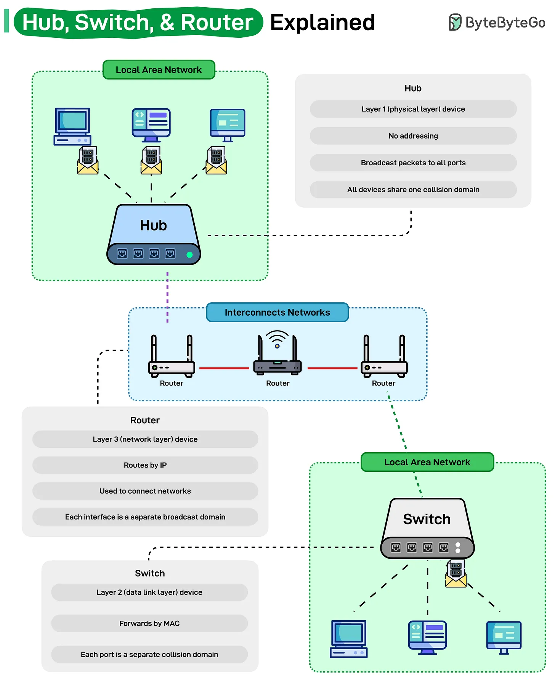

# 214 - Hub, Switch, & Router Explained

- Source: ByteByteGo Big Archive System Design 2025
- PDF pages: 435-436
- Figures: 1

## Figures

## Original Extracted Text

Every home and office network relies on these three devices, hub, switch, and router, yet their roles
are often mixed up.

   ● A hub operates at Layer 1 (Physical Layer). It's the simplest of the three, it doesn't
      understand addresses or data types. When a packet arrives, it simply broadcasts it to every
      connected device, creating one big collision domain. That means all devices compete for the
      same bandwidth, making hubs inefficient in modern networks.

   ● A switch works at Layer 2 (Data Link Layer). It learns MAC addresses and forwards frames
      only to the correct destination device. Each port on a switch acts as its own collision domain,
      improving efficiency and speeding up communication within a LAN.

   ● A router operates at Layer 3 (Network Layer). It routes packets based on IP addresses and
      connects different networks together, for example, your home network to the Internet. Each
      router interface forms a separate broadcast domain, keeping local and external traffic
      isolated.

Understanding how these three layers work together is the foundation of every modern network,
from your home Wi-Fi to the global Internet backbone.
