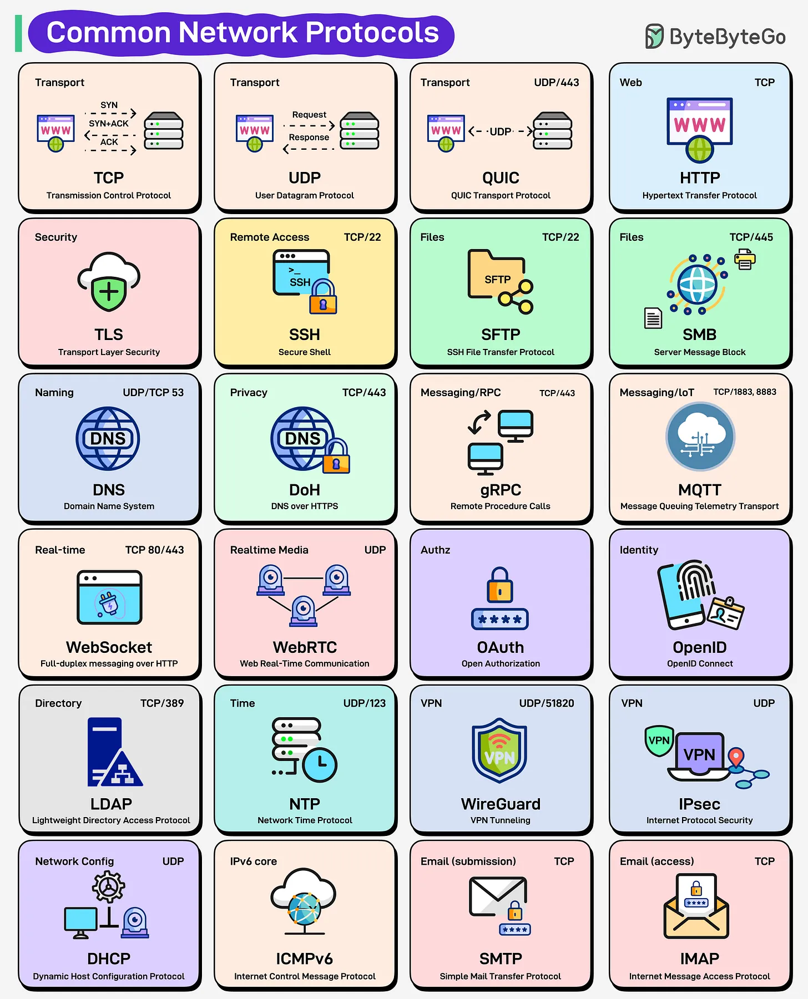

# 215 - Common Network Protocols Every Engineer Should Know

- Source: ByteByteGo Big Archive System Design 2025
- PDF pages: 437-438
- Figures: 1

## Figures

## Original Extracted Text

Ever wonder what actually happens when you click "Send" on an email or join a video call? Every
click, message, and API call on the internet relies on network protocols. They define how data
moves, who can talk, and how securely it all happens.

At the foundation are transport protocols: TCP ensures reliable delivery, UDP prioritizes speed, and
QUIC brings both worlds together over UDP.

On top of that, HTTP powers the web, TLS secures it, and DNS translates names into addresses.

Need remote access? That's SSH. File transfers? SFTP or SMB.

Real-time chat and media? WebSocket, WebRTC, and MQTT keep data flowing live.

For identity and access, OAuth and OpenID handle authorization and authentication.

In the backend, DHCP, NTP, ICMPv6, and LDAP quietly keep everything synchronized, addressed,
and discoverable.

From simple emails (SMTP, IMAP) to encrypted VPNs (WireGuard, IPsec), these protocols form the
invisible language that keeps the internet connected and secure.
