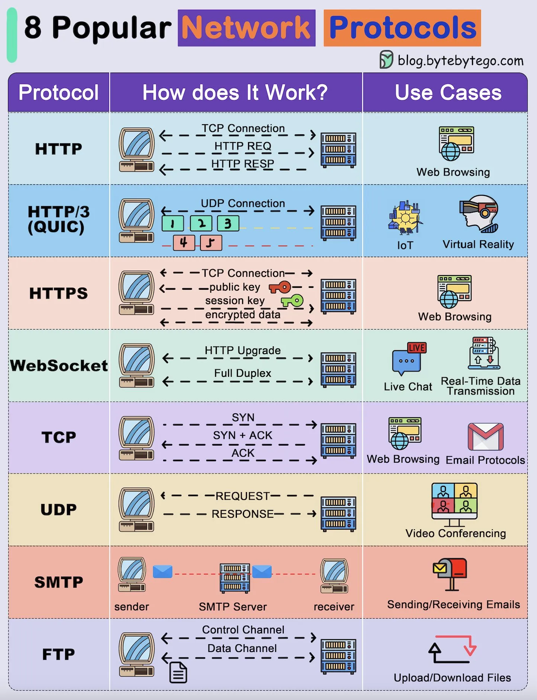

# 216 - 8 Popular Network Protocols

- Source: ByteByteGo Big Archive System Design 2025
- PDF pages: 439-440
- Figures: 1

## Figures

## Original Extracted Text

Network protocols are the key to transferring data between two systems in a network.

   1. FTP (File Transfer Protocol)
       Uses separate control and data channels to upload and download files between a client and
       server.

2. TCP (Transmission Control Protocol)
    Establishes a reliable connection using a 3-way handshake (SYN, SYN+ACK, ACK) for
    accurate data delivery.

3. UDP (User Datagram Protocol)
    Sends lightweight, connectionless packets (requests and responses) with minimal latency.
    Ideal for fast transmissions.

4. HTTP (HyperText Transfer Protocol)
    Uses TCP to request and receive web resources (HTML, images) through HTTP requests
    and responses.

5. HTTP/3 (QUIC)
    Built on top of UDP, it enables faster and more reliable connections by multiplexing data
    streams and reducing latency.

6. HTTPS (Secure HTTP)
    Secures HTTP with encryption using public and session keys over a TCP connection,
    thereby protecting web data.

7. SMTP (Simple Mail Transfer Protocol)
    Transfer emails from a sender to a recipient through an SMTP server. It is commonly used
    for email delivery.

8. WebSocket
    Upgrades an HTTP connection to a full-duplex channel for real-time, bidirectional
    communication like live chats.
