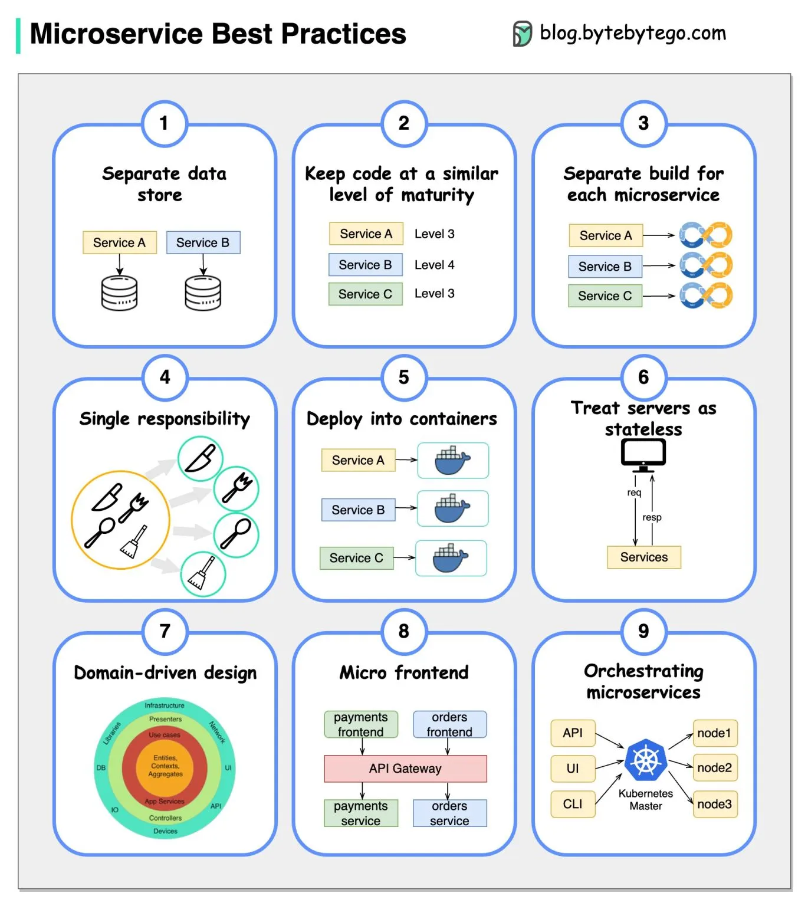

# 217 - A picture is worth a thousand words: 9 best practices for developing microservices

- Source: ByteByteGo Big Archive System Design 2025
- PDF pages: 441-442
- Figures: 1

## Figures

## Original Extracted Text

When we develop microservices, we need to follow the following best practices:

   1. Use separate data storage for each microservice

   2. Keep code at a similar level of maturity

   3. Separate build for each microservice

   4. Assign each microservice with a single responsibility

   5. Deploy into containers

6. Design stateless services

7. Adopt domain-driven design

8. Design micro frontend

9. Orchestrating microservices
