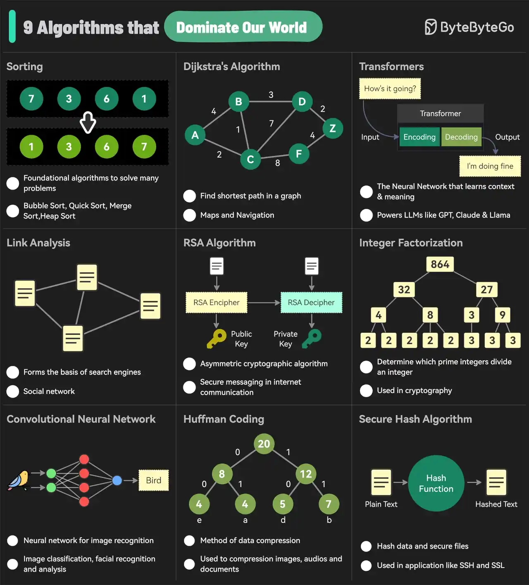

# 001 - 9 thuật toán chi phối thế giới của chúng ta

- Nguồn: ByteByteGo Big Archive System Design 2025
- Trang PDF: 8-9
- Ảnh minh họa: `../assets/001/figure-01.png`

## Hình minh họa

## Dịch sát

Sơ đồ bên dưới cho thấy những thuật toán được sử dụng phổ biến nhất trong đời sống hằng ngày. Chúng được dùng trong công cụ tìm kiếm trên Internet, mạng xã hội, WiFi, điện thoại di động, và thậm chí cả vệ tinh.

1. Sorting - sắp xếp
2. Dijkstra's Algorithm - thuật toán Dijkstra
3. Transformers
4. Link Analysis - phân tích liên kết
5. RSA Algorithm - thuật toán RSA
6. Integer Factorization - phân tích số nguyên thành thừa số
7. Convolutional Neural Networks - mạng nơ-ron tích chập
8. Huffman Coding - mã hóa Huffman
9. Secure Hash Algorithm - thuật toán băm an toàn

Câu hỏi dành cho bạn: Có thuật toán phổ biến nào khác mà chúng tôi đã bỏ sót không?

## Dịch nội dung trong hình

### Sorting - sắp xếp

- Là nhóm thuật toán nền tảng để giải quyết rất nhiều bài toán.
- Ví dụ: Bubble Sort, Quick Sort, Merge Sort, Heap Sort.

### Dijkstra's Algorithm - thuật toán Dijkstra

- Dùng để tìm đường đi ngắn nhất trong một đồ thị.
- Ứng dụng quen thuộc: bản đồ và hệ thống định vị.

### Transformers

- Là kiến trúc mạng nơ-ron học được ngữ cảnh và ý nghĩa của dữ liệu.
- Là nền tảng cho nhiều LLM như GPT, Claude và Llama.

### Link Analysis - phân tích liên kết

- Là nền tảng quan trọng của công cụ tìm kiếm.
- Cũng được dùng trong mạng xã hội để phân tích quan hệ giữa các thực thể.

### RSA Algorithm - thuật toán RSA

- Là thuật toán mật mã bất đối xứng.
- Được dùng để bảo mật trao đổi thông tin trên Internet.

### Integer Factorization - phân tích thừa số nguyên

- Xác định các số nguyên tố nào chia hết cho một số nguyên.
- Có vai trò quan trọng trong mật mã học.

### Convolutional Neural Network - CNN

- Là mạng nơ-ron dùng nhiều trong nhận diện hình ảnh.
- Ứng dụng: phân loại ảnh, nhận diện khuôn mặt và phân tích hình ảnh.

### Huffman Coding - mã hóa Huffman

- Là một phương pháp nén dữ liệu.
- Được dùng để nén hình ảnh, âm thanh và tài liệu.

### Secure Hash Algorithm - SHA

- Dùng để băm dữ liệu và bảo vệ file.
- Được dùng trong các ứng dụng như SSH và SSL.

## Tóm tắt & giải thích dễ hiểu

Bài này nhắc rằng nhiều hệ thống lớn chúng ta dùng hằng ngày không tự nhiên mà thông minh, nhanh và an toàn. Phía sau chúng là các thuật toán nền tảng.

Nếu nhìn theo tư duy lập trình và system design:

- `Sorting` giúp dữ liệu có thứ tự để tìm kiếm, hiển thị, phân trang và tối ưu truy vấn dễ hơn.
- `Dijkstra's Algorithm` xuất hiện khi hệ thống cần tìm đường đi tối ưu, ví dụ bản đồ, routing, network path hoặc cost optimization.
- `Transformers` là nền tảng của LLM hiện đại, giúp mô hình hiểu ngữ cảnh thay vì xử lý từng từ rời rạc.
- `Link Analysis` giúp đánh giá độ quan trọng của trang web, người dùng, node hoặc quan hệ trong graph.
- `RSA` và `SHA` thuộc nhóm thuật toán bảo mật, thường gặp trong authentication, encryption, signing, checksum và secure communication.
- `Huffman Coding` tối ưu dung lượng lưu trữ hoặc truyền dữ liệu, rất liên quan đến compression trong hệ thống phân tán.
- `CNN` xử lý dữ liệu hình ảnh, thường gặp trong các hệ thống AI/ML như nhận diện ảnh, OCR hoặc phân tích video.

Điểm quan trọng: khi học system design, ta không cần lúc nào cũng tự cài đặt các thuật toán này từ đầu. Nhưng cần hiểu chúng giải quyết loại vấn đề nào, vì chúng ảnh hưởng trực tiếp đến cách ta chọn database, cache, search engine, message format, bảo mật, ML pipeline và tối ưu hiệu năng.

## Ví dụ thực tế - không nằm trong tài liệu gốc

Một ứng dụng bản đồ có thể dùng thuật toán đường đi ngắn nhất kiểu Dijkstra để tìm route, dùng sorting/ranking để sắp xếp địa điểm gần nhất, dùng hash để kiểm tra cache key, dùng compression để giảm payload tile map, và dùng thuật toán bảo mật như SHA/RSA trong quá trình xác thực hoặc trao đổi dữ liệu an toàn.

## Thuật ngữ chính

- `Algorithm`: thuật toán, tức một chuỗi bước rõ ràng để giải quyết bài toán.
- `Graph`: đồ thị, mô hình gồm các node và edge, rất hay dùng trong routing, social network và dependency analysis.
- `Cryptography`: mật mã học, nền tảng của bảo mật dữ liệu và giao tiếp an toàn.
- `Hash`: giá trị băm, thường dùng để kiểm tra toàn vẹn dữ liệu, lưu mật khẩu an toàn hoặc định danh nội dung.
- `Compression`: nén dữ liệu để giảm dung lượng lưu trữ hoặc băng thông truyền tải.
- `LLM`: Large Language Model, mô hình ngôn ngữ lớn như GPT, Claude hoặc Llama.
