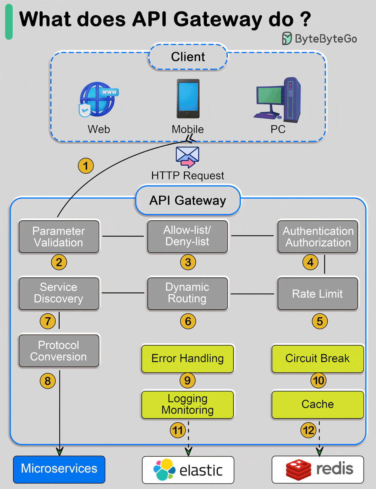

# 002 - API Gateway làm gì?

- Nguồn: ByteByteGo Big Archive System Design 2025
- Trang PDF: 10-11
- Ảnh minh họa: `../assets/002/figure-01.png`

## Hình minh họa

## Dịch sát

Sơ đồ bên dưới mô tả chi tiết.

Step 1 - Client gửi một HTTP request tới API Gateway.

Step 2 - API Gateway phân tích và kiểm tra hợp lệ các thuộc tính trong HTTP request.

Step 3 - API Gateway thực hiện kiểm tra allow-list/deny-list.

Step 4 - API Gateway trao đổi với identity provider để thực hiện authentication và authorization.

Step 5 - Các rule rate limiting được áp dụng cho request. Nếu request vượt quá giới hạn, request sẽ bị từ chối.

Steps 6 và 7 - Sau khi request vượt qua các bước kiểm tra cơ bản, API Gateway tìm service phù hợp để route tới bằng cách khớp path.

Step 8 - API Gateway chuyển đổi request sang protocol phù hợp và gửi request tới các backend microservices.

Steps 9-12 - API Gateway có thể xử lý lỗi đúng cách và xử lý fault nếu lỗi mất nhiều thời gian để phục hồi, ví dụ circuit break. Nó cũng có thể tận dụng ELK stack, tức Elastic-Logstash-Kibana, cho logging và monitoring. Đôi khi chúng ta cũng cache dữ liệu ngay tại API Gateway.

Câu hỏi dành cho bạn:

1. Load balancer và API Gateway khác nhau ở điểm nào?
2. Có cần dùng các API Gateway khác nhau riêng cho PC, mobile và browser không?

## Dịch nội dung trong hình

- `Client`: nhóm client gồm Web, Mobile và PC.
- `HTTP Request`: request HTTP được gửi từ client vào hệ thống.
- `API Gateway`: cổng vào tập trung trước các backend service.
- `Parameter Validation`: kiểm tra tham số request.
- `Allow-list/Deny-list`: cho phép hoặc chặn request dựa trên danh sách rule.
- `Authentication/Authorization`: xác thực người dùng và kiểm tra quyền truy cập.
- `Rate Limit`: giới hạn tần suất request để chống abuse hoặc quá tải.
- `Dynamic Routing`: route động tới service phù hợp.
- `Service Discovery`: tìm service đích trong hệ thống microservices.
- `Protocol Conversion`: chuyển đổi protocol trước khi gọi backend.
- `Error Handling`: xử lý lỗi.
- `Circuit Break`: ngắt mạch tạm thời khi service phía sau lỗi kéo dài.
- `Logging Monitoring`: ghi log và giám sát hệ thống.
- `Cache`: cache dữ liệu, ví dụ qua Redis.
- `Microservices`: các service backend nhỏ, độc lập.

## Tóm tắt & giải thích dễ hiểu

API Gateway là lớp đứng trước backend, đóng vai trò như một cửa vào chung cho client. Thay vì để Web, Mobile hoặc PC gọi trực tiếp từng microservice, client gọi vào API Gateway, sau đó Gateway kiểm tra, bảo vệ, route và chuyển tiếp request.

Trong system design, API Gateway thường gánh các trách nhiệm ngang hệ thống như authentication, authorization, rate limiting, request validation, routing, logging, monitoring, caching và protocol conversion. Nhờ vậy, từng microservice phía sau không phải tự lặp lại cùng một bộ logic bảo vệ ở mọi nơi.

API Gateway khác load balancer ở chỗ load balancer chủ yếu phân phối traffic giữa nhiều instance, còn API Gateway hiểu request ở tầng API nhiều hơn: path, token, quota, version, policy, user context và backend route. Trong thực tế, hai thành phần này có thể cùng tồn tại: load balancer đứng trước API Gateway, còn API Gateway đứng trước microservices.

## Ví dụ thực tế - không nằm trong tài liệu gốc

Một hệ thống thương mại điện tử có `user-service`, `order-service`, `payment-service` và `inventory-service`. Mobile app chỉ gọi `api.shop.com`. API Gateway đọc JWT, kiểm tra user còn quyền không, áp rate limit theo user, route `/orders` tới `order-service`, route `/payments` tới `payment-service`, và cache một số response ít thay đổi như thông tin danh mục sản phẩm.

Nếu `payment-service` liên tục timeout, API Gateway có thể bật `circuit breaker` để từ chối nhanh thay vì để toàn bộ request treo lâu, giúp hệ thống không bị hiệu ứng domino.

## Thuật ngữ chính

- `API Gateway`: cổng API tập trung trước backend service.
- `Authentication`: xác thực danh tính, trả lời câu hỏi “bạn là ai?”.
- `Authorization`: phân quyền, trả lời câu hỏi “bạn được phép làm gì?”.
- `Rate limiting`: giới hạn số request trong một khoảng thời gian.
- `Service discovery`: cơ chế tìm địa chỉ service đang chạy.
- `Circuit breaker`: mẫu thiết kế ngắt gọi tới service lỗi để tránh lan truyền sự cố.
- `ELK`: bộ công cụ Elastic, Logstash, Kibana dùng cho log và quan sát hệ thống.
