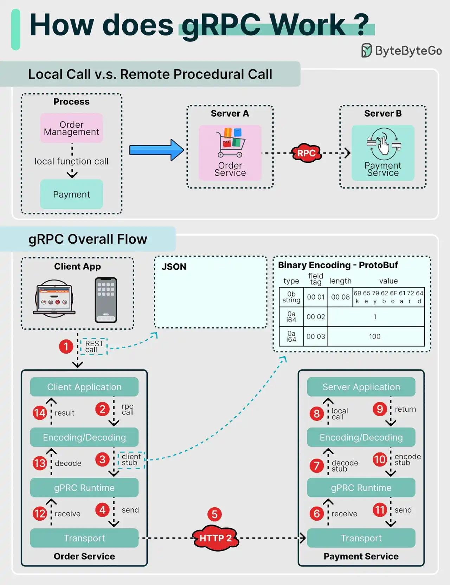

# 003 - gRPC hoạt động như thế nào?

- Nguồn: ByteByteGo Big Archive System Design 2025
- Trang PDF: 12-13
- Ảnh minh họa: `../assets/003/figure-01.png`

## Hình minh họa

## Dịch sát

RPC, viết tắt của Remote Procedure Call, được gọi là “remote” vì nó cho phép các service ở xa giao tiếp với nhau khi các service được triển khai trên các server khác nhau trong kiến trúc microservice. Từ góc nhìn của người dùng, nó hoạt động giống như một lời gọi hàm local.

Sơ đồ bên dưới minh họa luồng dữ liệu tổng thể của gRPC.

Step 1 - Một REST call được gửi từ client. Request body thường ở định dạng JSON.

Steps 2-4 - Order service, đóng vai trò gRPC client, nhận REST call, chuyển đổi request, rồi thực hiện một RPC call tới payment service. gRPC encode client stub sang định dạng binary và gửi xuống tầng transport cấp thấp.

Step 5 - gRPC gửi các packet qua network bằng HTTP/2. Nhờ binary encoding và các tối ưu network, gRPC thường được nói là nhanh hơn JSON khoảng 5 lần.

Steps 6-8 - Payment service, đóng vai trò gRPC server, nhận packet từ network, decode chúng và gọi server application.

Steps 9-11 - Kết quả được trả về từ server application, sau đó được encode và gửi tới tầng transport.

Steps 12-14 - Order service nhận các packet, decode chúng và gửi kết quả về client application.

Câu hỏi dành cho bạn: Bạn đã dùng gRPC trong project chưa? Một số hạn chế của nó là gì?

## Dịch nội dung trong hình

### Local Call vs. Remote Procedural Call

- `Process`: tiến trình đang chạy logic nghiệp vụ.
- `Order Management`: phần quản lý đơn hàng gọi hàm local tới `Payment`.
- `Server A` và `Server B`: hai server khác nhau giao tiếp qua RPC.
- `Order Service` gọi `Payment Service` như thể gọi một function, nhưng thực tế request đi qua network.

### gRPC Overall Flow

- `Client App`: ứng dụng client gửi REST call.
- `JSON`: dữ liệu đầu vào thường ở dạng JSON.
- `Binary Encoding - Protobuf`: dữ liệu được encode sang binary bằng Protocol Buffers.
- `Client Application`: ứng dụng phía order service.
- `Client Stub`: đoạn code đại diện cho remote service ở phía client.
- `Encoding/Decoding`: encode request và decode response.
- `gRPC Runtime`: runtime chịu trách nhiệm xử lý cơ chế gRPC.
- `Transport`: tầng vận chuyển dữ liệu qua network.
- `HTTP/2`: protocol network được gRPC sử dụng.
- `Server Application`: ứng dụng phía payment service.
- `Server Stub`: đoạn code đại diện cho lời gọi RPC ở phía server.

## Tóm tắt & giải thích dễ hiểu

gRPC giúp service này gọi function của service khác qua network theo cảm giác gần giống gọi hàm local. Điểm khác biệt là lời gọi đó được serialize, encode bằng Protobuf, truyền qua HTTP/2, rồi decode ở service đích.

Trong microservices, gRPC thường phù hợp cho giao tiếp nội bộ giữa service với service vì nó nhanh, có schema rõ ràng qua file `.proto`, hỗ trợ code generation và tận dụng HTTP/2 như multiplexing, streaming và binary framing. So với REST/JSON, gRPC ít “dễ đọc bằng mắt” hơn nhưng thường hiệu quả hơn về performance và contract.

Khi design hệ thống, gRPC không tự động tốt hơn REST trong mọi trường hợp. REST vẫn rất hợp cho public API, browser client, tích hợp bên thứ ba hoặc nơi cần debugging dễ bằng HTTP tooling. gRPC hợp hơn khi các service nội bộ cần contract chặt, latency thấp và traffic nhiều.

## Ví dụ thực tế - không nằm trong tài liệu gốc

Một hệ thống đặt hàng có `order-service` và `payment-service`. API public nhận request HTTP/JSON từ mobile app. Nhưng bên trong, `order-service` gọi `payment-service.Charge()` bằng gRPC. Hai service dùng chung file `payment.proto`, nên request/response rõ field, rõ kiểu dữ liệu và dễ generate client/server code.

Khi traffic tăng cao, việc dùng Protobuf binary qua HTTP/2 giúp giảm overhead so với JSON lớn, nhất là với các service gọi nhau liên tục.

## Thuật ngữ chính

- `RPC`: Remote Procedure Call, lời gọi thủ tục/hàm từ xa qua network.
- `gRPC`: framework RPC hiệu năng cao, thường dùng Protobuf và HTTP/2.
- `Protobuf`: Protocol Buffers, định dạng schema và binary serialization của Google.
- `Stub`: code đại diện cho remote function ở phía client hoặc server.
- `HTTP/2`: phiên bản HTTP hỗ trợ multiplexing và tối ưu truyền dữ liệu.
- `Serialization`: chuyển object/dữ liệu thành dạng có thể truyền qua network.

## Câu hỏi ôn tập + trả lời + thinking học tập + liên hệ

> Đây là phần học tập thêm ở cuối file. Câu hỏi ưu tiên lấy từ tài liệu gốc và được trả lời trực tiếp; nếu bài không có câu hỏi riêng thì dùng tiêu đề/nội dung chính để tạo câu hỏi tự kiểm tra.

### Câu hỏi 1

**Nguồn câu hỏi:** Câu hỏi trong tài liệu gốc.

**Câu hỏi:** Bạn đã dùng gRPC trong project chưa?

**Trả lời:** Trong một project microservices, gRPC đáng dùng khi các service nội bộ gọi nhau nhiều, cần contract chặt và latency thấp, ví dụ `order-service` gọi `payment-service` hoặc `pricing-service`. Nếu hệ thống chủ yếu phục vụ browser/public client, REST/JSON vẫn dễ debug và dễ tích hợp hơn; gRPC nên được cân nhắc ở boundary nội bộ nơi Protobuf và HTTP/2 phát huy lợi thế.

**Thinking học tập + liên hệ:** gRPC nên được học như một quyết định về contract giữa service, không chỉ là protocol nhanh hơn. Khi liên hệ project, hãy kiểm boundary public/internal, versioning `.proto`, tracing qua HTTP/2, timeout/retry và khả năng debug khi production incident xảy ra. Các keyword cần tự giải thích lại: `RPC`, `gRPC`, `Protobuf`, `Stub`, `HTTP/2`.

### Câu hỏi 2

**Nguồn câu hỏi:** Câu hỏi trong tài liệu gốc.

**Câu hỏi:** Một số hạn chế của nó là gì?

**Trả lời:** gRPC có vài hạn chế rõ: khó debug bằng mắt hơn REST/JSON vì dùng Protobuf binary; browser support không tự nhiên bằng REST nếu không dùng gRPC-Web; schema `.proto` cần quản lý version cẩn thận; load balancer/proxy/observability phải hỗ trợ HTTP/2 tốt; và team cần tooling để inspect request/response. Vì vậy gRPC hợp cho service-to-service nội bộ hơn là public API cho mọi client.

**Thinking học tập + liên hệ:** gRPC nên được học như một quyết định về contract giữa service, không chỉ là protocol nhanh hơn. Khi liên hệ project, hãy kiểm boundary public/internal, versioning `.proto`, tracing qua HTTP/2, timeout/retry và khả năng debug khi production incident xảy ra. Các keyword cần tự giải thích lại: `RPC`, `gRPC`, `Protobuf`, `Stub`, `HTTP/2`.
