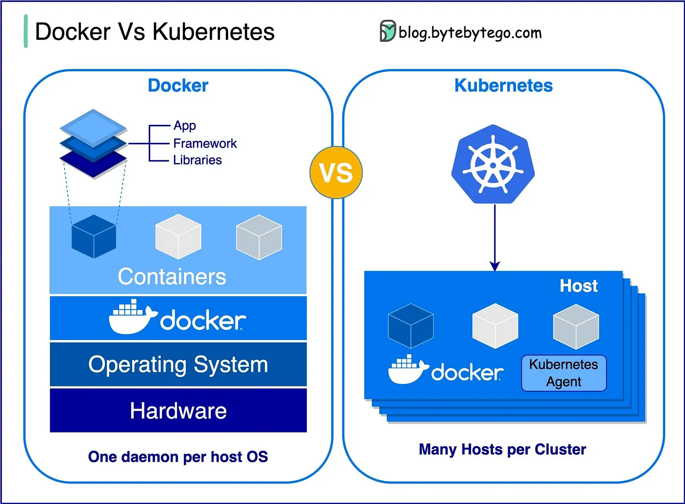

# 004 - Docker vs. Kubernetes: nên dùng cái nào?

- Nguồn: ByteByteGo Big Archive System Design 2025
- Trang PDF: 14-15
- Ảnh minh họa: `../assets/004/figure-01.png`

## Hình minh họa

## Dịch sát

Docker là gì?

Docker là một nền tảng open-source cho phép bạn đóng gói, phân phối và chạy ứng dụng trong các container cô lập. Docker tập trung vào containerization, cung cấp các môi trường nhẹ để đóng gói ứng dụng cùng toàn bộ dependency của chúng.

Kubernetes là gì?

Kubernetes, thường được gọi là K8s, là một nền tảng open-source dùng để orchestration container. Nó cung cấp một framework để tự động hóa việc deployment, scaling và quản lý các ứng dụng containerized trên một cluster gồm nhiều node.

Hai công cụ này khác nhau như thế nào?

Docker: Docker hoạt động ở cấp độ từng container riêng lẻ trên một host hệ điều hành.

Bạn phải tự quản lý từng host, và việc thiết lập network, security policy cũng như storage cho nhiều container liên quan với nhau có thể trở nên phức tạp.

Kubernetes: Kubernetes hoạt động ở cấp độ cluster. Nó quản lý nhiều ứng dụng containerized trên nhiều host, cung cấp automation cho các tác vụ như load balancing, scaling và đảm bảo desired state của ứng dụng.

Tóm lại, Docker tập trung vào containerization và chạy container trên từng host riêng lẻ, còn Kubernetes chuyên quản lý và điều phối container ở quy mô lớn trên một cluster gồm nhiều host.

Câu hỏi dành cho bạn: Những thách thức nào đã khiến bạn chuyển từ Docker sang Kubernetes để quản lý các ứng dụng containerized?

## Dịch nội dung trong hình

- `Docker`: đóng gói App, Framework và Libraries vào container chạy trên Docker engine, phía dưới là Operating System và Hardware.
- `Containers`: các môi trường chạy ứng dụng được cô lập.
- `One daemon per host OS`: mỗi host OS thường có một Docker daemon quản lý container trên host đó.
- `Kubernetes`: quản lý nhiều host trong một cluster.
- `Host`: từng máy/node trong cluster.
- `Kubernetes Agent`: agent trên từng host để Kubernetes điều phối workload.
- `Many Hosts per Cluster`: một cluster có thể gồm nhiều host.

## Tóm tắt & giải thích dễ hiểu

Docker giải quyết bài toán “đóng gói và chạy ứng dụng nhất quán”. Thay vì cài dependency thủ công trên từng máy, bạn đóng gói app vào image rồi chạy thành container. Điều này giúp môi trường dev, staging và production giống nhau hơn.

Kubernetes giải quyết bài toán “vận hành nhiều container ở quy mô lớn”. Khi hệ thống có nhiều service, nhiều instance, nhiều node, cần auto-healing, rolling update, service discovery, load balancing và autoscaling, Kubernetes trở nên phù hợp hơn.

Vì vậy câu hỏi không phải là Docker hay Kubernetes cái nào thay thế cái nào hoàn toàn. Trong thực tế, Docker/container runtime là lớp đóng gói và chạy container; Kubernetes là lớp điều phối nhiều container trên cluster. Bạn có thể bắt đầu đơn giản với Docker Compose, rồi chuyển sang Kubernetes khi bài toán vận hành vượt quá khả năng quản lý thủ công.

## Ví dụ thực tế - không nằm trong tài liệu gốc

Một team nhỏ chỉ có một API, một worker và một PostgreSQL có thể dùng Docker Compose để chạy staging rất ổn. Nhưng khi hệ thống phát triển thành 20 microservices, cần deploy không downtime, tự restart service lỗi, scale `order-service` từ 3 lên 20 replica trong giờ cao điểm, lúc đó Kubernetes hữu ích hơn.

Nếu chưa có nhu cầu cluster thật sự, dùng Kubernetes quá sớm có thể làm tăng độ phức tạp vận hành mà chưa đem lại lợi ích tương xứng.

## Thuật ngữ chính

- `Container`: môi trường chạy ứng dụng cô lập, nhẹ hơn virtual machine.
- `Image`: bản đóng gói bất biến dùng để tạo container.
- `Containerization`: kỹ thuật đóng gói app và dependency vào container.
- `Orchestration`: điều phối deployment, scaling, networking và lifecycle của container.
- `Cluster`: tập hợp nhiều node/máy cùng chạy workload.
- `Desired state`: trạng thái mong muốn mà hệ thống orchestration cố duy trì.
