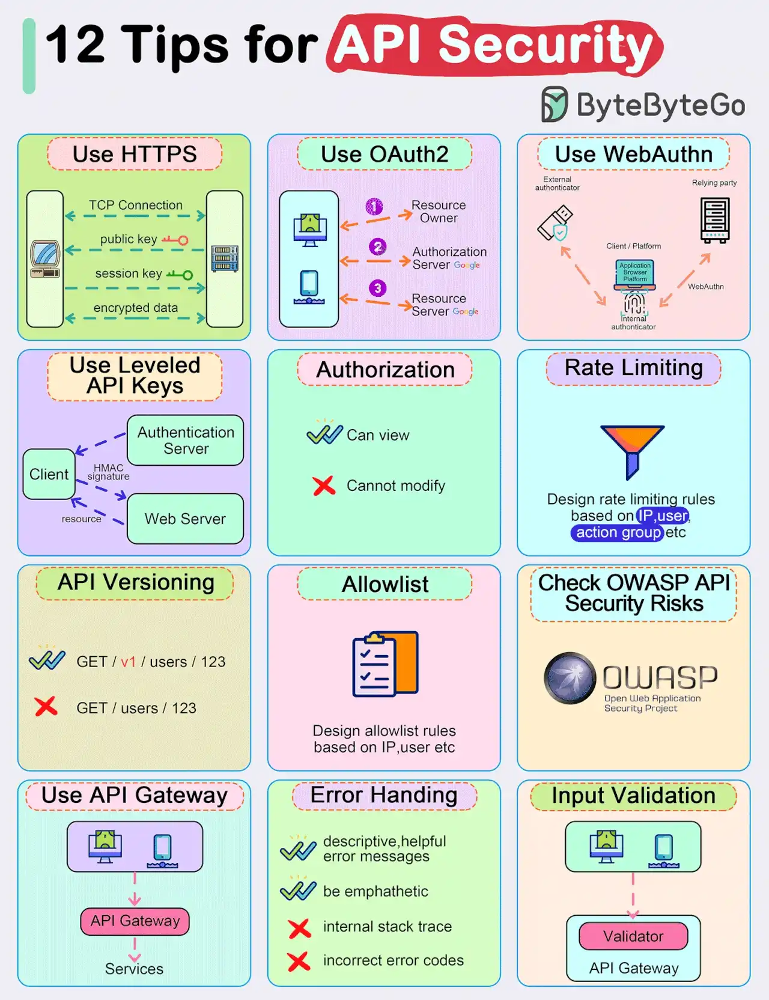

# 005 - 12 mẹo quan trọng để bảo mật API

- Nguồn: ByteByteGo Big Archive System Design 2025
- Trang PDF: 16-17
- Ảnh minh họa: `../assets/005/figure-01.png`

## Hình minh họa

## Dịch sát

- Dùng HTTPS.
- Dùng OAuth2.
- Dùng WebAuthn.
- Dùng API key theo nhiều cấp độ quyền.
- Authorization.
- Rate limiting.
- API versioning.
- Whitelisting.
- Kiểm tra OWASP API Security Risks.
- Dùng API Gateway.
- Error handling.
- Input validation.

## Dịch nội dung trong hình

- `Use HTTPS`: dùng HTTPS để mã hóa dữ liệu trên đường truyền.
- `Use OAuth2`: dùng OAuth2 để ủy quyền truy cập resource giữa client và resource server.
- `Use WebAuthn`: dùng WebAuthn cho xác thực mạnh, ví dụ passkey hoặc security key.
- `Use Leveled API Keys`: dùng API key theo cấp quyền khác nhau thay vì một key có toàn quyền.
- `Authorization`: phân quyền rõ hành động nào được xem, hành động nào không được sửa.
- `Rate Limiting`: thiết kế rule giới hạn request dựa trên IP, user action hoặc app.
- `API Versioning`: version API rõ ràng, ví dụ `GET /v1/users/123` thay vì endpoint không có version.
- `Allowlist`: thiết kế rule allowlist dựa trên IP, user hoặc tiêu chí khác.
- `Check OWASP API Security Risks`: kiểm tra các rủi ro bảo mật API theo OWASP.
- `Use API Gateway`: dùng API Gateway làm lớp kiểm soát chung trước services.
- `Error Handling`: trả error message mô tả đủ hữu ích và có thiện chí; tránh lộ internal stack trace và tránh trả sai error code.
- `Input Validation`: validate input trước khi request đi sâu vào backend.

## Tóm tắt & giải thích dễ hiểu

Bảo mật API không chỉ là bật HTTPS. Một API production cần nhiều lớp phòng vệ: mã hóa đường truyền, xác thực, phân quyền, giới hạn tần suất, validate input, quản lý version, kiểm soát allowlist, xử lý lỗi an toàn và giám sát các rủi ro đã biết.

Trong system design, nên xem API security như một chuỗi kiểm soát từ ngoài vào trong. HTTPS bảo vệ dữ liệu khi truyền qua network. OAuth2, WebAuthn và API key giúp xác định ai đang gọi. Authorization quyết định người đó được làm gì. Rate limiting và allowlist giảm abuse. Input validation chặn dữ liệu xấu trước khi vào business logic. Error handling tránh làm lộ thông tin nhạy cảm.

API Gateway rất hữu ích vì nhiều rule bảo mật có thể được tập trung ở một lớp chung. Tuy vậy, Gateway không thay thế hoàn toàn security trong từng service. Service vẫn cần kiểm tra quyền quan trọng ở boundary của chính nó, nhất là với dữ liệu nhạy cảm.

## Ví dụ thực tế - không nằm trong tài liệu gốc

Một API `/api/v1/payments/refund` nên yêu cầu HTTPS, access token hợp lệ, quyền `refund:write`, rate limit thấp hơn API đọc dữ liệu, validate số tiền hoàn trả phải hợp lệ, và chỉ cho phép một số IP nội bộ nếu đây là API admin.

Nếu API trả lỗi, response nên là thông báo an toàn như `Permission denied` hoặc `Invalid request`, không nên trả stack trace, SQL query hoặc tên server nội bộ.

## Thuật ngữ chính

- `HTTPS`: HTTP chạy trên TLS để mã hóa dữ liệu truyền tải.
- `OAuth2`: framework authorization cho phép cấp quyền truy cập resource.
- `WebAuthn`: chuẩn xác thực mạnh trên web, thường dùng với passkey/security key.
- `API key`: khóa định danh ứng dụng hoặc client gọi API.
- `Allowlist`: danh sách được phép truy cập.
- `OWASP`: tổ chức cung cấp danh sách rủi ro bảo mật phổ biến.
- `Input validation`: kiểm tra input đúng kiểu, đúng format, đúng rule nghiệp vụ.

## Câu hỏi ôn tập + trả lời + thinking học tập + liên hệ

> Đây là phần học tập thêm ở cuối file. Câu hỏi ưu tiên lấy từ tài liệu gốc và được trả lời trực tiếp; nếu bài không có câu hỏi riêng thì dùng tiêu đề/nội dung chính để tạo câu hỏi tự kiểm tra.

### Câu hỏi 1

**Nguồn câu hỏi:** Suy ra từ tiêu đề/nội dung chính vì bài gốc không có câu hỏi riêng.

**Câu hỏi:** Sau khi đọc bài “Top 12 Tips for API Security”, ý chính cần trả lời và áp dụng vào system design là gì?

**Trả lời:** Nếu rút thành checklist thiết kế thì ý chính là: Bảo mật API không chỉ là bật HTTPS. Một API production cần nhiều lớp phòng vệ: mã hóa đường truyền, xác thực, phân quyền, giới hạn tần suất, validate input, quản lý version, kiểm soát allowlist, xử lý lỗi an toàn và giám sát các rủi ro đã biết. Trong system design, nên xem API security như một chuỗi kiểm soát từ ngoài vào trong. HTTPS bảo vệ dữ liệu khi truyền qua network. OAuth2, WebAuthn và API key giúp xác định ai đang gọi. Authorization quyết định người đó được làm gì. Rate limiting và allowlist giảm abuse.... Khi áp dụng vào hệ thống thật, hãy kiểm thêm actor, trust boundary, dữ liệu nhạy cảm, lifetime của token/key, quyền truy cập và cơ chế revoke.

**Thinking học tập + liên hệ:** Khi học `12 mẹo quan trọng để bảo mật API`, hãy thử viết một checklist áp dụng vào project: input, output, owner, rủi ro và metric kiểm chứng. Lens chính là actor, trust boundary, dữ liệu nhạy cảm, lifetime của token/key, quyền truy cập và cơ chế revoke. Khi làm API thật, một endpoint chạy được chưa đủ; phải kiểm thêm abuse, audit log, error leakage, rate limit và quyền ở service chứa dữ liệu. Khi ghi chú lại, hãy giải thích được các keyword: `HTTPS`, `OAuth2`, `WebAuthn`, `API key`, `Allowlist`.
