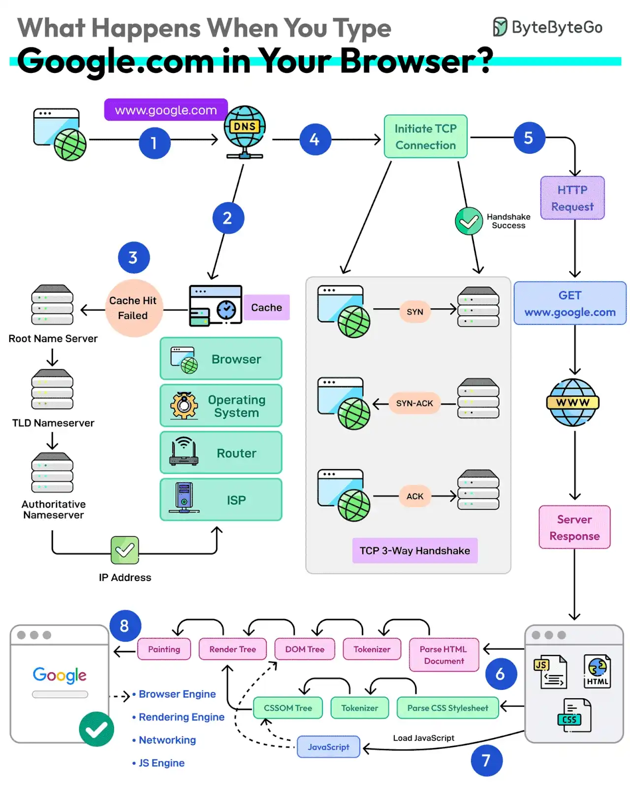

# 006 - Điều gì xảy ra khi bạn gõ google.com vào trình duyệt?

- Nguồn: ByteByteGo Big Archive System Design 2025
- Trang PDF: 18-19
- Ảnh minh họa: `../assets/006/figure-01.png`

## Hình minh họa

## Dịch sát

1. Trước tiên, bạn nhập địa chỉ website vào thanh địa chỉ của trình duyệt.

2. Trình duyệt kiểm tra cache của nó trước. Nếu cache miss, nó phải tìm địa chỉ IP.

3. DNS lookup bắt đầu, có thể hiểu như tra số điện thoại. Request đi qua các DNS server khác nhau như root, TLD và authoritative. Cuối cùng, địa chỉ IP được lấy về.

4. Tiếp theo, trình duyệt khởi tạo một TCP connection giống như một cái bắt tay. Ví dụ với HTTP/1.1, client và server thực hiện TCP three-way handshake bằng các message SYN, SYN-ACK và ACK.

5. Khi handshake thành công, trình duyệt tạo HTTP request tới server và server trả về các file HTML, CSS và JS.

6. Cuối cùng, trình duyệt xử lý mọi thứ. Nó parse tài liệu HTML và tạo cây DOM cùng CSSOM.

7. Trình duyệt thực thi JavaScript và render trang qua nhiều bước như tokenizer, parser, render tree, layout và painting.

8. Cuối cùng, webpage xuất hiện trên màn hình của bạn.

Câu hỏi dành cho bạn: Bạn sẽ thêm bước nào khác vào toàn bộ quá trình này?

## Dịch nội dung trong hình

- `www.google.com`: domain người dùng nhập vào trình duyệt.
- `Cache Hit Failed`: cache không có kết quả phù hợp nên phải lookup tiếp.
- `Root Name Server`: DNS root name server.
- `TLD Nameserver`: DNS server cho top-level domain như `.com`.
- `Authoritative Nameserver`: DNS server có câu trả lời có thẩm quyền cho domain.
- `IP Address`: địa chỉ IP tìm được sau DNS lookup.
- `Browser`, `Operating System`, `Router`, `ISP`: các lớp có thể tham gia quá trình cache hoặc chuyển tiếp DNS/network.
- `Initiate TCP Connection`: khởi tạo kết nối TCP.
- `TCP 3-Way Handshake`: bắt tay 3 bước gồm SYN, SYN-ACK và ACK.
- `HTTP Request`: request HTTP được gửi tới server.
- `Server Response`: response từ server.
- `GET www.google.com`: request lấy nội dung trang.
- `Parse HTML Document`, `Parse CSS Stylesheet`, `Tokenizer`, `DOM Tree`, `CSSOM Tree`, `Render Tree`, `Layout`, `Painting`: các bước browser engine dùng để dựng và vẽ trang.
- `JavaScript`: mã JS được tải và thực thi trong quá trình render.

## Tóm tắt & giải thích dễ hiểu

Khi bạn gõ một URL vào browser, hệ thống phải đi qua nhiều tầng: browser cache, DNS, network connection, HTTP request, server response và browser rendering. Đây là một câu hỏi kinh điển vì nó nối nhiều mảng kiến thức: networking, DNS, TCP, HTTP, backend, frontend và browser internals.

Theo tư duy system design, request không “bay thẳng” từ trình duyệt tới website. Trước hết cần biết server nằm ở IP nào thông qua DNS. Sau đó client thiết lập connection, gửi HTTP request, nhận response, rồi browser parse HTML/CSS/JS để dựng trang. Nếu dùng HTTPS, giữa TCP và HTTP còn có TLS handshake. Nếu dùng HTTP/2 hoặc HTTP/3, chi tiết transport sẽ khác HTTP/1.1.

Điểm quan trọng là mỗi bước đều có thể ảnh hưởng performance: DNS chậm, TCP/TLS handshake nhiều round-trip, server response chậm, file JS quá lớn, CSS block render, hoặc cache không hiệu quả đều làm trang tải lâu.

## Ví dụ thực tế - không nằm trong tài liệu gốc

Nếu một website mất 3 giây mới hiện nội dung, nguyên nhân có thể không nằm ở backend. Có thể DNS lookup chậm, TLS handshake chậm, CDN cache miss, HTML trả nhanh nhưng JS bundle quá lớn, hoặc browser phải thực thi quá nhiều JavaScript trước khi render.

Với production web app, ta thường tối ưu bằng CDN, DNS ổn định, HTTP keep-alive, HTTP/2 hoặc HTTP/3, cache header đúng, giảm kích thước JS/CSS và render nội dung quan trọng càng sớm càng tốt.

## Thuật ngữ chính

- `DNS`: hệ thống phân giải domain thành IP address.
- `Cache hit/cache miss`: cache có hoặc không có dữ liệu cần tìm.
- `TCP handshake`: quá trình thiết lập kết nối TCP trước khi truyền dữ liệu.
- `HTTP request/response`: mô hình client gửi request và server trả response.
- `DOM`: cây biểu diễn cấu trúc HTML của trang.
- `CSSOM`: cây biểu diễn CSS sau khi browser parse stylesheet.
- `Render tree`: cây dùng để tính layout và vẽ nội dung lên màn hình.
