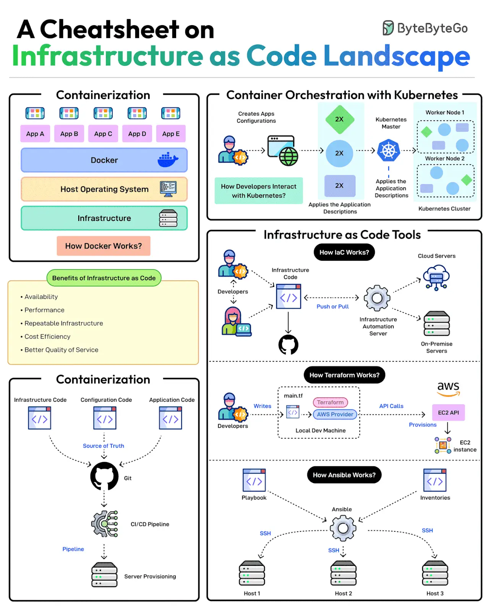

# 007 - Cheatsheet về bức tranh Infrastructure as Code

- Nguồn: ByteByteGo Big Archive System Design 2025
- Trang PDF: 20-21
- Ảnh minh họa: `../assets/007/figure-01.png`

## Hình minh họa

## Dịch sát

Việc provisioning infrastructure theo cách có thể mở rộng đem lại nhiều lợi ích liên quan đến availability, scalability, repeatability và cost-effectiveness.

Nhưng làm sao để đạt được điều đó?

Provisioning infrastructure bằng code là chìa khóa để quản lý hạ tầng có khả năng scale. Có nhiều chiến lược có thể hỗ trợ:

1. Containerization là một trong những chiến lược đầu tiên giúp deployment ứng dụng dựa trên code. Docker là một trong những cách phổ biến nhất để containerize ứng dụng.

2. Tiếp theo, container orchestration trở nên cần thiết khi phải xử lý nhiều container trong một ứng dụng. Đây là lúc các công cụ container orchestration như Kubernetes trở nên quan trọng.

3. IaC xem việc provisioning và configuration hạ tầng như code, cho phép developer định nghĩa hạ tầng ứng dụng trong các file có thể version, test và reuse. Có thể dùng các công cụ phổ biến như Terraform, AWS CloudFormation và Ansible. Ansible thiên về công cụ configuration hơn.

4. GitOps tận dụng Git workflow kết hợp với CI/CD để tự động hóa các cập nhật infrastructure và configuration.

Câu hỏi dành cho bạn: Bạn đã dùng Infrastructure as Code trong project của mình chưa?

## Dịch nội dung trong hình

- `Containerization`: đóng gói application code, configuration code và infrastructure code thành quy trình triển khai nhất quán.
- `Docker`: chạy nhiều app container trên host operating system và infrastructure.
- `Benefits of Infrastructure as Code`: availability, performance, repeatable infrastructure, cost efficiency và better quality of service.
- `Container Orchestration with Kubernetes`: tạo cấu hình app, triển khai app, scale instance và đưa workload vào Kubernetes cluster.
- `Infrastructure as Code Tools`: nhóm công cụ giúp quản lý hạ tầng bằng file code.
- `How IaC Works?`: developer push/pull code qua Git, infrastructure automation server áp dụng thay đổi tới cloud server hoặc on-premise server.
- `How Terraform Works?`: developer viết file Terraform, Terraform gọi API của AWS provider để provision tài nguyên như EC2 API và EC2 instance.
- `How Ansible Works?`: developer viết playbook, Ansible dùng inventory và SSH để cấu hình nhiều host.

## Tóm tắt & giải thích dễ hiểu

Infrastructure as Code, thường viết là IaC, giúp biến hạ tầng thành thứ có thể quản lý giống code: có file, có version control, có review, có CI/CD, có khả năng tái tạo. Thay vì click tay trên cloud console, team mô tả server, network, database, permission và config bằng code.

Theo luồng tiến hóa, Docker giúp chuẩn hóa cách đóng gói app. Kubernetes giúp điều phối nhiều container trên cluster. IaC giúp tạo và cấu hình hạ tầng một cách lặp lại được. GitOps đi thêm một bước: Git trở thành source of truth, còn pipeline/agent tự động đưa trạng thái thật của hạ tầng về đúng trạng thái trong Git.

Điểm quan trọng trong system design là IaC không chỉ để “đỡ click tay”. Nó giảm drift giữa môi trường, giúp rollback dễ hơn, audit thay đổi rõ hơn và scale team tốt hơn vì mọi thay đổi hạ tầng đều có dấu vết.

## Ví dụ thực tế - không nằm trong tài liệu gốc

Một team cần tạo môi trường staging giống production. Nếu làm thủ công, rất dễ thiếu security group, sai version database hoặc quên bật backup. Với Terraform, team định nghĩa VPC, subnet, ECS/Kubernetes cluster, RDS, Redis và IAM policy bằng code. Khi cần tạo staging mới, chỉ cần chạy pipeline áp dụng cùng một bộ module với biến cấu hình khác.

Với GitOps, khi muốn tăng replica của service từ 3 lên 5, developer sửa YAML trong Git. Sau khi merge, Argo CD hoặc Flux tự đồng bộ cluster về trạng thái mới.

## Thuật ngữ chính

- `Provisioning`: tạo và cấp phát tài nguyên hạ tầng.
- `IaC`: Infrastructure as Code, quản lý hạ tầng bằng code.
- `GitOps`: dùng Git làm source of truth cho trạng thái hạ tầng/app.
- `Terraform`: công cụ IaC phổ biến, mạnh về provisioning cloud resource.
- `CloudFormation`: dịch vụ IaC của AWS.
- `Ansible`: công cụ automation/configuration management, thường dùng qua SSH.

## Câu hỏi ôn tập + trả lời + thinking học tập + liên hệ

> Đây là phần học tập thêm ở cuối file. Câu hỏi ưu tiên lấy từ tài liệu gốc và được trả lời trực tiếp; nếu bài không có câu hỏi riêng thì dùng tiêu đề/nội dung chính để tạo câu hỏi tự kiểm tra.

### Câu hỏi 1

**Nguồn câu hỏi:** Câu hỏi trong tài liệu gốc.

**Câu hỏi:** Bạn đã dùng Infrastructure as Code trong project của mình chưa?

**Trả lời:** Nếu đưa `Cheatsheet về bức tranh Infrastructure as Code` vào stack, nên bắt đầu từ một use case hẹp, dễ rollback và có metric rõ. Nên kiểm bằng workload nhỏ trước: latency, độ ổn định, khả năng debug, cost và rủi ro vận hành. Phần cốt lõi cần đem theo từ bài là: Infrastructure as Code, thường viết là IaC, giúp biến hạ tầng thành thứ có thể quản lý giống code: có file, có version control, có review, có CI/CD, có khả năng tái tạo. Thay vì click tay trên cloud console, team mô tả server, network, database, permission và config bằng code.

**Thinking học tập + liên hệ:** Với `Cheatsheet về bức tranh Infrastructure as Code`, trải nghiệm thật nên được đo bằng latency, độ ổn định, chi phí, khả năng debug và mức dễ rollback. Lens chính là độ phức tạp vận hành, rollback, cost, kỹ năng team, observability và blast radius khi hỏng. Khi đưa lên production, hãy map từng thành phần vào deploy, rollback, monitoring, alerting, secret, cost và ownership rõ ràng. Khi ghi chú lại, hãy giải thích được các keyword: `Provisioning`, `IaC`, `GitOps`, `Terraform`, `CloudFormation`.
