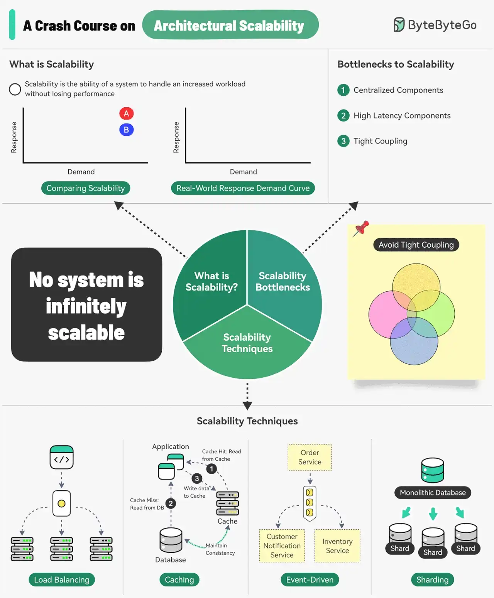

# 008 - Khóa học cấp tốc về khả năng mở rộng kiến trúc

- Nguồn: ByteByteGo Big Archive System Design 2025
- Trang PDF: 22-23
- Ảnh minh họa: `../assets/008/figure-01.png`

## Hình minh họa

## Dịch sát

Scalability là khả năng của một hệ thống trong việc xử lý workload tăng lên mà không làm mất performance. Tuy nhiên, chúng ta cũng có thể nhìn scalability theo góc độ chiến lược scaling.

Scalability là khả năng hệ thống xử lý workload tăng lên bằng cách lặp đi lặp lại một chiến lược có hiệu quả về chi phí. Điều này có nghĩa là một hệ thống có thể khó scale vượt qua một điểm nào đó nếu chiến lược scaling không khả thi về mặt tài chính.

Ba bottleneck chính đối với scalability là:

1. Centralized components: thành phần tập trung có thể trở thành single point of failure.

2. High latency components: các thành phần thực hiện những operation tốn thời gian.

3. Tight coupling: làm cho các component khó scale.

Vì vậy, để xây dựng một hệ thống scalable, chúng ta nên tuân theo các nguyên tắc statelessness, loose coupling và asynchronous processing.

Một số kỹ thuật phổ biến để cải thiện scalability gồm:

- Load balancing: phân phối request qua nhiều server để tránh một server đơn lẻ trở thành bottleneck.
- Caching: lưu thông tin được request thường xuyên nhất trong memory.
- Event-driven processing: dùng cách xử lý async để xử lý các task chạy lâu.
- Sharding: chia một dataset lớn thành các tập con nhỏ hơn gọi là shard để scale ngang.

Câu hỏi dành cho bạn: Bạn cải thiện scalability của một hệ thống như thế nào?

## Dịch nội dung trong hình

- `What is Scalability`: khả năng xử lý demand tăng mà không làm giảm response/performance.
- `No system is infinitely scalable`: không có hệ thống nào scale vô hạn.
- `Bottlenecks to Scalability`: centralized components, high latency components và tight coupling.
- `Avoid Tight Coupling`: tránh coupling quá chặt giữa các component.
- `Scalability Techniques`: load balancing, caching, event-driven và sharding.
- `Load Balancing`: phân phối traffic qua nhiều server/app instance.
- `Caching`: cache hit đọc từ cache, cache miss đọc database rồi ghi cache.
- `Event-Driven`: dùng queue/event để tách order service khỏi customer notification service và inventory service.
- `Sharding`: tách monolithic database thành nhiều shard.

## Tóm tắt & giải thích dễ hiểu

Scalability không chỉ là “thêm server”. Một kiến trúc scalable phải có chiến lược tăng tải lặp lại được và vẫn hợp lý về chi phí. Nếu mỗi lần tăng traffic lại phải tăng chi phí gấp nhiều lần, hệ thống đó chưa thật sự scale tốt.

Ba thứ thường làm hệ thống khó scale là thành phần tập trung, operation latency cao và coupling quá chặt. Thành phần tập trung dễ thành single point of failure. Operation chậm làm queue request bị dồn. Coupling chặt khiến muốn scale một phần nhưng phải scale cả cụm.

Các nguyên tắc nền tảng gồm stateless service để thêm/bớt instance dễ, loose coupling để mỗi component scale độc lập, và async processing để tách request path khỏi tác vụ nặng. Các kỹ thuật như load balancing, caching, event-driven và sharding là cách triển khai cụ thể của các nguyên tắc đó.

## Ví dụ thực tế - không nằm trong tài liệu gốc

Một API tạo đơn hàng ban đầu vừa ghi order, vừa trừ kho, vừa gửi email ngay trong cùng request. Khi traffic tăng, request chậm vì email service và inventory service đôi khi delay. Cách scale tốt hơn là order service ghi order nhanh, publish event `OrderCreated`, rồi worker xử lý trừ kho và gửi email bất đồng bộ.

Nếu database quá lớn, có thể sharding theo `tenant_id` hoặc `user_id`. Nếu dữ liệu sản phẩm được đọc nhiều, cache bằng Redis giúp giảm tải database.

## Thuật ngữ chính

- `Scalability`: khả năng xử lý tải tăng mà vẫn giữ hiệu năng chấp nhận được.
- `Bottleneck`: điểm nghẽn giới hạn hiệu năng hoặc khả năng scale.
- `Stateless`: service không giữ session state cục bộ, dễ scale ngang.
- `Loose coupling`: các component phụ thuộc lỏng lẻo, thay đổi/scale độc lập hơn.
- `Asynchronous processing`: xử lý bất đồng bộ, thường qua queue/event.
- `Sharding`: chia dữ liệu thành nhiều phần nhỏ để scale ngang.

## Câu hỏi ôn tập + trả lời + thinking học tập + liên hệ

> Đây là phần học tập thêm ở cuối file. Câu hỏi ưu tiên lấy từ tài liệu gốc và được trả lời trực tiếp; nếu bài không có câu hỏi riêng thì dùng tiêu đề/nội dung chính để tạo câu hỏi tự kiểm tra.

### Câu hỏi 1

**Nguồn câu hỏi:** Câu hỏi trong tài liệu gốc.

**Câu hỏi:** Bạn cải thiện scalability của một hệ thống như thế nào?

**Trả lời:** Nên trả lời theo flow end-to-end: request/dữ liệu đi vào đâu, qua thành phần nào, state đổi ở đâu và kết quả trả ra thế nào. Với `Khóa học cấp tốc về khả năng mở rộng kiến trúc`, ý chính là: Scalability không chỉ là “thêm server”. Một kiến trúc scalable phải có chiến lược tăng tải lặp lại được và vẫn hợp lý về chi phí. Nếu mỗi lần tăng traffic lại phải tăng chi phí gấp nhiều lần, hệ thống đó chưa thật sự scale tốt. Ba thứ thường làm hệ thống khó scale là thành phần tập trung, operation latency cao và coupling quá chặt. Thành phần tập trung dễ thành single point of failure. Operation chậm làm queue request bị dồn. Coupling chặt khiến muốn scale một phần nhưng phải scale cả cụm.

**Thinking học tập + liên hệ:** Luồng trong `Khóa học cấp tốc về khả năng mở rộng kiến trúc` nên được vẽ từ input tới output, kèm owner của từng bước và failure mode ở mỗi boundary. Lens chính là requirement, constraint, traffic, dữ liệu, failure mode và khả năng vận hành của team. Khi gặp system design thật, hãy biến khái niệm thành quyết định: boundary ở đâu, data flow thế nào, bottleneck nào đến trước và rollback ra sao. Khi ghi chú lại, hãy giải thích được các keyword: `Scalability`, `Bottleneck`, `Stateless`, `Loose coupling`, `Asynchronous processing`.
