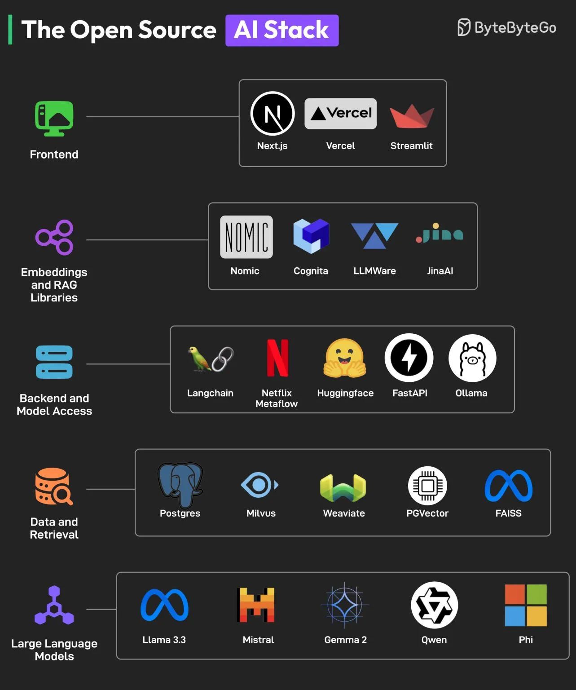

# 009 - Open Source AI Stack

- Nguồn: ByteByteGo Big Archive System Design 2025
- Trang PDF: 24-25
- Ảnh minh họa: `../assets/009/figure-01.png`

## Hình minh họa

## Dịch sát

Bạn không cần chi quá nhiều tiền để xây dựng một ứng dụng AI. Những công cụ AI tốt nhất dành cho developer là open-source, và một ecosystem rất tốt đang phát triển để giúp AI trở nên dễ tiếp cận với mọi người.

Các component chính của open-source AI stack gồm:

1. Frontend

   Để xây dựng AI UI đẹp, các framework như NextJS và Streamlit cực kỳ hữu ích. Ngoài ra, Vercel có thể hỗ trợ deployment.

2. Embeddings và RAG libraries

   Các embedding model và RAG library như Nomic, JinaAI, Cognito và LLMAware giúp developer xây dựng các tính năng search và RAG chính xác.

3. Backend và Model Access

   Với backend development, developer có thể dựa vào các framework như FastAPI, Langchain và Netflix Metaflow. Các lựa chọn như Ollama và Huggingface có sẵn để truy cập model.

4. Data và Retrieval

   Với lưu trữ và truy xuất dữ liệu, có nhiều lựa chọn như Postgres, Milvus, Weaviate, PGVector và FAISS.

5. Large-Language Models

   Dựa trên benchmark performance, các open-source model như Llama, Mistral, Qwen, Phi và Gemma là lựa chọn thay thế tốt cho các proprietary LLM như GPT và Claude.

Câu hỏi dành cho bạn: Bạn sẽ thêm công cụ nào khác vào Open Source AI Stack?

## Dịch nội dung trong hình

- `Frontend`: Next.js, Vercel và Streamlit.
- `Embeddings and RAG Libraries`: Nomic, Cognita/Cognito, LLMAware và JinaAI.
- `Backend and Model Access`: LangChain, Netflix Metaflow, Hugging Face, FastAPI và Ollama.
- `Data and Retrieval`: Postgres, Milvus, Weaviate, PGVector và FAISS.
- `Large Language Models`: Llama 3.3, Mistral, Gemma 2, Qwen và Phi.

## Tóm tắt & giải thích dễ hiểu

Một ứng dụng AI hiện đại thường không chỉ gồm một LLM. Nó cần frontend để người dùng tương tác, backend để điều phối logic, model access để gọi hoặc chạy model, embedding/RAG để tìm ngữ cảnh, data layer để lưu và truy xuất dữ liệu, và LLM để sinh câu trả lời.

RAG là phần rất quan trọng trong nhiều AI app production. Thay vì chỉ hỏi LLM bằng kiến thức sẵn có của model, hệ thống tìm tài liệu liên quan trong database/vector store, đưa chúng vào prompt, rồi yêu cầu model trả lời dựa trên ngữ cảnh đó. Vì vậy stack AI thường cần embedding model, vector database hoặc search index.

Open-source AI stack giúp giảm phụ thuộc vendor, dễ chạy local hoặc self-host, và linh hoạt hơn khi tối ưu chi phí. Tuy nhiên, team vẫn cần đánh đổi giữa chi phí vận hành, latency, chất lượng model, bảo mật dữ liệu và độ phức tạp triển khai.

## Ví dụ thực tế - không nằm trong tài liệu gốc

Một chatbot nội bộ cho tài liệu công ty có thể dùng Next.js làm UI, FastAPI làm backend, Postgres + pgvector để lưu embedding, một embedding model open-source để index tài liệu, Ollama để chạy Llama local, và LangChain để nối luồng ingest/search/generate.

Nếu yêu cầu bảo mật cao, chạy model và vector database trong hạ tầng riêng có thể tốt hơn gửi toàn bộ tài liệu nội bộ qua một API bên ngoài.

## Thuật ngữ chính

- `Embedding`: vector biểu diễn ý nghĩa của text hoặc dữ liệu.
- `RAG`: Retrieval-Augmented Generation, sinh câu trả lời dựa trên tài liệu truy xuất được.
- `Vector database`: database tối ưu tìm kiếm vector gần nhau theo semantic similarity.
- `Model access`: cách ứng dụng gọi model, qua API cloud hoặc chạy local/self-host.
- `LLM`: Large Language Model, mô hình ngôn ngữ lớn.
- `Open-source model`: model có trọng số hoặc mã nguồn/cách dùng mở hơn proprietary model.

## Câu hỏi ôn tập + trả lời + thinking học tập + liên hệ

> Đây là phần học tập thêm ở cuối file. Câu hỏi ưu tiên lấy từ tài liệu gốc và được trả lời trực tiếp; nếu bài không có câu hỏi riêng thì dùng tiêu đề/nội dung chính để tạo câu hỏi tự kiểm tra.

### Câu hỏi 1

**Nguồn câu hỏi:** Câu hỏi trong tài liệu gốc.

**Câu hỏi:** Bạn sẽ thêm công cụ nào khác vào Open Source AI Stack?

**Trả lời:** Danh sách sẽ đầy đủ hơn nếu thêm evaluation harness để đo chất lượng thay vì cảm tính; guardrails/policy để giảm prompt injection và output nguy hiểm; observability cho prompt, context, latency, cost và hallucination; và model routing theo độ khó/cost của request. Các mục này giúp bức tranh đầy đủ hơn vì chúng chạm vào phần triển khai/vận hành mà bài gốc chưa đi sâu. Ý chính đang có của bài là: Một ứng dụng AI hiện đại thường không chỉ gồm một LLM. Nó cần frontend để người dùng tương tác, backend để điều phối logic, model access để gọi hoặc chạy model, embedding/RAG để tìm ngữ cảnh, data layer để lưu và truy xuất dữ liệu, và LLM để sinh câu trả lời. RAG là phần rất quan trọng trong nhiều AI app production. Thay vì chỉ hỏi LLM bằng kiến thức sẵn có của model, hệ thống tìm tài liệu liên quan trong database/vector store, đưa chúng vào prompt, rồi yêu cầu model trả lời dựa trên ngữ cảnh đó. Vì vậy stack AI...

**Thinking học tập + liên hệ:** Khi bài hỏi còn thiếu gì trong `Open Source AI Stack`, hãy so danh sách hiện tại với nhu cầu production: scale, debug, security, cost và vận hành. Lens chính là quality, latency, cost/token, privacy, cập nhật tri thức và rủi ro hallucination. Khi build AI app, hãy nối model với pipeline thật: data vào đâu, context lấy từ đâu, output được kiểm thế nào và chi phí tăng theo traffic ra sao. Khi ghi chú lại, hãy giải thích được các keyword: `Embedding`, `RAG`, `Vector database`, `Model access`, `LLM`.
