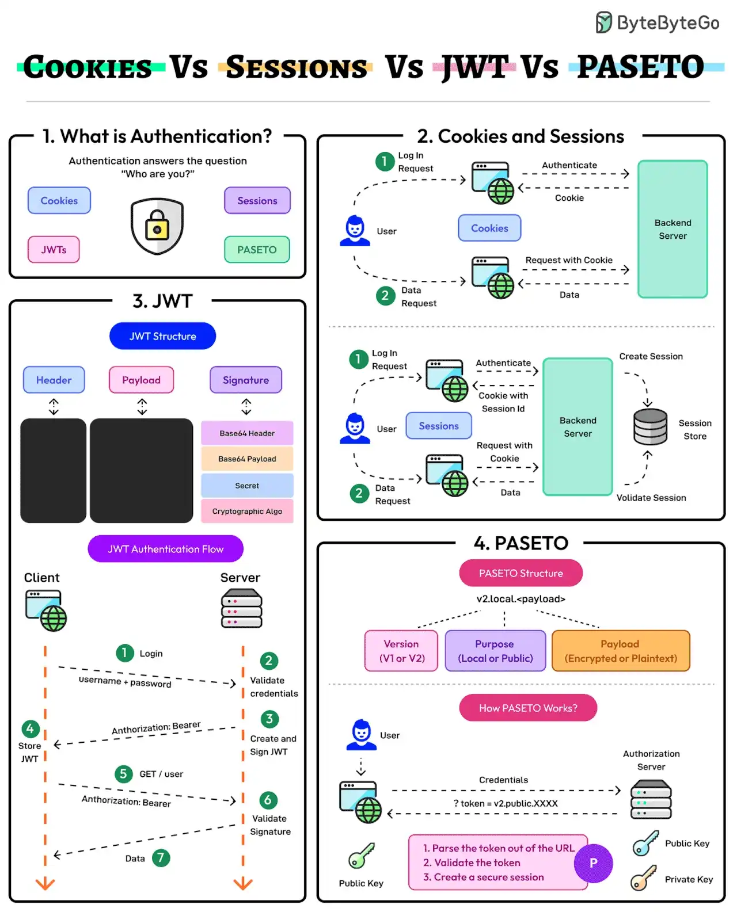

# 010 - Cookies vs Sessions vs JWT vs PASETO

- Nguồn: ByteByteGo Big Archive System Design 2025
- Trang PDF: 26-27
- Ảnh minh họa: `../assets/010/figure-01.png`

## Hình minh họa

## Dịch sát

Authentication đảm bảo rằng chỉ những user được ủy quyền mới có quyền truy cập tài nguyên của ứng dụng. Nó trả lời câu hỏi về danh tính người dùng, tức “Bạn là ai?”.

Bức tranh authentication hiện đại có nhiều cách tiếp cận: Cookies, Sessions, JWTs và PASETO. Ý nghĩa của chúng như sau:

1. Cookies và Sessions

   Cookies và sessions là các cơ chế authentication trong đó session data được lưu trên server và được tham chiếu thông qua cookie ở phía client.

   Sessions phù hợp với các ứng dụng cần kiểm soát chặt chẽ dữ liệu user ở phía server. Điểm bất lợi là sessions có thể gặp thách thức về scalability trong các hệ thống phân tán.

2. JWT

   JSON Web Token, hay JWT, là một phương thức authentication stateless, self-contained, lưu toàn bộ dữ liệu user bên trong token.

   JWT có khả năng scale cao nhưng cần xử lý cẩn thận để giảm nguy cơ token bị đánh cắp và để quản lý token expiration.

3. PASETO

   Platform-Agnostic Security Tokens, hay PASETO, cải thiện so với JWT bằng cách ép dùng các mặc định cryptographic mạnh hơn và loại bỏ các lỗ hổng liên quan đến algorithm.

   PASETO đơn giản hóa việc triển khai token bằng cách tránh các rủi ro liên quan đến misconfiguration.

Câu hỏi dành cho bạn: Bạn đã dùng cách authentication nào?

## Dịch nội dung trong hình

### Authentication là gì?

- Authentication trả lời câu hỏi: “Who are you?” - bạn là ai?
- Các lựa chọn được minh họa: Cookies, Sessions, JWTs và PASETO.

### Cookies and Sessions

- User gửi login request tới backend server.
- Server authenticate, tạo session và lưu vào session store.
- Client giữ cookie chứa session id.
- Các request sau gửi kèm cookie để server validate session rồi trả data.

### JWT

- JWT gồm `Header`, `Payload` và `Signature`.
- Luồng JWT: client login bằng username/password; server validate credential, tạo và ký JWT; client lưu JWT; request sau gửi `Authorization: Bearer`; server validate signature rồi trả data.

### PASETO

- PASETO token có version, purpose và payload.
- Purpose có thể là `local` hoặc `public`; payload có thể được encrypt hoặc ở dạng plaintext tùy mode.
- Luồng PASETO: parse token khỏi URL/request, validate token, rồi tạo secure session.

## Tóm tắt & giải thích dễ hiểu

Cookie là cơ chế browser lưu và gửi dữ liệu nhỏ theo request. Session thường dùng cookie để lưu session id ở client, còn dữ liệu session thật nằm ở server. Cách này dễ kiểm soát và revoke, nhưng khi hệ thống phân tán, nhiều server phải cùng truy cập session store hoặc dùng sticky session.

JWT là token tự chứa thông tin. Server không cần lookup session mỗi request nên dễ scale ngang. Đổi lại, nếu token bị lộ thì rủi ro lớn, và việc revoke token trước khi hết hạn không đơn giản nếu không có blacklist hoặc token versioning.

PASETO cố gắng giảm các lỗi cấu hình thường gặp của JWT bằng cách hạn chế lựa chọn thuật toán nguy hiểm và đặt cryptographic defaults an toàn hơn. Với team không chuyên sâu crypto, PASETO có thể giảm rủi ro triển khai sai.

## Ví dụ thực tế - không nằm trong tài liệu gốc

Một web admin nội bộ có yêu cầu logout/revoke ngay lập tức thường hợp với session server-side, vì server có thể xóa session trong Redis. Một public API phục vụ mobile app nhiều traffic có thể dùng access token dạng JWT ngắn hạn kết hợp refresh token, vì backend scale ngang dễ hơn.

Nếu dùng JWT, không nên lưu secret yếu, không nên để token sống quá lâu, không nên nhét dữ liệu nhạy cảm vào payload nếu token không được mã hóa, vì payload JWT thường chỉ base64url encode chứ không tự động encrypt.

## Thuật ngữ chính

- `Authentication`: xác thực danh tính người dùng.
- `Cookie`: dữ liệu nhỏ browser lưu và tự gửi kèm request theo domain/path.
- `Session`: trạng thái đăng nhập lưu phía server, client giữ session id.
- `JWT`: JSON Web Token, token tự chứa claim và chữ ký.
- `PASETO`: token bảo mật với mặc định crypto an toàn hơn JWT.
- `Stateless`: server không cần lưu session state cho mỗi request.
- `Token expiration`: thời điểm token hết hiệu lực.

## Câu hỏi ôn tập + trả lời + thinking học tập + liên hệ

> Đây là phần học tập thêm ở cuối file. Câu hỏi ưu tiên lấy từ tài liệu gốc và được trả lời trực tiếp; nếu bài không có câu hỏi riêng thì dùng tiêu đề/nội dung chính để tạo câu hỏi tự kiểm tra.

### Câu hỏi 1

**Nguồn câu hỏi:** Câu hỏi trong tài liệu gốc.

**Câu hỏi:** Bạn đã dùng cách authentication nào?

**Trả lời:** Trong project thật, `Cookies vs Sessions vs JWT vs PASETO` đáng dùng/thử khi bài toán khớp với nhu cầu cụ thể và team đo được kết quả. Nên kiểm bằng workload nhỏ trước: latency, độ ổn định, khả năng debug, cost và rủi ro vận hành. Phần cốt lõi cần đem theo từ bài là: Cookie là cơ chế browser lưu và gửi dữ liệu nhỏ theo request. Session thường dùng cookie để lưu session id ở client, còn dữ liệu session thật nằm ở server. Cách này dễ kiểm soát và revoke, nhưng khi hệ thống phân tán, nhiều server phải cùng truy cập session store hoặc dùng sticky session.

**Thinking học tập + liên hệ:** Câu hỏi trải nghiệm trong `Cookies vs Sessions vs JWT vs PASETO` nên quy về adoption: dùng cho workload nào, đo thành công bằng metric nào và có đáng giữ lâu dài trong stack không. Lens chính là actor, trust boundary, dữ liệu nhạy cảm, lifetime của token/key, quyền truy cập và cơ chế revoke. Khi làm API thật, một endpoint chạy được chưa đủ; phải kiểm thêm abuse, audit log, error leakage, rate limit và quyền ở service chứa dữ liệu. Khi ghi chú lại, hãy giải thích được các keyword: `Authentication`, `Cookie`, `Session`, `JWT`, `PASETO`.
