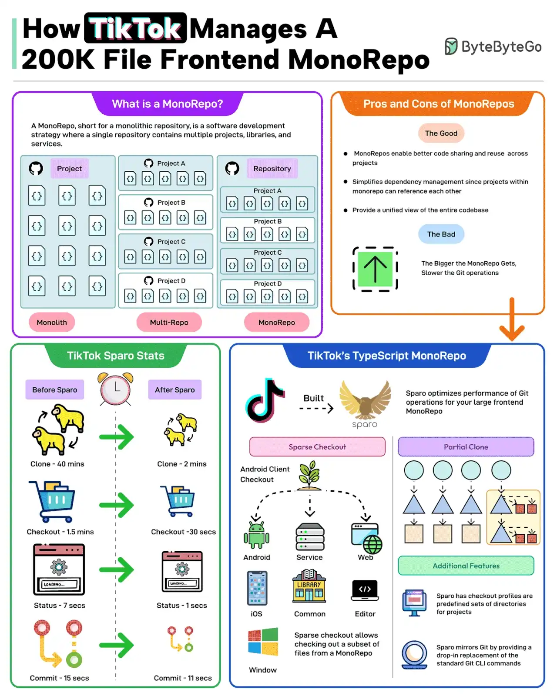

# 011 - TikTok quản lý Frontend MonoRepo 200K file như thế nào?

- Nguồn: ByteByteGo Big Archive System Design 2025
- Trang PDF: 28-29
- Ảnh minh họa: `../assets/011/figure-01.png`

## Hình minh họa

## Dịch sát

MonoRepo, viết tắt của monolithic repository, là một chiến lược phát triển phần mềm trong đó một repository duy nhất chứa nhiều project, library và service.

Những điểm tốt của MonoRepo gồm:

- Chia sẻ code tốt hơn.
- Quản lý dependency đơn giản hơn.
- Có một góc nhìn thống nhất về codebase.

Tuy nhiên, MonoRepo càng lớn thì các thao tác Git khác nhau càng chậm.

TikTok gặp một thay đổi/thách thức tương tự với frontend TypeScript MonoRepo có 200K file.

Để xử lý vấn đề này, TikTok xây dựng một công cụ tên là Sparo để tối ưu performance của các thao tác Git cho frontend MonoRepo lớn.

Sparo cải thiện mạnh performance của các thao tác Git. Một số số liệu như sau:

- Thời gian `git clone` giảm từ 40 phút xuống chỉ còn 2 phút.
- `checkout` giảm từ 1,5 phút xuống 30 giây.
- `status` giảm từ 7 giây xuống 1 giây.
- Thời gian `git commit` giảm từ 15 giây xuống 11 giây.

Câu hỏi dành cho bạn: Bạn đã dùng MonoRepo trong project của mình chưa?

## Dịch nội dung trong hình

- `What is a MonoRepo?`: một repository duy nhất chứa nhiều project, thư viện và service.
- `Monolith`: một khối repo/project đơn lẻ.
- `Multi-Repo`: nhiều repository tách riêng.
- `MonoRepo`: một repository chứa nhiều project.
- `Pros and Cons of MonoRepos`: MonoRepo giúp share code tốt hơn, quản lý dependency đơn giản hơn và có góc nhìn thống nhất; điểm xấu là repo càng lớn thì Git operation càng chậm.
- `TikTok Sparo Stats`: trước Sparo và sau Sparo, clone, checkout, status và commit đều nhanh hơn đáng kể.
- `TikTok's TypeScript MonoRepo`: Sparo tối ưu Git operations cho frontend MonoRepo lớn.
- `Sparse Checkout`: checkout một phần repo.
- `Partial Clone`: clone một phần dữ liệu cần thiết thay vì toàn bộ object.

## Tóm tắt & giải thích dễ hiểu

MonoRepo giúp nhiều team dùng chung code, chuẩn hóa dependency và nhìn toàn bộ hệ thống trong một repository. Nhưng khi repo quá lớn, chính Git trở thành bottleneck: clone lâu, checkout lâu, status chậm, commit chậm và CI cũng dễ nặng.

Trường hợp TikTok cho thấy khi MonoRepo đạt quy mô rất lớn, cần công cụ và workflow chuyên biệt. Sparo tối ưu bằng các kỹ thuật như sparse checkout và partial clone, tức developer chỉ tải và làm việc với phần repo cần thiết thay vì kéo toàn bộ 200K file mỗi lần.

Điểm cần nhớ là MonoRepo không tự động tốt hơn Multi-Repo. MonoRepo hợp khi team có tooling tốt, dependency liên quan chặt và cần refactor xuyên project. Multi-Repo hợp khi service độc lập, quyền truy cập tách biệt và lifecycle release khác nhau.

## Ví dụ thực tế - không nằm trong tài liệu gốc

Một công ty có web app, mobile app, design system và shared TypeScript SDK có thể dùng MonoRepo để cập nhật type/interface một lần cho tất cả package. Nhưng nếu repo có hàng trăm package, team cần Nx, Turborepo, Bazel hoặc công cụ tương tự để chỉ build/test phần bị ảnh hưởng.

Nếu không có affected build, caching và sparse checkout, MonoRepo lớn dễ làm developer mất nhiều thời gian chỉ để clone, install dependency và chạy test.

## Thuật ngữ chính

- `MonoRepo`: một repository chứa nhiều project/package/service.
- `Multi-Repo`: mỗi project/service nằm ở repository riêng.
- `Sparse checkout`: chỉ checkout một phần cây file của repo.
- `Partial clone`: clone một phần object cần thiết của repository.
- `Dependency management`: quản lý version và quan hệ phụ thuộc giữa package.
- `Code sharing`: chia sẻ code/library/type giữa nhiều project.

## Câu hỏi ôn tập + trả lời + thinking học tập + liên hệ

> Đây là phần học tập thêm ở cuối file. Câu hỏi ưu tiên lấy từ tài liệu gốc và được trả lời trực tiếp; nếu bài không có câu hỏi riêng thì dùng tiêu đề/nội dung chính để tạo câu hỏi tự kiểm tra.

### Câu hỏi 1

**Nguồn câu hỏi:** Câu hỏi trong tài liệu gốc.

**Câu hỏi:** Bạn đã dùng MonoRepo trong project của mình chưa?

**Trả lời:** Trong project thật, `TikTok quản lý Frontend MonoRepo 200K file như thế nào?` đáng dùng/thử khi bài toán khớp với nhu cầu cụ thể và team đo được kết quả. Nên kiểm bằng workload nhỏ trước: latency, độ ổn định, khả năng debug, cost và rủi ro vận hành. Phần cốt lõi cần đem theo từ bài là: MonoRepo giúp nhiều team dùng chung code, chuẩn hóa dependency và nhìn toàn bộ hệ thống trong một repository. Nhưng khi repo quá lớn, chính Git trở thành bottleneck: clone lâu, checkout lâu, status chậm, commit chậm và CI cũng dễ nặng. Trường hợp TikTok cho thấy khi MonoRepo đạt quy mô rất lớn, cần công cụ và workflow chuyên biệt. Sparo tối ưu bằng các kỹ thuật như sparse checkout và partial clone, tức developer chỉ tải và làm việc với phần repo cần thiết thay vì kéo toàn bộ 200K file mỗi lần.

**Thinking học tập + liên hệ:** Câu hỏi trải nghiệm trong `TikTok quản lý Frontend MonoRepo 200K file như thế nào?` nên quy về adoption: dùng cho workload nào, đo thành công bằng metric nào và có đáng giữ lâu dài trong stack không. Lens chính là UX, bundle size, build time, maintainability, accessibility và tốc độ release. Khi làm frontend production, hãy nối code với người dùng thật: load có nhanh không, lỗi có thấy được không, component có tái dùng được không và build có scale với team không. Khi ghi chú lại, hãy giải thích được các keyword: `MonoRepo`, `Multi-Repo`, `Sparse checkout`, `Partial clone`, `Dependency management`.
