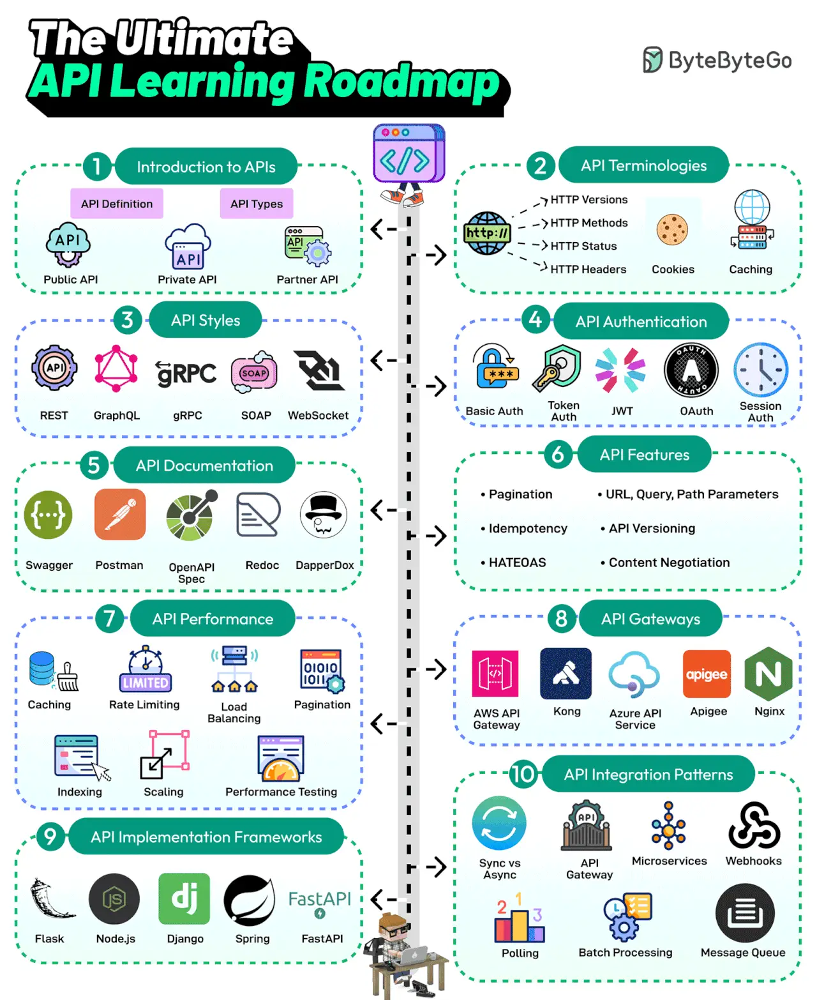

# 012 - Lộ trình học API đầy đủ

- Nguồn: ByteByteGo Big Archive System Design 2025
- Trang PDF: 30-31
- Ảnh minh họa: `../assets/012/figure-01.png`

## Hình minh họa

## Dịch sát

API là xương sống của giao tiếp trên Internet. Mọi developer đều cần học về API. Đây là roadmap bao phủ các chủ đề quan trọng nhất:

1. Introduction to APIs

   API là một tập hợp protocol và công cụ để xây dựng application. Có nhiều loại API khác nhau, chẳng hạn public, private và partner.

2. API Terminologies

   Cần hiểu nhiều thuật ngữ API khác nhau như HTTP versions, cookies và caching.

3. API Styles

   Các API style phổ biến nhất là REST, SOAP, GraphQL, gRPC và WebSockets.

4. API Authentication

   Các kỹ thuật API Authentication như Basic Auth, Token, JWTs, OAuth và Session Auth.

5. API Documentation

   Một API tốt là API dễ hiểu. Các công cụ API Documentation như Swagger, Postman, Redoc và DapperDox giúp làm được điều đó.

6. API Features

   Các feature API quan trọng gồm pagination, parameters, idempotency, API versioning, HATEOAS và content negotiation.

7. API Performance Techniques

   Các kỹ thuật performance API phổ biến gồm caching, rate limiting, load balancing, pagination, DB indexing, scaling và performance testing.

8. API Gateways

   Học về API Gateway như Amazon API Gateway, Azure API Services, Kong, Nginx, v.v.

9. API Implementation Frameworks

   Các framework phát triển API phổ biến nhất là Node.js, Spring, Flask, Django và FastAPI.

10. API Integration Patterns

   Học nhiều pattern tích hợp API như gateway, event-driven, webhook, polling và batch processing.

Câu hỏi dành cho bạn: Bạn sẽ thêm gì khác vào API learning roadmap?

## Dịch nội dung trong hình

- `Introduction to APIs`: API definition và API types như Public API, Private API, Partner API.
- `API Terminologies`: HTTP versions, HTTP methods, HTTP status, HTTP headers, cookies và caching.
- `API Styles`: REST, GraphQL, gRPC, SOAP và WebSocket.
- `API Authentication`: Basic Auth, Token Auth, JWT, OAuth và Session Auth.
- `API Documentation`: Swagger, Postman, OpenAPI Spec, Redoc và DapperDox.
- `API Features`: pagination, URL/query/path parameters, idempotency, API versioning, HATEOAS và content negotiation.
- `API Performance`: caching, rate limiting, load balancing, pagination, indexing, scaling và performance testing.
- `API Gateways`: AWS API Gateway, Kong, Azure API Service, Apigee và Nginx.
- `API Implementation Frameworks`: Flask, Node.js, Django, Spring và FastAPI.
- `API Integration Patterns`: sync vs async, API Gateway, microservices, webhooks, polling, batch processing và message queue.

## Tóm tắt & giải thích dễ hiểu

Bài này đưa ra roadmap học API theo thứ tự từ nền tảng đến production. Trước hết cần hiểu API là gì, các loại API và thuật ngữ HTTP. Sau đó học các style như REST, GraphQL, gRPC, SOAP và WebSocket để biết mỗi kiểu phù hợp với bài toán nào.

Khi đi sâu hơn, developer cần nắm authentication, documentation, feature thiết kế API và performance. Một API production không chỉ cần endpoint chạy được; nó cần versioning, idempotency, pagination, validation, documentation, rate limiting, observability và gateway phù hợp.

Phần cuối của roadmap hướng tới tích hợp hệ thống: webhook, polling, batch processing, message queue, event-driven và API Gateway. Đây là các pattern rất quan trọng khi nhiều hệ thống cần nói chuyện với nhau ổn định.

## Ví dụ thực tế - không nằm trong tài liệu gốc

Nếu thiết kế API tạo đơn hàng `POST /v1/orders`, bạn cần nghĩ về authentication, idempotency key để tránh tạo trùng đơn khi client retry, schema request/response, error code, pagination cho API danh sách đơn, rate limit chống spam và OpenAPI document để frontend/mobile tích hợp đúng.

Nếu tích hợp với cổng thanh toán, webhook thường tốt hơn polling liên tục. Payment provider gọi lại hệ thống của bạn khi trạng thái thanh toán đổi, còn hệ thống của bạn cần verify signature và xử lý event idempotently.

## Thuật ngữ chính

- `REST`: style API dựa trên resource và HTTP method.
- `GraphQL`: query language cho API, client chọn chính xác dữ liệu cần lấy.
- `WebSocket`: kết nối hai chiều, phù hợp realtime.
- `Idempotency`: gọi lại cùng request nhiều lần vẫn cho cùng một kết quả logic.
- `HATEOAS`: API trả link/hành động liên quan để client khám phá luồng.
- `Content negotiation`: client/server thỏa thuận format dữ liệu như JSON hoặc XML.
- `Webhook`: server gọi ngược về URL của client khi có event.
