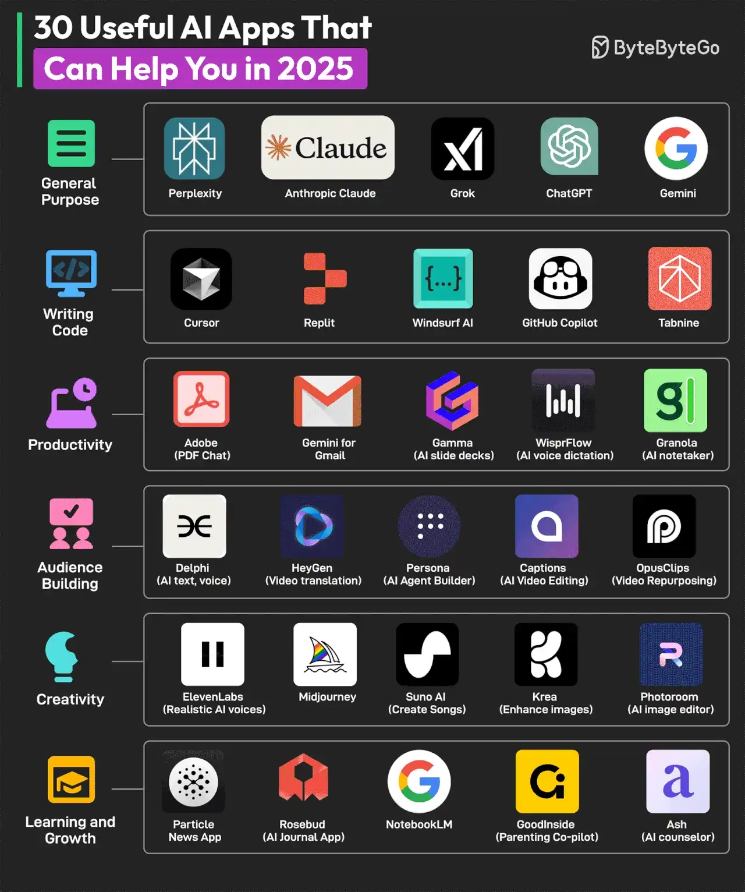

# 013 - 30 ứng dụng AI hữu ích có thể giúp bạn trong năm 2025

- Nguồn: ByteByteGo Big Archive System Design 2025
- Trang PDF: 32-33
- Ảnh minh họa: `../assets/013/figure-01.png`

## Hình minh họa

## Dịch sát

Các ứng dụng AI đang lan rộng khắp thế giới. Gần như với mọi use case có thể tưởng tượng, đều có một ứng dụng AI tương ứng. Dưới đây là một số AI app theo từng nhóm:

1. General Purpose: Perplexity, Anthropic Claude, Grok, ChatGPT và Gemini.

2. Writing Code: Cursor, Replit, Windsurf AI, GitHub Copilot và Tabnine.

3. Productivity: Adobe (PDF Chat), Gemini for Gmail, Gamma (AI slide deck), WisprFlow (AI voice dictation) và Granola (AI notetaker).

4. Audience Building: Delphi (AI text, voice), HeyGen (video translation), Persona (AI agent builder), Captions (AI video editing) và OpusClips (video repurposing).

5. Creativity: ElevenLabs (realistic AI voices), Midjourney, Suno AI (music generation), Krea (enhance images) và Photoroom (AI image editing).

6. Learning and Growth: Particle News App, Rosebud (AI journal app), NotebookLM, GoodInside (parenting co-pilot) và Ash (AI counselor).

Câu hỏi dành cho bạn: Bạn sẽ thêm AI app nào khác vào danh sách?

## Dịch nội dung trong hình

- `General Purpose`: Perplexity, Anthropic Claude, Grok, ChatGPT và Gemini.
- `Writing Code`: Cursor, Replit, Windsurf AI, GitHub Copilot và Tabnine.
- `Productivity`: Adobe PDF Chat, Gemini for Gmail, Gamma, WisprFlow và Granola.
- `Audience Building`: Delphi, HeyGen, Persona, Captions và OpusClips.
- `Creativity`: ElevenLabs, Midjourney, Suno AI, Krea và Photoroom.
- `Learning and Growth`: Particle News App, Rosebud, NotebookLM, GoodInside và Ash.

## Tóm tắt & giải thích dễ hiểu

Bài này phân loại AI app theo nhu cầu sử dụng. Với developer, nhóm `Writing Code` hỗ trợ viết, đọc, refactor và debug code. Nhóm `General Purpose` phù hợp hỏi đáp, research và tạo nội dung. Nhóm `Productivity` giúp xử lý tài liệu, email, slide, ghi chú và dictation. Các nhóm còn lại phục vụ sáng tạo, xây dựng audience và học tập cá nhân.

Theo tư duy kỹ thuật, các app AI thường khác nhau ở model, dữ liệu ngữ cảnh, workflow tích hợp và UX. Một coding assistant tốt không chỉ cần model mạnh mà còn cần hiểu repo, terminal, file context, git diff và test result. Một AI notetaker tốt lại cần audio transcription, speaker diarization, summarization và khả năng tìm kiếm ghi chú.

## Ví dụ thực tế - không nằm trong tài liệu gốc

Một developer có thể dùng ChatGPT hoặc Claude để brainstorm kiến trúc, Cursor hoặc GitHub Copilot để sửa code trong IDE, Perplexity để research nhanh, NotebookLM để hỏi trên tài liệu nội bộ, và Gamma để tạo slide demo. Nhưng với code production, vẫn cần review diff, chạy test và kiểm tra security thay vì tin tuyệt đối vào output AI.

## Thuật ngữ chính

- `General purpose AI app`: ứng dụng AI đa dụng cho hỏi đáp, viết, research và phân tích.
- `Coding assistant`: công cụ AI hỗ trợ viết, đọc, sửa và giải thích code.
- `AI notetaker`: công cụ ghi âm, chuyển giọng nói thành text và tóm tắt meeting.
- `AI agent builder`: công cụ tạo agent có workflow, tool và memory.
- `Video repurposing`: tái sử dụng video dài thành nhiều clip ngắn.

## Câu hỏi ôn tập + trả lời + thinking học tập + liên hệ

> Đây là phần học tập thêm ở cuối file. Câu hỏi ưu tiên lấy từ tài liệu gốc và được trả lời trực tiếp; nếu bài không có câu hỏi riêng thì dùng tiêu đề/nội dung chính để tạo câu hỏi tự kiểm tra.

### Câu hỏi 1

**Nguồn câu hỏi:** Câu hỏi trong tài liệu gốc.

**Câu hỏi:** Bạn sẽ thêm AI app nào khác vào danh sách?

**Trả lời:** Phần còn thiếu đáng cân nhắc là evaluation harness để đo chất lượng thay vì cảm tính; guardrails/policy để giảm prompt injection và output nguy hiểm; observability cho prompt, context, latency, cost và hallucination; và model routing theo độ khó/cost của request. Các mục này giúp bức tranh đầy đủ hơn vì chúng chạm vào phần triển khai/vận hành mà bài gốc chưa đi sâu. Ý chính đang có của bài là: Bài này phân loại AI app theo nhu cầu sử dụng. Với developer, nhóm `Writing Code` hỗ trợ viết, đọc, refactor và debug code. Nhóm `General Purpose` phù hợp hỏi đáp, research và tạo nội dung. Nhóm `Productivity` giúp xử lý tài liệu, email, slide, ghi chú và dictation. Các nhóm còn lại phục vụ sáng tạo, xây dựng audience và học tập cá nhân.

**Thinking học tập + liên hệ:** Đừng thêm mục cho dài danh sách; với `30 ứng dụng AI hữu ích có thể giúp bạn trong năm 2025`, chỉ thêm thứ mở ra một nhóm vấn đề mới hoặc giúp ra quyết định thiết kế tốt hơn. Lens chính là quality, latency, cost/token, privacy, cập nhật tri thức và rủi ro hallucination. Khi build AI app, hãy nối model với pipeline thật: data vào đâu, context lấy từ đâu, output được kiểm thế nào và chi phí tăng theo traffic ra sao. Khi ghi chú lại, hãy giải thích được các keyword: `General purpose AI app`, `Coding assistant`, `AI notetaker`, `AI agent builder`, `Video repurposing`.
