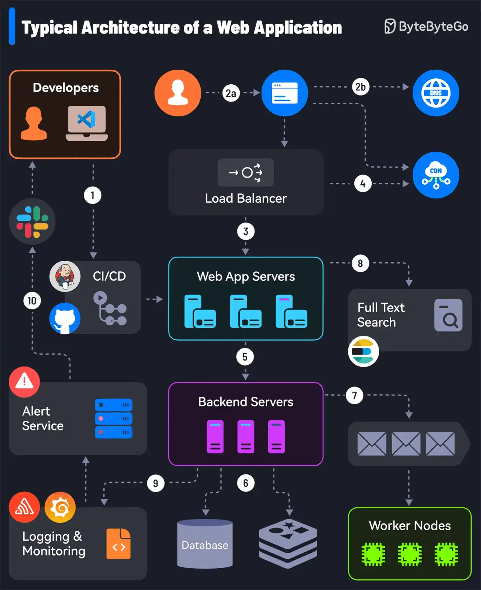

# 014 - 10 thành phần thiết yếu của một web application production

- Nguồn: ByteByteGo Big Archive System Design 2025
- Trang PDF: 34-35
- Ảnh minh họa: `../assets/014/figure-01.png`

## Hình minh họa

## Dịch sát

1. Mọi thứ bắt đầu với CI/CD pipeline triển khai code lên các server instance. Các công cụ như Jenkins và GitHub hỗ trợ ở phần này.

2. Request của user bắt nguồn từ web browser. Sau khi DNS resolution, request đi tới app server.

3. Load balancer và reverse proxy, chẳng hạn Nginx và HAProxy, phân phối request của user đều qua các web application server.

4. Request cũng có thể được phục vụ bởi Content Delivery Network, tức CDN.

5. Web app giao tiếp với backend services thông qua API.

6. Backend services tương tác với database server hoặc distributed cache để cung cấp dữ liệu.

7. Các task tốn nhiều tài nguyên và chạy lâu được gửi tới job worker bằng job queue.

8. Full-text search service hỗ trợ chức năng tìm kiếm. Các công cụ như Elasticsearch và Apache Solr có thể giúp ở đây.

9. Monitoring tools, chẳng hạn Sentry, Grafana và Prometheus, lưu log và giúp phân tích dữ liệu để đảm bảo mọi thứ hoạt động tốt.

10. Khi có vấn đề, alerting service thông báo cho developer qua các nền tảng như Slack để xử lý nhanh.

Câu hỏi dành cho bạn: Bạn sẽ thêm thành phần nào khác vào kiến trúc của một production web app?

## Dịch nội dung trong hình

- `Developers`: developer viết code và đẩy qua CI/CD.
- `CI/CD`: pipeline build, test và deploy ứng dụng.
- `DNS`: phân giải domain trước khi request tới hệ thống.
- `CDN`: phục vụ static content hoặc cache response ở edge.
- `Load Balancer`: phân phối traffic tới nhiều web app server.
- `Web App Servers`: các server xử lý request web/app.
- `Backend Servers`: các service phía backend.
- `Database`: nơi lưu dữ liệu bền vững.
- `Distributed Cache`: cache phân tán, ví dụ Redis/Memcached.
- `Worker Nodes`: worker xử lý task nền qua queue.
- `Full Text Search`: hệ thống tìm kiếm toàn văn.
- `Logging & Monitoring`: log, metric, tracing và dashboard.
- `Alert Service`: cảnh báo tới team khi có sự cố.

## Tóm tắt & giải thích dễ hiểu

Một web app production không chỉ là vài API endpoint. Nó là một hệ sinh thái gồm deploy pipeline, DNS, CDN, load balancer, web server, backend service, database, cache, queue/worker, search, monitoring và alerting.

Luồng cơ bản là developer merge code, CI/CD deploy lên server. User truy cập qua browser, DNS phân giải domain, CDN có thể trả static asset hoặc cache, load balancer phân phối request tới app server, backend gọi database/cache/search hoặc đẩy task dài vào queue. Monitoring và alerting giúp team biết hệ thống có đang khỏe hay không.

Trong system design interview, bài này là checklist rất tốt. Khi thiết kế web app production, luôn hỏi: deploy thế nào, scale request thế nào, dữ liệu lưu ở đâu, cache ở đâu, task nền xử lý sao, search cần gì, quan sát hệ thống bằng gì và ai nhận alert khi lỗi?

## Ví dụ thực tế - không nằm trong tài liệu gốc

Một hệ thống quản lý văn bản có thể dùng GitHub Actions để deploy, Cloudflare làm CDN/DNS, Nginx làm reverse proxy, backend API chạy nhiều instance, PostgreSQL lưu dữ liệu, Redis làm cache/session store, queue xử lý gửi email và OCR file, Elasticsearch phục vụ tìm kiếm nội dung văn bản, Grafana/Prometheus theo dõi metric và Sentry ghi lỗi runtime.

Nếu thiếu monitoring và alerting, hệ thống vẫn có thể chạy nhưng team chỉ biết lỗi khi user phàn nàn. Đó không phải production readiness tốt.

## Thuật ngữ chính

- `CI/CD`: Continuous Integration/Continuous Delivery hoặc Deployment.
- `Reverse proxy`: proxy đứng trước server, nhận request và chuyển tiếp vào backend.
- `CDN`: mạng phân phối nội dung ở gần user hơn.
- `Distributed cache`: cache dùng chung giữa nhiều instance.
- `Job queue`: hàng đợi tác vụ nền.
- `Full-text search`: tìm kiếm theo nội dung văn bản.
- `Monitoring`: quan sát metric, log, trace và trạng thái hệ thống.

## Câu hỏi ôn tập + trả lời + thinking học tập + liên hệ

> Đây là phần học tập thêm ở cuối file. Câu hỏi ưu tiên lấy từ tài liệu gốc và được trả lời trực tiếp; nếu bài không có câu hỏi riêng thì dùng tiêu đề/nội dung chính để tạo câu hỏi tự kiểm tra.

### Câu hỏi 1

**Nguồn câu hỏi:** Câu hỏi trong tài liệu gốc.

**Câu hỏi:** Bạn sẽ thêm thành phần nào khác vào kiến trúc của một production web app?

**Trả lời:** Có thể thêm DNS caching/TTL và negative caching; TLS handshake/session resumption; CDN edge caching và origin shielding; và QUIC/HTTP/3 khi cần giảm latency. Các mục này giúp bức tranh đầy đủ hơn vì chúng chạm vào phần triển khai/vận hành mà bài gốc chưa đi sâu. Ý chính đang có của bài là: Một web app production không chỉ là vài API endpoint. Nó là một hệ sinh thái gồm deploy pipeline, DNS, CDN, load balancer, web server, backend service, database, cache, queue/worker, search, monitoring và alerting. Luồng cơ bản là developer merge code, CI/CD deploy lên server. User truy cập qua browser, DNS phân giải domain, CDN có thể trả static asset hoặc cache, load balancer phân phối request tới app server, backend gọi database/cache/search hoặc đẩy task dài vào queue. Monitoring và alerting giúp team biết...

**Thinking học tập + liên hệ:** Đừng thêm mục cho dài danh sách; với `10 thành phần thiết yếu của một web application production`, chỉ thêm thứ mở ra một nhóm vấn đề mới hoặc giúp ra quyết định thiết kế tốt hơn. Lens chính là DNS, transport, TLS, HTTP, proxy/CDN, application timeout và observability theo từng layer. Khi debug production, hãy tách latency theo DNS lookup, TCP connect, TLS handshake, TTFB và download để không đoán mò. Khi ghi chú lại, hãy giải thích được các keyword: `CI/CD`, `Reverse proxy`, `CDN`, `Distributed cache`, `Job queue`.
