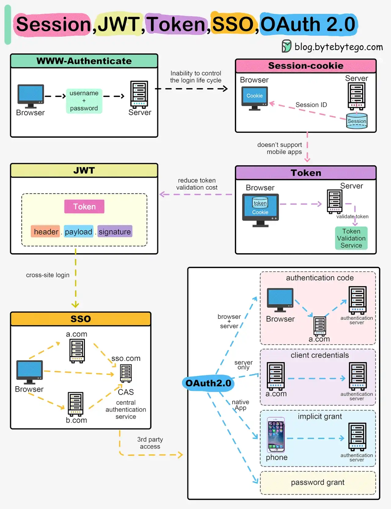

# 015 - Session, Cookie, JWT, Token, SSO và OAuth 2.0 trong một sơ đồ

- Nguồn: ByteByteGo Big Archive System Design 2025
- Trang PDF: 36-37
- Ảnh minh họa: `../assets/015/figure-01.png`

## Hình minh họa

## Dịch sát

Khi bạn đăng nhập vào một website, danh tính của bạn cần được quản lý. Dưới đây là cách các giải pháp khác nhau hoạt động:

- Session - Server lưu danh tính của bạn và đưa cho browser một session ID cookie. Điều này cho phép server theo dõi trạng thái đăng nhập. Nhưng cookie không hoạt động tốt trên nhiều thiết bị.

- Token - Danh tính của bạn được encode vào một token gửi tới browser. Browser gửi token này trong các request sau để authentication. Không cần lưu session trên server. Nhưng token cần encryption/decryption.

- JWT - JSON Web Tokens chuẩn hóa identity token bằng digital signature để tạo trust. Signature nằm trong token nên không cần session server-side.

- SSO - Single Sign On dùng một authentication service tập trung. Điều này cho phép một lần login có hiệu lực trên nhiều site.

- OAuth2 - Cho phép một site khác truy cập có giới hạn vào dữ liệu của bạn trên một site, mà không cần đưa password.

- QR Code - Encode một random token vào QR code để login bằng mobile. Quét mã sẽ đăng nhập mà không cần gõ password.

Câu hỏi dành cho bạn: QR code login đang ngày càng phổ biến. Bạn có biết nó hoạt động như thế nào không?

## Dịch nội dung trong hình

- `WWW-Authenticate`: browser gửi username/password tới server để xác thực.
- `Session-Cookie`: server trả session id cho browser qua cookie; browser gửi cookie ở các request sau.
- `JWT`: token gồm header, payload và signature.
- `Token`: browser lưu token code; server dùng token validation service để validate token.
- `SSO`: browser đăng nhập qua central authentication service, có thể truy cập nhiều domain như `a.com`, `b.com`, `sso.com`.
- `OAuth2.0`: gồm nhiều flow như authentication code, client credentials, implicit grant và password grant.
- `3rd party access`: bên thứ ba được truy cập có giới hạn mà không cần biết password của user.

## Tóm tắt & giải thích dễ hiểu

Các cơ chế này đều liên quan đến danh tính và quyền truy cập, nhưng giải quyết các bài toán khác nhau. Session phù hợp khi server muốn kiểm soát trạng thái đăng nhập. Token/JWT phù hợp khi muốn giảm phụ thuộc session store và scale ngang dễ hơn. SSO phù hợp khi một tổ chức có nhiều ứng dụng nhưng muốn user login một lần. OAuth2 phù hợp cho delegated authorization, tức cho app A truy cập giới hạn tài nguyên ở app B mà không lộ password.

Điểm hay nhầm: OAuth2 không phải chỉ là “login”. Bản chất OAuth2 là authorization framework. OpenID Connect, xây trên OAuth2, mới thường dùng cho login/identity. JWT là format token; nó có thể được dùng trong OAuth2/OIDC nhưng không đồng nghĩa với OAuth2.

QR code login thường dùng một token ngắn hạn. Browser hiển thị QR chứa token/session tạm. Mobile app đã đăng nhập quét mã, xác nhận, rồi server gắn phiên browser với tài khoản user.

## Ví dụ thực tế - không nằm trong tài liệu gốc

Một công ty có nhiều hệ thống như HR, CRM và E-Office nên dùng SSO để nhân viên đăng nhập một lần qua identity provider. Một mobile app gọi API có thể dùng OAuth2/OIDC để lấy access token. Một web admin nội bộ có thể dùng session server-side để dễ revoke khi nhân viên nghỉ việc.

Nếu cho phép “Đăng nhập bằng Google”, hệ thống của bạn không nhận password Google của user. Thay vào đó, OAuth2/OIDC flow trả về token/identity claim để bạn xác minh user là ai.

## Thuật ngữ chính

- `Session ID`: định danh phiên đăng nhập lưu ở cookie.
- `Token`: chuỗi đại diện cho danh tính/quyền truy cập.
- `JWT`: token JSON có chữ ký số.
- `SSO`: Single Sign On, đăng nhập một lần cho nhiều ứng dụng.
- `OAuth2`: framework ủy quyền truy cập giới hạn.
- `OIDC`: OpenID Connect, lớp identity/login xây trên OAuth2.
- `QR code login`: đăng nhập bằng token ngắn hạn được mã hóa trong QR.

## Câu hỏi ôn tập + trả lời + thinking học tập + liên hệ

> Đây là phần học tập thêm ở cuối file. Câu hỏi ưu tiên lấy từ tài liệu gốc và được trả lời trực tiếp; nếu bài không có câu hỏi riêng thì dùng tiêu đề/nội dung chính để tạo câu hỏi tự kiểm tra.

### Câu hỏi 1

**Nguồn câu hỏi:** Câu hỏi trong tài liệu gốc.

**Câu hỏi:** QR code login đang ngày càng phổ biến. Bạn có biết nó hoạt động như thế nào không?

**Trả lời:** QR code login thường hoạt động bằng cách browser/TV tạo một login session tạm thời và hiển thị mã QR chứa `login_token` hoặc URL xác thực ngắn hạn. Mobile app đã đăng nhập quét mã, gửi token đó lên server để xác nhận danh tính. Server đánh dấu session trên browser/TV là authenticated, rồi thiết bị kia tự polling hoặc nhận realtime event để chuyển sang trạng thái đã đăng nhập. Điểm quan trọng là token phải ngắn hạn, dùng một lần và bị ràng buộc với session/device ban đầu.

**Thinking học tập + liên hệ:** Luồng trong `Session, Cookie, JWT, Token, SSO và OAuth 2.0 trong một sơ đồ` nên được vẽ từ input tới output, kèm owner của từng bước và failure mode ở mỗi boundary. Lens chính là actor, trust boundary, dữ liệu nhạy cảm, lifetime của token/key, quyền truy cập và cơ chế revoke. Khi làm API thật, một endpoint chạy được chưa đủ; phải kiểm thêm abuse, audit log, error leakage, rate limit và quyền ở service chứa dữ liệu. Khi ghi chú lại, hãy giải thích được các keyword: `Session ID`, `Token`, `JWT`, `SSO`, `OAuth2`.
