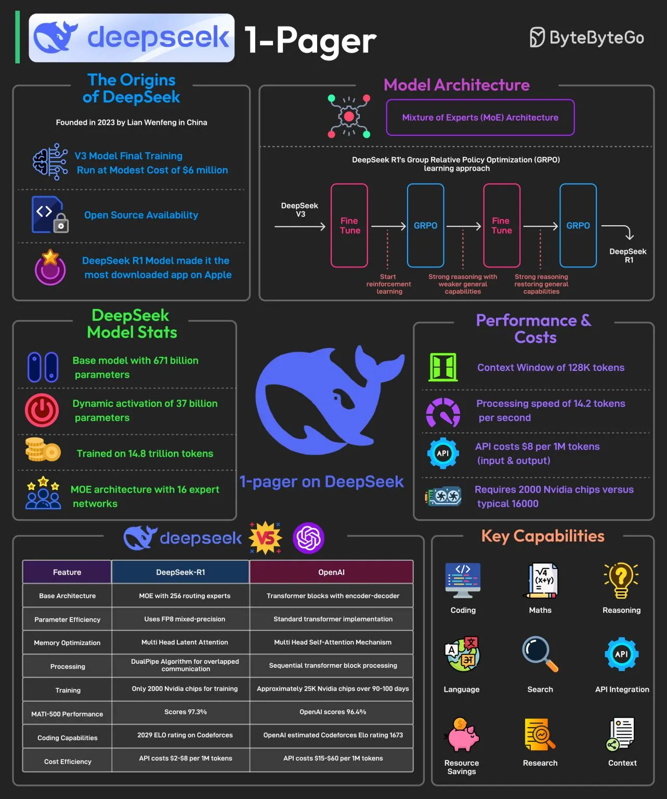

# 016 - DeepSeek trong một trang

- Nguồn: ByteByteGo Big Archive System Design 2025
- Trang PDF: 38-39
- Ảnh minh họa: `../assets/016/figure-01.png`

## Hình minh họa

## Dịch sát

DeepSeek được cho là đã phát triển một AI model mạnh với chi phí rất thấp, khoảng 6 triệu USD cho final training run. Vào tháng 1 năm 2025, DeepSeek được cho là đã phát hành model mới nhất tập trung vào reasoning, tên là DeepSeek R1.

Lần phát hành này khiến nó trở thành app miễn phí được tải xuống nhiều nhất trên Apple Play Store, theo cách diễn đạt trong tài liệu gốc.

Hầu hết AI model được train bằng supervised fine-tuning, nghĩa là chúng học bằng cách bắt chước các dataset lớn gồm ví dụ được con người gắn nhãn. Phương pháp này có những hạn chế.

DeepSeek R1 vượt qua các hạn chế này bằng cách dùng Group Relative Policy Optimization, viết tắt là GRPO, một kỹ thuật reinforcement learning giúp cải thiện hiệu quả reasoning bằng cách so sánh nhiều câu trả lời khả dĩ trong cùng một ngữ cảnh.

Một số thông tin về model DeepSeek R1 như sau:

1. DeepSeek-R1 dùng kiến trúc Mixture-of-Experts, viết tắt là MoE, với tổng 671 tỷ parameter, nhưng chỉ kích hoạt 37 tỷ parameter cho mỗi task.

2. Nó sử dụng selective parameter activation thông qua MoE để tối ưu tài nguyên.

3. Model được pre-train trên 14,8 nghìn tỷ token qua 52 ngôn ngữ.

4. DeepSeek-R1 được train chỉ bằng 2000 GPU Nvidia. Để so sánh, ChatGPT-4 cần khoảng 25K GPU Nvidia trong 90-100 ngày.

5. Model này cost-effective hơn đối thủ khoảng 85-90%.

6. Nó nổi bật ở các task mathematics, coding và reasoning.

7. Ngoài ra, model được phát hành open-source dưới license MIT.

Câu hỏi dành cho bạn: Bạn đã thử DeepSeek chưa?

## Dịch nội dung trong hình

- `The Origins of DeepSeek`: thành lập năm 2023 bởi Liang Wenfeng tại Trung Quốc; V3 final training run được nói là tốn khoảng 6 triệu USD; có open-source availability; DeepSeek R1 trở thành app được tải nhiều.
- `Model Architecture`: dùng Mixture of Experts, kết hợp fine-tune và GRPO trong learning approach.
- `DeepSeek Model Stats`: base model 671B parameters, kích hoạt động 37B parameters, train trên 14,8T tokens, MoE với 16 expert network.
- `Performance & Costs`: context window 128K tokens, processing speed 14,2 tokens/second, API cost được ghi theo input/output token, cần 2000 Nvidia chips so với khoảng 16000 trong phần so sánh của hình.
- `Key Capabilities`: coding, math, reasoning, language, search, API integration, resource savings, research và context.
- Bảng so sánh trong hình đặt DeepSeek-R1 cạnh OpenAI theo architecture, parameter efficiency, memory optimization, processing, training, benchmark và cost efficiency.

## Tóm tắt & giải thích dễ hiểu

Bài này nhấn mạnh DeepSeek R1 như một ví dụ về model reasoning có chi phí huấn luyện thấp hơn đáng kể so với kỳ vọng phổ biến. Điểm kỹ thuật nổi bật là MoE và GRPO. MoE giúp model không cần kích hoạt toàn bộ parameter cho mọi request, từ đó tiết kiệm tài nguyên. GRPO thuộc nhóm reinforcement learning, tối ưu khả năng reasoning bằng cách đánh giá nhiều output trong cùng ngữ cảnh.

Theo tư duy system design cho AI, chi phí model không chỉ nằm ở training mà còn ở inference: số parameter active, context window, throughput, latency, GPU memory và API pricing đều ảnh hưởng trực tiếp đến kiến trúc sản phẩm. Một model rẻ hơn và đủ tốt có thể thay đổi cách chọn self-host, hybrid hoặc API-based deployment.

## Ví dụ thực tế - không nằm trong tài liệu gốc

Một công ty muốn xây coding assistant nội bộ có thể cân nhắc nhiều model: model proprietary cho task khó, model open-source/self-host cho request nhạy cảm hoặc khối lượng lớn. Nếu model dạng MoE cho chất lượng đủ tốt với chi phí inference thấp hơn, hệ thống có thể route một phần request sang model đó để giảm chi phí.

Tuy nhiên, trước khi chọn model production, cần benchmark trên dữ liệu thật của mình: codebase nội bộ, tiếng Việt, latency, hallucination rate, chi phí mỗi request và khả năng triển khai an toàn.

## Thuật ngữ chính

- `Supervised fine-tuning`: fine-tune model bằng dữ liệu mẫu có nhãn/câu trả lời mong muốn.
- `Reinforcement learning`: học tăng cường, tối ưu hành vi dựa trên reward.
- `GRPO`: Group Relative Policy Optimization, kỹ thuật RL được nhắc trong bài.
- `MoE`: Mixture-of-Experts, kiến trúc chỉ kích hoạt một phần expert cho mỗi input.
- `Parameter`: trọng số học được của model.
- `Context window`: lượng token model có thể xem trong một lần xử lý.
- `Inference`: quá trình dùng model để sinh output sau khi đã train.
