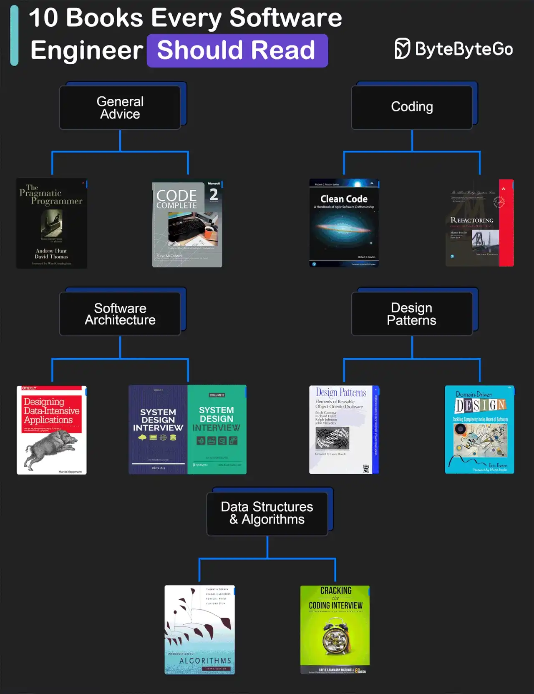

# 017 - 10 cuốn sách yêu thích dành cho software developer

- Nguồn: ByteByteGo Big Archive System Design 2025
- Trang PDF: 40-41
- Ảnh minh họa: `../assets/017/figure-01.png`

## Hình minh họa

## Dịch sát

General Advice

1. The Pragmatic Programmer của Andrew Hunt và David Thomas.

2. Code Complete của Steve McConnell: thường được xem như một cuốn “kinh thánh” cho software developer, cuốn sách toàn diện này bao phủ mọi khía cạnh của software development, từ design và coding đến testing và maintenance.

Coding

1. Clean Code của Robert C. Martin.

2. Refactoring của Martin Fowler.

Software Architecture

1. Designing Data-Intensive Applications của Martin Kleppmann.

2. System Design Interview, sách của chính chúng tôi :)

Design Patterns

1. Design Patterns của Eric Gamma và các tác giả khác.

2. Domain-Driven Design của Eric Evans.

Data Structures and Algorithms

1. Introduction to Algorithms của Cormen, Leiserson, Rivest và Stein.

2. Cracking the Coding Interview của Gayle Laakmann McDowell.

Câu hỏi dành cho bạn: Cuốn sách yêu thích của bạn là gì?

## Dịch nội dung trong hình

- `General Advice`: The Pragmatic Programmer và Code Complete.
- `Coding`: Clean Code và Refactoring.
- `Software Architecture`: Designing Data-Intensive Applications và System Design Interview.
- `Design Patterns`: Design Patterns và Domain-Driven Design.
- `Data Structures & Algorithms`: Introduction to Algorithms và Cracking the Coding Interview.

## Tóm tắt & giải thích dễ hiểu

Danh sách này chia việc học software engineering thành nhiều lớp. General advice giúp hình thành tư duy nghề nghiệp và chất lượng phần mềm. Coding giúp viết code rõ ràng, dễ maintain và biết cải thiện code cũ. Software architecture giúp hiểu hệ thống dữ liệu, scalability, consistency và trade-off. Design patterns và DDD giúp tổ chức domain logic. Data structures and algorithms giúp xây nền tảng giải quyết vấn đề.

Với người học system design, `Designing Data-Intensive Applications` đặc biệt quan trọng vì nó giải thích sâu về storage, replication, partitioning, transactions, consistency, stream processing và distributed systems. Đây là nền để hiểu vì sao một kiến trúc được chọn, không chỉ vẽ box cho đẹp.

## Ví dụ thực tế - không nằm trong tài liệu gốc

Nếu bạn đang làm backend web/app, có thể đọc theo thứ tự thực dụng: The Pragmatic Programmer để chỉnh mindset, Clean Code để viết code dễ đọc, Refactoring để sửa code cũ an toàn, Designing Data-Intensive Applications để hiểu database/distributed systems, rồi Domain-Driven Design khi hệ thống nghiệp vụ bắt đầu phức tạp.

Không cần đọc hết mọi cuốn trước khi code. Cách hiệu quả là đọc theo vấn đề đang gặp: code rối thì đọc Refactoring, domain nghiệp vụ khó thì đọc DDD, hệ thống dữ liệu scale kém thì đọc DDIA.

## Thuật ngữ chính

- `Software architecture`: cấu trúc cấp cao và trade-off của hệ thống phần mềm.
- `Refactoring`: cải thiện cấu trúc code mà không đổi behavior bên ngoài.
- `Design pattern`: mẫu giải pháp lặp lại cho vấn đề thiết kế phổ biến.
- `DDD`: Domain-Driven Design, thiết kế phần mềm xoay quanh domain nghiệp vụ.
- `Data structures and algorithms`: cấu trúc dữ liệu và thuật toán nền tảng.
