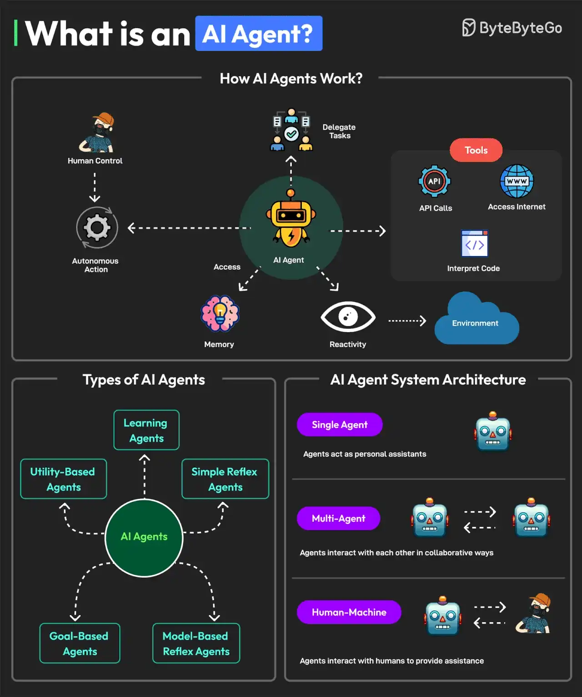

# 018 - AI Agent là gì?

- Nguồn: ByteByteGo Big Archive System Design 2025
- Trang PDF: 42-43
- Ảnh minh họa: `../assets/018/figure-01.png`

## Hình minh họa

## Dịch sát

AI agent là một chương trình phần mềm có thể tương tác với môi trường của nó, thu thập dữ liệu và dùng dữ liệu đó để đạt các mục tiêu đã được định trước. AI agent có thể chọn những hành động tốt nhất để thực hiện nhằm đạt các mục tiêu đó.

Các đặc điểm chính của AI agent như sau:

Một agent có thể thực hiện các hành động autonomous mà không cần con người can thiệp liên tục. Ngoài ra, chúng có thể có human in the loop để duy trì kiểm soát.

- Agent có memory để lưu sở thích cá nhân và cho phép personalization. Nó cũng có thể lưu knowledge. Một LLM có thể đảm nhận chức năng xử lý thông tin và ra quyết định.

- Agent phải có khả năng perceive và process thông tin có sẵn từ môi trường của nó.

- Agent cũng có thể dùng tools như truy cập Internet, dùng code interpreter và gọi API.

- Agent cũng có thể cộng tác với agent khác hoặc với con người.

Có nhiều loại AI agent như learning agents, simple reflex agents, model-based reflex agents, goal-based agents và utility-based agents.

Một hệ thống có AI agent có thể được xây dựng bằng nhiều approach kiến trúc khác nhau.

1. Single Agent: agent có thể đóng vai trò personal assistant.

2. Multi-Agent: agent có thể tương tác với nhau theo cách cộng tác hoặc cạnh tranh.

3. Human Machine: agent có thể tương tác với con người để thực thi task hiệu quả hơn.

Câu hỏi dành cho bạn: Bạn đã dùng AI Agent chưa?

## Dịch nội dung trong hình

- `How AI Agents Work?`: AI agent nhận memory, truy cập môi trường, dùng tool và có thể có human control.
- `Human Control`: con người kiểm soát hoặc can thiệp khi cần.
- `Autonomous Action`: agent tự hành động theo mục tiêu.
- `Memory`: lưu thông tin, sở thích, lịch sử hoặc knowledge.
- `Reactivity`: phản ứng với tín hiệu từ environment.
- `Tools`: API calls, access Internet và interpret code.
- `Types of AI Agents`: learning agents, utility-based agents, goal-based agents, simple reflex agents và model-based reflex agents.
- `AI Agent System Architecture`: single agent, multi-agent và human-machine.

## Tóm tắt & giải thích dễ hiểu

AI agent khác chatbot thường ở chỗ nó không chỉ trả lời một câu hỏi. Agent có mục tiêu, có thể quan sát môi trường, lập hoặc chọn hành động, dùng tool, ghi nhớ thông tin và lặp lại quá trình cho tới khi đạt mục tiêu.

Trong kiến trúc AI agent, LLM thường đóng vai trò reasoning/decision engine, nhưng agent cần nhiều thành phần khác: memory, tool layer, environment interface, policy/guardrail, planning loop và cơ chế human-in-the-loop. Nếu thiếu guardrail, agent có thể gọi tool sai, lặp vô hạn hoặc thực hiện hành động rủi ro.

Single-agent phù hợp task cá nhân đơn giản. Multi-agent phù hợp khi cần chia vai trò như planner, researcher, coder, reviewer. Human-machine phù hợp production vì con người vẫn phê duyệt các hành động nhạy cảm như gửi email, xóa dữ liệu, deploy hoặc thanh toán.

## Ví dụ thực tế - không nằm trong tài liệu gốc

Một agent hỗ trợ xử lý ticket có thể đọc ticket mới, tìm tài liệu liên quan, truy vấn log, đề xuất nguyên nhân, tạo draft trả lời và nhờ kỹ sư approve trước khi gửi. Nếu được cấp quyền cao hơn, nó có thể tự tạo pull request sửa lỗi nhỏ, nhưng vẫn nên yêu cầu review trước khi merge.

Trong hệ thống production, nên giới hạn tool permission theo nguyên tắc least privilege. Agent đọc log không nhất thiết được quyền xóa database hoặc deploy production.

## Thuật ngữ chính

- `AI agent`: phần mềm dùng AI để quan sát, quyết định và hành động hướng tới mục tiêu.
- `Autonomous`: tự động thực hiện hành động mà không cần chỉ dẫn từng bước.
- `Human in the loop`: con người tham gia kiểm soát/phê duyệt trong vòng lặp.
- `Memory`: bộ nhớ lưu context, preference, lịch sử hoặc knowledge.
- `Tool use`: khả năng gọi API, dùng Internet, chạy code hoặc thao tác hệ thống.
- `Multi-agent`: nhiều agent phối hợp hoặc cạnh tranh để giải quyết task.

## Câu hỏi ôn tập + trả lời + thinking học tập + liên hệ

> Đây là phần học tập thêm ở cuối file. Câu hỏi ưu tiên lấy từ tài liệu gốc và được trả lời trực tiếp; nếu bài không có câu hỏi riêng thì dùng tiêu đề/nội dung chính để tạo câu hỏi tự kiểm tra.

### Câu hỏi 1

**Nguồn câu hỏi:** Câu hỏi trong tài liệu gốc.

**Câu hỏi:** Bạn đã dùng AI Agent chưa?

**Trả lời:** Với `AI Agent là gì?`, cách liên hệ tốt nhất là chọn một workload nhỏ rồi kiểm chứng bằng số liệu thay vì chọn theo cảm tính. Nên kiểm bằng workload nhỏ trước: latency, độ ổn định, khả năng debug, cost và rủi ro vận hành. Phần cốt lõi cần đem theo từ bài là: AI agent khác chatbot thường ở chỗ nó không chỉ trả lời một câu hỏi. Agent có mục tiêu, có thể quan sát môi trường, lập hoặc chọn hành động, dùng tool, ghi nhớ thông tin và lặp lại quá trình cho tới khi đạt mục tiêu. Trong kiến trúc AI agent, LLM thường đóng vai trò reasoning/decision engine, nhưng agent cần nhiều thành phần khác: memory, tool layer, environment interface, policy/guardrail, planning loop và cơ chế human-in-the-loop. Nếu thiếu guardrail, agent có thể gọi tool sai, lặp vô hạn hoặc thực hiện hành...

**Thinking học tập + liên hệ:** Khi tự liên hệ `AI Agent là gì?`, hãy viết ra một project cụ thể, lý do chọn công nghệ và lỗi vận hành có thể xảy ra. Lens chính là quality, latency, cost/token, privacy, cập nhật tri thức và rủi ro hallucination. Khi build AI app, hãy nối model với pipeline thật: data vào đâu, context lấy từ đâu, output được kiểm thế nào và chi phí tăng theo traffic ra sao. Khi ghi chú lại, hãy giải thích được các keyword: `AI agent`, `Autonomous`, `Human in the loop`, `Memory`, `Tool use`.
