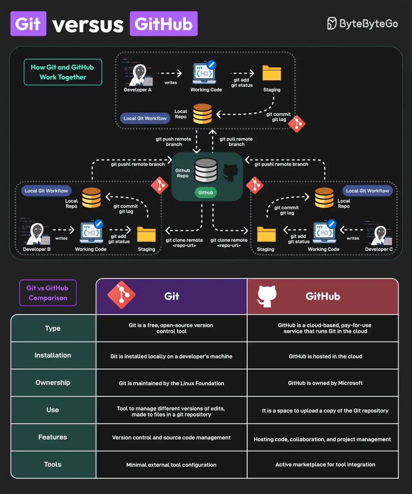

# 019 - Git vs GitHub

- Nguồn: ByteByteGo Big Archive System Design 2025
- Trang PDF: 44-45
- Ảnh minh họa: `../assets/019/figure-01.png`

## Hình minh họa

## Dịch sát

Git và GitHub là các công cụ phổ biến cho version control. Chúng hoạt động cùng nhau và bổ sung cho nhau để cung cấp khả năng source control management hiệu quả.

Ở mức tổng quan, Git tập trung vào version control và chia sẻ code, trong khi GitHub tập trung vào centralized source code hosting để chia sẻ với developer khác.

Tuy nhiên, chúng có một số khác biệt chính:

1. Git là một công cụ version control miễn phí, open-source. GitHub là một dịch vụ cloud-based, trả phí theo nhu cầu sử dụng, chạy Git trên cloud.

2. Git được cài local trên máy của developer. GitHub được host trên cloud.

3. Linux Foundation duy trì Git. Microsoft sở hữu GitHub.

4. Git có thể quản lý các version khác nhau của thay đổi được thực hiện trên file trong một Git repository. GitHub là nơi upload một bản copy của Git repository.

5. Git hỗ trợ version control và source code management. GitHub có thể được dùng để hosting code, collaboration và project management.

6. Git có cấu hình external tool tối thiểu. GitHub cung cấp marketplace năng động để tích hợp tool.

Cuối cùng, bạn có thể dùng Git mà không cần GitHub, nhưng bạn không thể dùng GitHub mà không có Git.

Câu hỏi dành cho bạn: Bạn sẽ thêm điểm nào khác để phân biệt Git và GitHub?

## Dịch nội dung trong hình

- `How Git and GitHub Work Together?`: developer làm việc ở local Git workflow, commit code, tạo branch, push lên GitHub, rồi các developer khác pull về local workflow của họ.
- `Local Git Workflow`: working code, staging, local repository, commit, branch, merge và pull.
- `Git vs GitHub Comparison`: so sánh theo type, installation, ownership, use, features và tools.
- `Git`: công cụ version control open-source, cài local, quản lý version và source code.
- `GitHub`: dịch vụ cloud-based để host Git repository, cộng tác, quản lý project và tích hợp tool.

## Tóm tắt & giải thích dễ hiểu

Git là engine version control. Nó chạy trên máy bạn, quản lý lịch sử commit, branch, merge, diff và revert. GitHub là nền tảng cloud dùng Git làm nền, thêm các tính năng cộng tác như pull request, issue, review, Actions, release, project board và permission.

Trong workflow thực tế, developer dùng Git để commit local và quản lý branch. Khi cần chia sẻ code, review hoặc CI/CD, họ push repository lên GitHub. GitHub không thay thế Git; nó cung cấp remote hosting và collaboration layer trên Git.

Hiểu rõ khác biệt này giúp tránh nhầm lẫn khi debug. Ví dụ `git merge conflict` là vấn đề của Git history/local branch, còn GitHub chỉ hiển thị conflict trong Pull Request. `git remote`, `git fetch`, `git pull`, `git push` là lệnh Git để đồng bộ với remote như GitHub.

## Ví dụ thực tế - không nằm trong tài liệu gốc

Bạn có thể tạo một repo Git local bằng `git init`, commit code nhiều lần mà không cần Internet hay GitHub. Khi muốn team cùng review, bạn tạo repo trên GitHub, thêm remote `origin`, rồi `git push` branch lên. Sau đó team mở Pull Request, chạy CI bằng GitHub Actions và merge vào main branch.

## Thuật ngữ chính

- `Version control`: quản lý lịch sử thay đổi của file/code.
- `Repository`: kho chứa code và lịch sử Git.
- `Commit`: snapshot thay đổi tại một thời điểm.
- `Branch`: nhánh phát triển độc lập.
- `Remote`: repository ở nơi khác, ví dụ GitHub.
- `Pull request`: yêu cầu review và merge code trên nền tảng như GitHub.

## Câu hỏi ôn tập + trả lời + thinking học tập + liên hệ

> Đây là phần học tập thêm ở cuối file. Câu hỏi ưu tiên lấy từ tài liệu gốc và được trả lời trực tiếp; nếu bài không có câu hỏi riêng thì dùng tiêu đề/nội dung chính để tạo câu hỏi tự kiểm tra.

### Câu hỏi 1

**Nguồn câu hỏi:** Câu hỏi trong tài liệu gốc.

**Câu hỏi:** Bạn sẽ thêm điểm nào khác để phân biệt Git và GitHub?

**Trả lời:** Nên bổ sung pre-commit hook/lint để chặn lỗi sớm; trunk-based development khi team cần release nhanh; branch protection và required checks; và reflog/revert strategy để cứu lỗi Git. Các mục này giúp bức tranh đầy đủ hơn vì chúng chạm vào phần triển khai/vận hành mà bài gốc chưa đi sâu. Ý chính đang có của bài là: Git là engine version control. Nó chạy trên máy bạn, quản lý lịch sử commit, branch, merge, diff và revert. GitHub là nền tảng cloud dùng Git làm nền, thêm các tính năng cộng tác như pull request, issue, review, Actions, release, project board và permission. Trong workflow thực tế, developer dùng Git để commit local và quản lý branch. Khi cần chia sẻ code, review hoặc CI/CD, họ push repository lên GitHub. GitHub không thay thế Git; nó cung cấp remote hosting và collaboration layer trên Git.

**Thinking học tập + liên hệ:** Danh sách trong `Git vs GitHub` nên được kiểm theo coverage: nó đã nói phần nào, thiếu phần nào và phần thiếu có làm thay đổi quyết định thiết kế không. Lens chính là feedback loop, rollback, collaboration, code review và mức tự động hóa phù hợp team. Khi áp dụng vào team thật, hãy nhìn developer workflow như một hệ thống: commit, review, test, deploy và rollback đều phải giảm rủi ro production. Khi ghi chú lại, hãy giải thích được các keyword: `Version control`, `Repository`, `Commit`, `Branch`, `Remote`.
