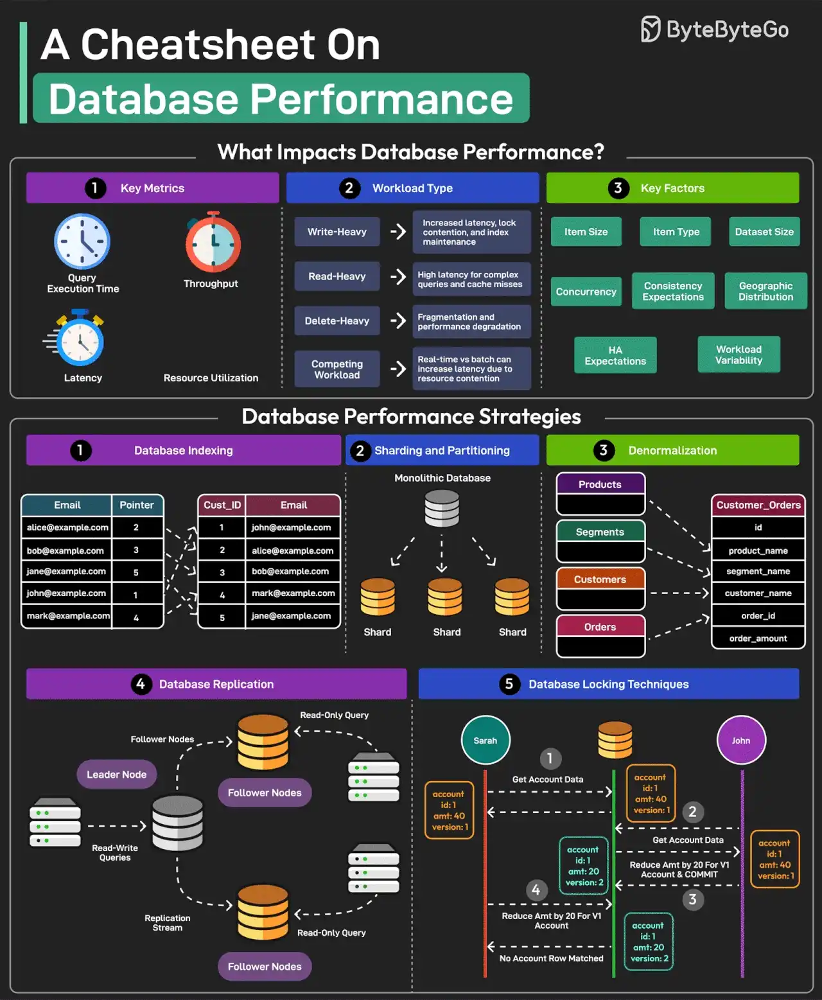

# 020 - Cheatsheet về hiệu năng database

- Nguồn: ByteByteGo Big Archive System Design 2025
- Trang PDF: 46-47
- Ảnh minh họa: `../assets/020/figure-01.png`

## Hình minh họa

## Dịch sát

Hiệu năng database tốt là yếu tố critical vì nó ảnh hưởng trực tiếp tới user experience, operational cost và scalability.

Nhưng điều gì ảnh hưởng đến database performance?

Đánh giá database performance phụ thuộc vào các metric chính như query execution time, throughput, latency và resource utilization.

Các workload type như write-heavy, read-heavy, delete-heavy và competing workloads tạo ra những thách thức riêng.

Các yếu tố khác ảnh hưởng đến performance gồm item size, item type, dataset size, concurrency expectations, consistency requirements, HA expectations và geographic distribution.

Có nhiều chiến lược để cải thiện database performance. Một số chiến lược quan trọng nhất như sau:

1. Database Indexing

   Index rất quan trọng để tăng tốc query bằng cách giảm lượng dữ liệu cần scan. Ngoài ra, chọn đúng loại index cũng rất critical.

2. Sharding and Partitioning

   Chia dữ liệu thành các phần nhỏ hơn, dễ quản lý hơn, gọi là shard. Mỗi shard cũng được lưu trên một server khác nhau.

3. Denormalization

   Denormalization kết hợp dữ liệu vào ít table hơn để giảm overhead của join, cải thiện read performance.

4. Database Replication

   Replication liên quan đến việc duy trì nhiều bản copy của cùng một database, thường có primary node cho write và các critical read, cùng secondary node cho phần lớn read operation.

5. Database Locking Techniques

   Dùng các kỹ thuật locking như pessimistic locking và optimistic locking để quản lý concurrency level và resource contention.

Câu hỏi dành cho bạn: Bạn sẽ thêm chiến lược database performance nào khác vào danh sách?

## Dịch nội dung trong hình

- `Key Metrics`: query execution time, throughput, latency và resource utilization.
- `Workload Type`: write-heavy, read-heavy, delete-heavy và competing workload.
- `Key Factors`: item size, item type, dataset size, concurrency, consistency expectation, geographic distribution, HA expectation và workload variability.
- `Database Performance Strategies`: database indexing, sharding and partitioning, denormalization, database replication và database locking techniques.
- `Database Indexing`: dùng index để tìm row nhanh hơn thay vì scan toàn bảng.
- `Sharding and Partitioning`: tách monolithic database thành nhiều shard.
- `Denormalization`: gộp dữ liệu như product, customer, order vào cấu trúc phục vụ đọc nhanh hơn.
- `Database Replication`: leader node và follower nodes phục vụ read-only query/failover.
- `Database Locking Techniques`: minh họa optimistic/pessimistic flow khi nhiều account update cạnh tranh.

## Tóm tắt & giải thích dễ hiểu

Database performance là một trong những điểm dễ thành bottleneck nhất trong system design. Muốn tối ưu đúng, trước hết phải biết workload là read-heavy, write-heavy hay mixed; dữ liệu lớn cỡ nào; yêu cầu consistency ra sao; traffic tập trung một vùng hay phân tán toàn cầu.

Index giúp query nhanh nhưng làm write chậm hơn và tốn storage. Sharding giúp scale ngang nhưng tăng độ phức tạp query, transaction và rebalancing. Denormalization tăng tốc đọc nhưng tạo rủi ro dữ liệu bị lệch nếu update không cẩn thận. Replication giảm tải đọc và tăng availability nhưng có thể gặp replication lag. Locking giúp bảo vệ consistency nhưng có thể gây contention.

Vì vậy tối ưu database không nên làm theo checklist máy móc. Cần đo metric, hiểu query pattern, đọc execution plan, rồi chọn trade-off phù hợp.

## Ví dụ thực tế - không nằm trong tài liệu gốc

Một API danh sách đơn hàng chậm vì query `WHERE user_id = ? ORDER BY created_at DESC LIMIT 20`. Nếu bảng có hàng trăm triệu row, index composite `(user_id, created_at)` có thể cải thiện mạnh. Nhưng nếu thêm quá nhiều index cho mọi filter, tốc độ insert/update sẽ giảm và storage tăng.

Một hệ thống báo cáo đọc nhiều có thể dùng read replica hoặc materialized view. Một hệ thống ví tiền cần consistency cao có thể ưu tiên transaction và locking đúng hơn là denormalize quá mức.

## Thuật ngữ chính

- `Query execution time`: thời gian database thực thi một query.
- `Throughput`: số lượng operation xử lý được mỗi giây.
- `Latency`: độ trễ từ lúc gửi request đến lúc có response.
- `Index`: cấu trúc dữ liệu giúp tìm kiếm nhanh hơn.
- `Replication lag`: độ trễ giữa primary và replica.
- `Resource contention`: nhiều transaction tranh cùng tài nguyên.
- `HA`: High Availability, khả năng hệ thống vẫn hoạt động khi có lỗi.
