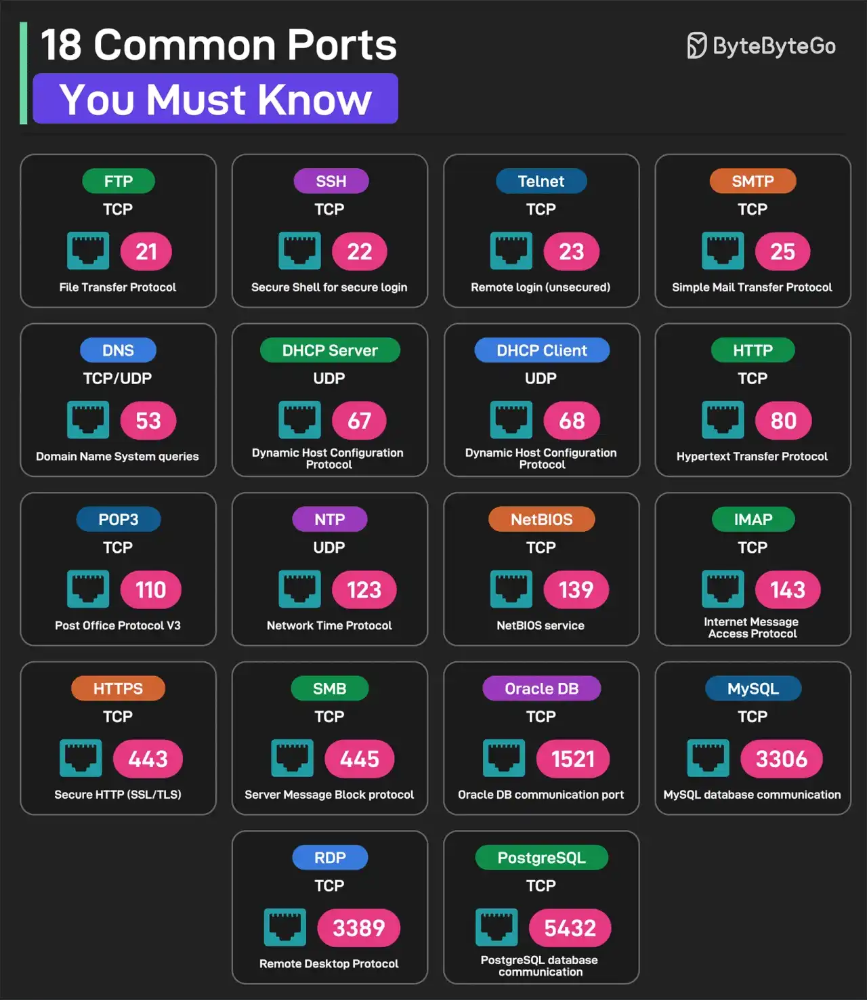

# 021 - 18 port phổ biến nên biết

- Nguồn: ByteByteGo Big Archive System Design 2025
- Trang PDF: 48-49
- Ảnh minh họa: `../assets/021/figure-01.png`

## Hình minh họa

## Dịch sát

1. FTP, File Transfer Protocol: dùng TCP port 21.

2. SSH, Secure Shell for Login: dùng TCP port 22.

3. Telnet: dùng TCP port 23 cho remote login.

4. SMTP, Simple Mail Transfer Protocol: dùng TCP port 25.

5. DNS: dùng UDP hoặc TCP trên port 53 cho DNS query.

6. DHCP Server: dùng UDP port 67.

7. DHCP Client: dùng UDP port 68.

8. HTTP, Hypertext Transfer Protocol: dùng TCP port 80.

9. POP3, Post Office Protocol V3: dùng TCP port 110.

10. NTP, Network Time Protocol: dùng UDP port 123.

11. NetBIOS: dùng TCP port 139 cho NetBIOS service.

12. IMAP, Internet Message Access Protocol: dùng TCP port 139 theo text extract từ tài liệu gốc.

13. HTTPS, Secure HTTP: dùng TCP port 443.

14. SMB, Server Message Block: dùng TCP port 445.

15. Oracle DB: dùng TCP port 1521 cho port giao tiếp Oracle database.

16. MySQL: dùng TCP port 3360 theo text extract từ tài liệu gốc.

17. RDP: dùng TCP port 3389 cho Remote Desktop Protocol.

18. PostgreSQL: dùng TCP port 5432 cho giao tiếp PostgreSQL database.

## Dịch nội dung trong hình

- `FTP`: TCP 21, File Transfer Protocol.
- `SSH`: TCP 22, Secure Shell for secure login.
- `Telnet`: TCP 23, remote login không bảo mật.
- `SMTP`: TCP 25, Simple Mail Transfer Protocol.
- `DNS`: TCP/UDP 53, Domain Name System queries.
- `DHCP Server`: UDP 67, Dynamic Host Configuration Protocol.
- `DHCP Client`: UDP 68.
- `HTTP`: TCP 80, Hypertext Transfer Protocol.
- `POP3`: TCP 110, Post Office Protocol V3.
- `NTP`: UDP 123, Network Time Protocol.
- `NetBIOS`: TCP 139, NetBIOS service.
- `IMAP`: TCP 143 trong hình, Internet Message Access Protocol.
- `HTTPS`: TCP 443, Secure HTTP.
- `SMB`: TCP 445, Server Message Block protocol.
- `Oracle DB`: TCP 1521.
- `MySQL`: TCP 3306 trong hình.
- `RDP`: TCP 3389, Remote Desktop Protocol.
- `PostgreSQL`: TCP 5432.

## Tóm tắt & giải thích dễ hiểu

Port là số định danh service ở tầng transport. Khi client kết nối tới một IP, port giúp hệ điều hành biết request nên đi tới service nào. Ví dụ web server thường nghe port 80 cho HTTP và 443 cho HTTPS; PostgreSQL thường nghe 5432; MySQL thường nghe 3306.

Trong vận hành hệ thống, biết port phổ biến giúp debug network nhanh hơn: kiểm tra firewall, security group, service binding, container port mapping, load balancer target group và connection string. Tuy nhiên, port mặc định có thể thay đổi theo cấu hình, nên luôn xác nhận trên hệ thống thật.

## Ghi chú kỹ thuật - không nằm trong tài liệu gốc

Text extract của tài liệu có vài điểm dễ gây nhầm: `Secure Sheel` là typo của `Secure Shell`; `DHCTP Client` là typo của `DHCP Client`; IMAP mặc định phổ biến là TCP `143`, còn IMAPS là `993`; MySQL mặc định phổ biến là TCP `3306`. Phần hình minh họa cũng hiển thị IMAP `143` và MySQL `3306`.

## Ví dụ thực tế - không nằm trong tài liệu gốc

Nếu API không kết nối được PostgreSQL, bạn có thể kiểm tra connection string đang trỏ tới host nào và port `5432` có mở không. Trong Kubernetes, cần kiểm tra thêm `Service`, `targetPort`, `NetworkPolicy` và security group/cloud firewall.

Nếu server SSH không vào được, kiểm tra port `22` hoặc port SSH custom, firewall, key authentication và security group trước khi kết luận server chết.

## Thuật ngữ chính

- `Port`: số định danh endpoint của một service trên một host.
- `TCP`: protocol kết nối tin cậy, thường dùng cho HTTP, SSH, database.
- `UDP`: protocol không kết nối, nhẹ hơn, thường dùng cho DNS, DHCP, NTP.
- `Firewall`: lớp rule cho phép hoặc chặn traffic theo IP/port/protocol.
- `Security group`: firewall ở mức cloud resource.

## Câu hỏi ôn tập + trả lời + thinking học tập + liên hệ

> Đây là phần học tập thêm ở cuối file. Câu hỏi ưu tiên lấy từ tài liệu gốc và được trả lời trực tiếp; nếu bài không có câu hỏi riêng thì dùng tiêu đề/nội dung chính để tạo câu hỏi tự kiểm tra.

### Câu hỏi 1

**Nguồn câu hỏi:** Suy ra từ tiêu đề/nội dung chính vì bài gốc không có câu hỏi riêng.

**Câu hỏi:** Sau khi đọc bài “18 Common Ports Worth Knowing”, ý chính cần trả lời và áp dụng vào system design là gì?

**Trả lời:** Trọng tâm cần đem vào thực tế là: Port là số định danh service ở tầng transport. Khi client kết nối tới một IP, port giúp hệ điều hành biết request nên đi tới service nào. Ví dụ web server thường nghe port 80 cho HTTP và 443 cho HTTPS; PostgreSQL thường nghe 5432; MySQL thường nghe 3306. Trong vận hành hệ thống, biết port phổ biến giúp debug network nhanh hơn: kiểm tra firewall, security group, service binding, container port mapping, load balancer target group và connection string. Tuy nhiên, port mặc định có thể thay đổi theo cấu hình, nên... Khi áp dụng vào hệ thống thật, hãy kiểm thêm DNS, transport, TLS, HTTP, proxy/CDN, application timeout và observability theo từng layer.

**Thinking học tập + liên hệ:** Liên hệ `18 port phổ biến nên biết` bằng một scenario thật sẽ giúp thấy trade-off rõ hơn so với chỉ đọc định nghĩa. Lens chính là DNS, transport, TLS, HTTP, proxy/CDN, application timeout và observability theo từng layer. Khi debug production, hãy tách latency theo DNS lookup, TCP connect, TLS handshake, TTFB và download để không đoán mò. Khi ghi chú lại, hãy giải thích được các keyword: `Port`, `TCP`, `UDP`, `Firewall`, `Security group`.
