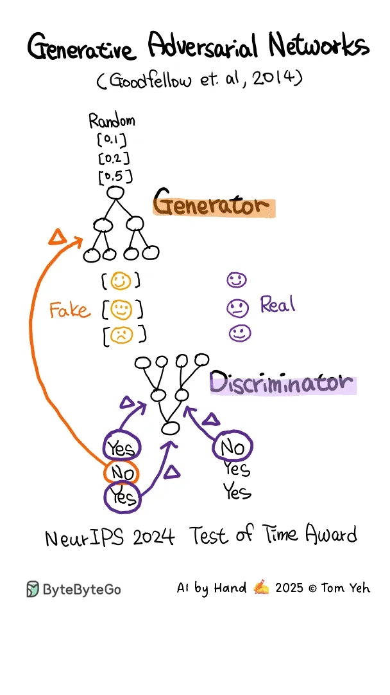

# 022 - Generative Adversarial Network (GAN) - AI vẽ tay

- Nguồn: ByteByteGo Big Archive System Design 2025
- Trang PDF: 50
- Ảnh minh họa: `../assets/022/figure-01.png`

## Hình minh họa

## Dịch sát

Generative Adversarial Network, viết tắt là GAN - AI by Hand.

Animation này được vẽ tay bởi Giáo sư Tom Yeh, dành riêng cho độc giả của ByteByteGo Newsletter.

Nếu bạn muốn học thêm về GAN, hãy xem Chương 7 trong sách System Design Interview.

## Dịch nội dung trong hình

- `Generative Adversarial Networks`: mạng sinh đối kháng.
- `Generator`: mô hình sinh dữ liệu giả từ random input.
- `Discriminator`: mô hình phân biệt dữ liệu fake và real.
- `Fake`: mẫu giả do generator tạo ra.
- `Real`: mẫu thật từ dữ liệu huấn luyện.
- `Yes/No`: discriminator đánh giá mẫu là thật hay giả.
- `NeurIPS 2024 Test of Time Award`: ghi chú giải thưởng trong hình.

## Tóm tắt & giải thích dễ hiểu

GAN gồm hai mô hình học cạnh tranh với nhau. `Generator` cố tạo dữ liệu giả ngày càng giống thật. `Discriminator` cố phân biệt dữ liệu nào là thật, dữ liệu nào là giả. Qua quá trình đối kháng này, generator học cách tạo output chất lượng hơn.

Ý tưởng cốt lõi là một bên “làm giả” và một bên “bắt lỗi”. Khi discriminator bắt lỗi tốt hơn, generator phải cải thiện. Khi generator tạo dữ liệu thuyết phục hơn, discriminator lại phải học tinh hơn.

## Ví dụ thực tế - không nằm trong tài liệu gốc

GAN có thể được dùng để tạo ảnh khuôn mặt giả, nâng độ phân giải ảnh, sinh dữ liệu training hoặc chuyển style ảnh. Tuy nhiên, trong production cần chú ý rủi ro deepfake, bản quyền dữ liệu huấn luyện và kiểm soát nội dung sinh ra.

Trong system design AI, GAN là một pattern model-level hơn là kiến trúc backend. Nhưng khi đưa GAN vào sản phẩm, vẫn cần pipeline dữ liệu, model serving, GPU inference, queue xử lý ảnh và moderation.

## Thuật ngữ chính

- `GAN`: Generative Adversarial Network, mạng sinh đối kháng.
- `Generator`: mô hình tạo dữ liệu giả.
- `Discriminator`: mô hình phân biệt thật/giả.
- `Training data`: dữ liệu thật dùng để huấn luyện.
- `Adversarial training`: huấn luyện theo kiểu hai thành phần cạnh tranh nhau.

## Câu hỏi ôn tập + trả lời + thinking học tập + liên hệ

> Đây là phần học tập thêm ở cuối file. Câu hỏi ưu tiên lấy từ tài liệu gốc và được trả lời trực tiếp; nếu bài không có câu hỏi riêng thì dùng tiêu đề/nội dung chính để tạo câu hỏi tự kiểm tra.

### Câu hỏi 1

**Nguồn câu hỏi:** Suy ra từ tiêu đề/nội dung chính vì bài gốc không có câu hỏi riêng.

**Câu hỏi:** Sau khi đọc bài “Generative Adversarial Network (GAN) - AI by Hand”, ý chính cần trả lời và áp dụng vào system design là gì?

**Trả lời:** Sau bài này, phần đáng nhớ nhất là: GAN gồm hai mô hình học cạnh tranh với nhau. `Generator` cố tạo dữ liệu giả ngày càng giống thật. `Discriminator` cố phân biệt dữ liệu nào là thật, dữ liệu nào là giả. Qua quá trình đối kháng này, generator học cách tạo output chất lượng hơn. Ý tưởng cốt lõi là một bên “làm giả” và một bên “bắt lỗi”. Khi discriminator bắt lỗi tốt hơn, generator phải cải thiện. Khi generator tạo dữ liệu thuyết phục hơn, discriminator lại phải học tinh hơn. Khi áp dụng vào hệ thống thật, hãy kiểm thêm quality, latency, cost/token, privacy, cập nhật tri thức và rủi ro hallucination.

**Thinking học tập + liên hệ:** Ôn tập `Generative Adversarial Network (GAN) - AI vẽ tay` bằng cách biến khái niệm thành quyết định thiết kế cụ thể: chọn gì, bỏ gì, đo gì và ai chịu trách nhiệm. Lens chính là quality, latency, cost/token, privacy, cập nhật tri thức và rủi ro hallucination. Khi build AI app, hãy nối model với pipeline thật: data vào đâu, context lấy từ đâu, output được kiểm thế nào và chi phí tăng theo traffic ra sao. Khi ghi chú lại, hãy giải thích được các keyword: `GAN`, `Generator`, `Discriminator`, `Training data`, `Adversarial training`.
