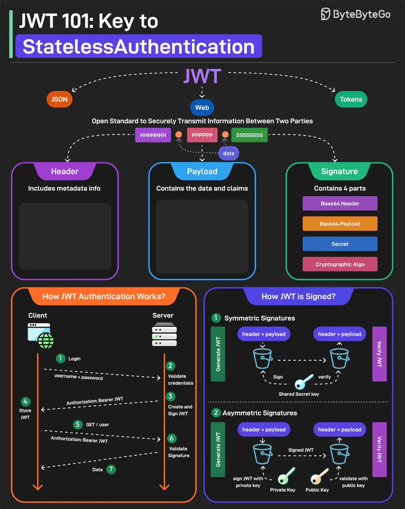

# 023 - JWT 101: chìa khóa cho Stateless Authentication

- Nguồn: ByteByteGo Big Archive System Design 2025
- Trang PDF: 51-52
- Ảnh minh họa: `../assets/023/figure-01.png`

## Hình minh họa

## Dịch sát

JWT, hay JSON Web Tokens, là một open standard để truyền thông tin an toàn giữa hai bên. Chúng được dùng rộng rãi cho authentication và authorization.

Một JWT gồm ba thành phần chính:

1. Header

   Mỗi JWT mang một header chỉ định các algorithm dùng để ký JWT. Nó được viết ở định dạng JSON.

2. Payload

   Payload gồm các claim và dữ liệu user. Có nhiều loại claim khác nhau như registered, public và private claims.

3. Signature

   Signature là thành phần làm JWT trở nên an toàn. Nó được tạo bằng cách lấy encoded header, encoded payload, secret key và algorithm rồi ký chúng.

JWT có thể được ký theo hai cách khác nhau:

1. Symmetric Signatures

   Cách này dùng một secret key duy nhất cho cả việc ký token và verify token. Cùng một key phải được chia sẻ giữa server ký JWT và hệ thống verify JWT.

2. Asymmetric Signatures

   Trong trường hợp này, private key được dùng để ký token, còn public key được dùng để verify token. Private key được giữ an toàn trên server, trong khi public key có thể được phân phối cho bất kỳ ai cần verify token.

Câu hỏi dành cho bạn: Bạn có dùng JWT cho authentication không?

## Dịch nội dung trong hình

- `JWT`: open standard để truyền thông tin an toàn giữa hai bên.
- `Header`: chứa metadata và thuật toán ký.
- `Payload`: chứa data và claims.
- `Signature`: chứa ba phần: base64 header, base64 payload, secret và cryptographic algorithm.
- `How JWT Authentication Works?`: client login, server validate credentials, tạo và ký JWT, client lưu JWT, request sau gửi `Authorization: Bearer`, server validate signature và trả data.
- `How JWT is Signed?`: symmetric signatures dùng cùng một secret key; asymmetric signatures dùng private key để ký và public key để verify.

## Tóm tắt & giải thích dễ hiểu

JWT là format token gồm header, payload và signature. Header nói token dùng thuật toán gì. Payload chứa claim như user id, role, issuer hoặc expiration. Signature giúp server kiểm tra token có bị sửa hay không.

JWT thường được gọi là stateless vì server không nhất thiết phải lưu session cho mỗi user. Khi request đến, server verify chữ ký và đọc claim trong token. Điều này giúp scale ngang dễ hơn, nhưng cũng tạo trách nhiệm bảo vệ token rất nghiêm túc.

Điểm quan trọng: JWT có chữ ký không có nghĩa payload được mã hóa. Nhiều JWT chỉ base64url encode payload, nên không nên đưa dữ liệu nhạy cảm như password, secret hoặc thông tin cá nhân không cần thiết vào token.

## Ví dụ thực tế - không nằm trong tài liệu gốc

Một API có thể phát access token JWT sống 15 phút và refresh token sống lâu hơn. Client gửi `Authorization: Bearer <token>` trong mỗi request. Backend verify signature, kiểm tra `exp`, `iss`, `aud`, rồi lấy `sub` làm user id.

Nếu cần revoke ngay lập tức, có thể dùng token version trong database, blacklist token id, hoặc chuyển sang session server-side cho các use case nhạy cảm.

## Thuật ngữ chính

- `Claim`: thông tin được khai báo trong payload của token.
- `Registered claim`: claim chuẩn như `iss`, `sub`, `aud`, `exp`.
- `Signature`: chữ ký xác minh token không bị sửa.
- `Symmetric key`: cùng một key để ký và verify.
- `Asymmetric key`: private key ký, public key verify.
- `Bearer token`: token mà ai sở hữu thì có thể dùng để truy cập nếu token hợp lệ.
