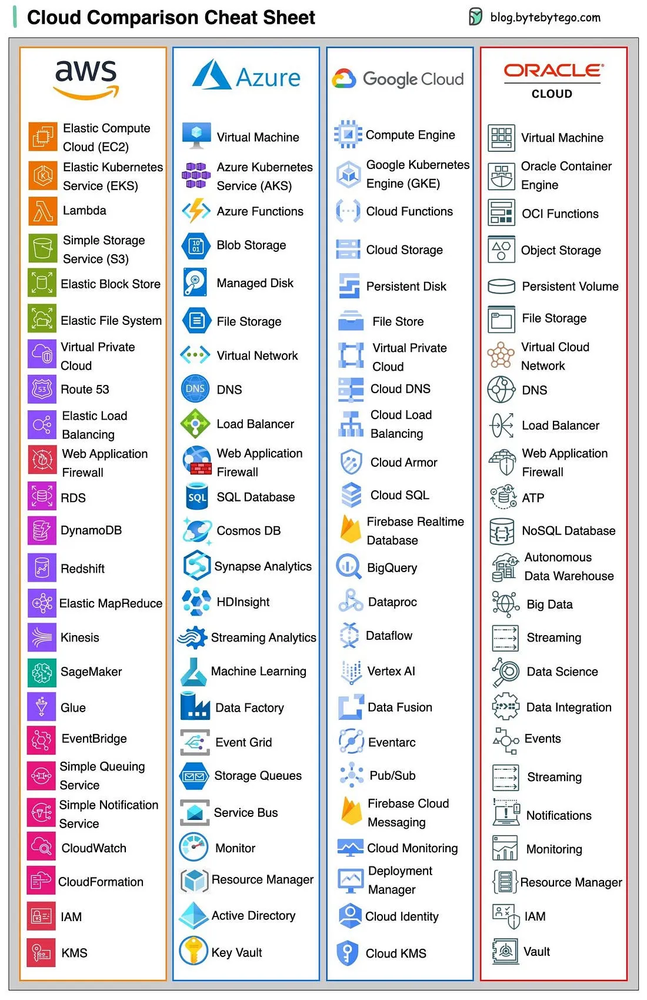

# 024 - Cheatsheet tiện dụng cho các cloud service phổ biến nhất

- Nguồn: ByteByteGo Big Archive System Design 2025
- Trang PDF: 53-54
- Ảnh minh họa: `../assets/024/figure-01.png`

## Hình minh họa

## Dịch sát

Bao gồm những gì?

- AWS, Azure, Google Cloud, Oracle Cloud, Alibaba Cloud.
- Cloud servers.
- Databases.
- Message queues và streaming platforms.
- Load balancing, DNS routing software.
- Security.
- Monitoring.

Câu hỏi dành cho bạn: công ty nào đặt tên tốt nhất?

## Dịch nội dung trong hình

Hình là bảng so sánh tên dịch vụ tương ứng giữa các cloud provider lớn:

- `Compute/Cloud servers`: ví dụ Amazon EC2, Azure Virtual Machine, Google Compute Engine, Oracle Virtual Machine.
- `Kubernetes/Container`: ví dụ EKS, AKS, GKE và Oracle Container Engine.
- `Functions`: ví dụ AWS Lambda, Azure Functions, Google Cloud Functions và Oracle Functions.
- `Storage`: object storage, file storage, persistent disk/volume.
- `Networking`: virtual network, DNS, load balancer, CDN, firewall.
- `Databases`: relational database, NoSQL database, data warehouse/big data.
- `Messaging/Streaming`: queue, pub/sub, event, streaming.
- `Monitoring/Resource/IAM/Key`: monitoring, resource manager, identity/access management và key/vault service.

## Tóm tắt & giải thích dễ hiểu

Các cloud provider thường cung cấp những nhóm năng lực giống nhau nhưng đặt tên khác nhau. Khi học system design, điều quan trọng không phải nhớ hết tên service, mà là nhận ra category: compute, storage, database, networking, security, observability, queue và streaming.

Ví dụ, nếu kiến trúc cần object storage, trên AWS bạn nghĩ đến S3, trên Azure là Blob Storage, trên Google Cloud là Cloud Storage. Nếu cần managed Kubernetes, AWS có EKS, Azure có AKS, Google có GKE. Khi chuyển cloud hoặc thiết kế multi-cloud, việc map đúng category giúp tránh nhầm service.

## Ví dụ thực tế - không nằm trong tài liệu gốc

Một hệ thống upload file có thể dùng EC2/ECS/EKS cho compute, S3 cho object storage, RDS cho metadata, CloudFront cho CDN, SQS cho queue xử lý ảnh, CloudWatch cho monitoring và IAM/KMS cho permission/encryption. Nếu triển khai trên Azure hoặc Google Cloud, ta thay bằng các service cùng category.

Khi phỏng vấn system design, bạn có thể mô tả ở mức generic như `object storage`, `managed relational database`, `message queue`, rồi nếu cần mới map sang AWS/Azure/GCP cụ thể.

## Thuật ngữ chính

- `Cloud provider`: nhà cung cấp hạ tầng cloud như AWS, Azure, Google Cloud.
- `Compute`: tài nguyên chạy ứng dụng như VM, container hoặc function.
- `Object storage`: lưu file/object dung lượng lớn, ví dụ ảnh/video/backup.
- `Managed database`: database do cloud provider vận hành.
- `Message queue`: hàng đợi giúp xử lý bất đồng bộ.
- `IAM`: Identity and Access Management, quản lý danh tính và quyền.

## Câu hỏi ôn tập + trả lời + thinking học tập + liên hệ

> Đây là phần học tập thêm ở cuối file. Câu hỏi ưu tiên lấy từ tài liệu gốc và được trả lời trực tiếp; nếu bài không có câu hỏi riêng thì dùng tiêu đề/nội dung chính để tạo câu hỏi tự kiểm tra.

### Câu hỏi 1

**Nguồn câu hỏi:** Câu hỏi trong tài liệu gốc.

**Câu hỏi:** công ty nào đặt tên tốt nhất?

**Trả lời:** Nếu xét độ dễ hiểu cho người mới, Google Cloud và Cloudflare thường đặt tên trực quan hơn vì nhiều dịch vụ mô tả khá sát chức năng. AWS phổ biến và giàu dịch vụ nhất, nhưng tên như `S3`, `EC2`, `IAM`, `EKS` cần thời gian học acronym. Trong team production, tên hay không quan trọng bằng việc mapping đúng service tương đương và hiểu pricing/limit của từng cloud.

**Thinking học tập + liên hệ:** Liên hệ `Cheatsheet tiện dụng cho các cloud service phổ biến nhất` bằng một scenario thật sẽ giúp thấy trade-off rõ hơn so với chỉ đọc định nghĩa. Lens chính là độ phức tạp vận hành, rollback, cost, kỹ năng team, observability và blast radius khi hỏng. Khi đưa lên production, hãy map từng thành phần vào deploy, rollback, monitoring, alerting, secret, cost và ownership rõ ràng. Khi ghi chú lại, hãy giải thích được các keyword: `Cloud provider`, `Compute`, `Object storage`, `Managed database`, `Message queue`.
