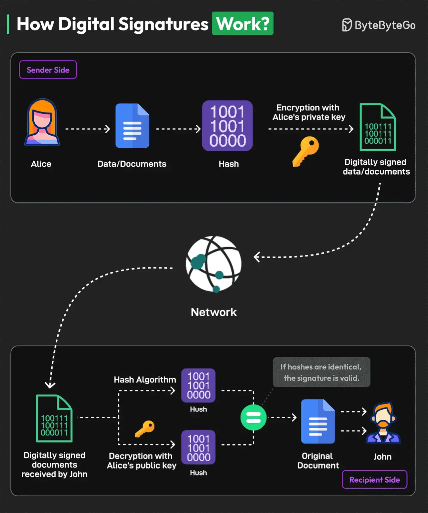

# 025 - Digital Signature hoạt động như thế nào?

- Nguồn: ByteByteGo Big Archive System Design 2025
- Trang PDF: 55-56
- Ảnh minh họa: `../assets/025/figure-01.png`

## Hình minh họa

## Dịch sát

Digital signature là một loại electronic signature cụ thể dùng để ký và bảo vệ các tài liệu được truyền điện tử.

Digital signature tương tự chữ ký vật lý vì chúng là duy nhất đối với mỗi người. Chúng xác định danh tính của người ký.

Dưới đây là ví dụ về quy trình hoạt động của digital signature, với Alice là người gửi và John là người nhận:

1. Alice tạo một cặp cryptographic key gồm private key và public key tương ứng. Private key được giữ bí mật và chỉ người ký biết, trong khi public key có thể được chia sẻ công khai.

2. Người ký, Alice, dùng hash function để tạo một chuỗi số và chữ có độ dài cố định, gọi là hash, từ tài liệu. Giá trị hash này đại diện cho nội dung của tài liệu.

3. Alice dùng private key của mình để encrypt hash value của message. Hash value này được gọi là digital signature.

4. Digital signature được gắn vào tài liệu gốc, tạo thành một tài liệu được ký số. Nó được truyền qua network tới người nhận.

5. Người nhận, John, trích xuất cả digital signature và original hash value từ tài liệu.

6. Người nhận dùng public key của Alice để decrypt digital signature. Việc này tạo ra hash value vốn ban đầu được encrypt bằng private key.

7. Người nhận tính một hash value mới cho message nhận được bằng cùng hashing algorithm với người ký. Sau đó họ so sánh hash tính lại này với hash đã decrypt từ digital signature.

8. Nếu các hash value bằng nhau, digital signature hợp lệ, và có thể xác định rằng tài liệu chưa bị tamper hoặc altered.

Câu hỏi dành cho bạn: Bạn đã dùng digital signature chưa?

## Dịch nội dung trong hình

- `Sender Side`: phía người gửi.
- `Alice`: người gửi tài liệu.
- `Data/Documents`: dữ liệu hoặc tài liệu gốc.
- `Hash`: giá trị băm đại diện cho nội dung tài liệu.
- `Encryption with Alice's private key`: ký hash bằng private key của Alice.
- `Digitally signed data/documents`: tài liệu đã được ký số.
- `Network`: tài liệu đi qua network tới người nhận.
- `Recipient Side`: phía người nhận.
- `John`: người nhận.
- `Decryption with Alice's public key`: dùng public key của Alice để verify/decrypt signature.
- `Hash Algorithm`: tính lại hash từ tài liệu nhận được.
- `If hashes are identical, the signature is valid`: nếu hash trùng nhau, chữ ký hợp lệ.

## Tóm tắt & giải thích dễ hiểu

Digital signature giải quyết hai câu hỏi: tài liệu có đúng là do Alice ký không, và nội dung có bị sửa sau khi ký không. Alice không ký trực tiếp toàn bộ tài liệu; cô ấy hash tài liệu trước, rồi ký hash bằng private key. Người nhận dùng public key của Alice để kiểm tra signature và tự tính lại hash từ tài liệu.

Nếu hash tính lại trùng với hash từ signature, nghĩa là nội dung không bị thay đổi và signature khớp với public key của Alice. Digital signature vì vậy cung cấp integrity, authenticity và non-repudiation ở nhiều hệ thống.

Trong thực tế, cách nói “encrypt bằng private key” là diễn giải đơn giản hóa. Với nhiều thuật toán chữ ký hiện đại, thao tác ký và verify không nên hiểu y hệt encryption/decryption thông thường, nhưng ý tưởng kiểm chứng bằng cặp private/public key vẫn đúng ở mức hệ thống.

## Ví dụ thực tế - không nằm trong tài liệu gốc

Khi một package release được ký số, người dùng có thể verify chữ ký để chắc rằng file họ tải đúng từ maintainer và không bị sửa trên đường truyền. Tương tự, webhook từ cổng thanh toán thường có signature header; backend dùng secret/public key để verify payload trước khi xử lý event.

Nếu bỏ qua signature verification cho webhook thanh toán, attacker có thể giả mạo request “payment_success” và làm hệ thống ghi nhận đơn hàng đã thanh toán dù thực tế chưa thanh toán.

## Thuật ngữ chính

- `Digital signature`: chữ ký số dùng để xác minh nguồn gốc và tính toàn vẹn.
- `Hash function`: hàm tạo fingerprint cố định từ dữ liệu.
- `Private key`: khóa bí mật dùng để ký.
- `Public key`: khóa công khai dùng để verify.
- `Integrity`: đảm bảo dữ liệu không bị sửa.
- `Authenticity`: đảm bảo dữ liệu đến từ đúng chủ thể.
- `Non-repudiation`: người ký khó phủ nhận hành động ký.
