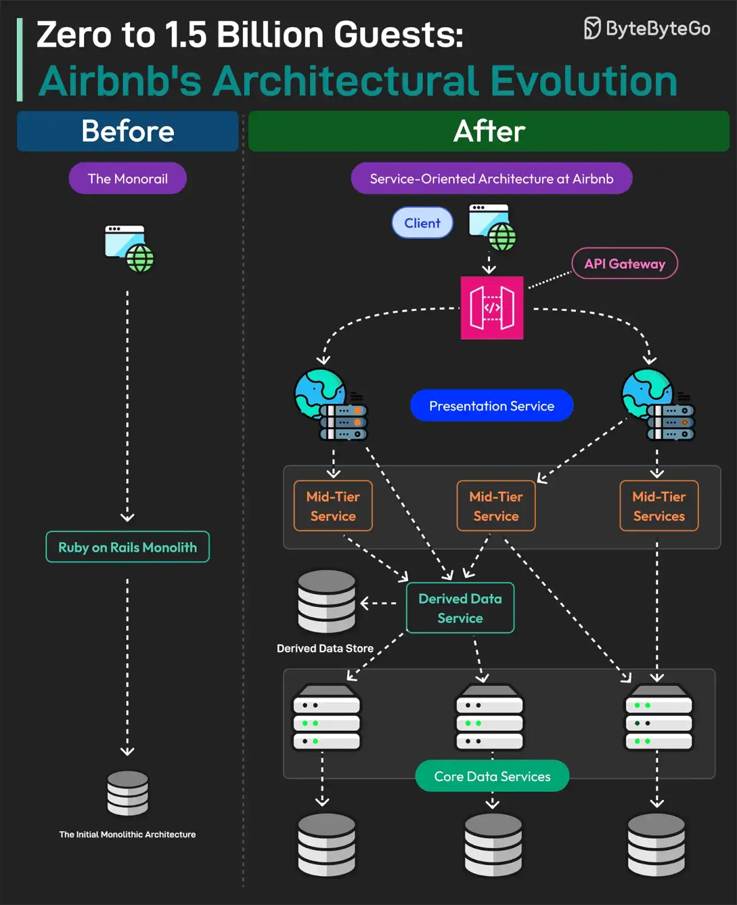

# 026 - Từ 0 đến 1,5 tỷ khách: sự tiến hóa kiến trúc của Airbnb

- Nguồn: ByteByteGo Big Archive System Design 2025
- Trang PDF: 57-58
- Ảnh minh họa: `../assets/026/figure-01.png`

## Hình minh họa

## Dịch sát

Airbnb hoạt động ở hơn 200 quốc gia và đã giúp 4 triệu host đón hơn 1,5 tỷ khách trên toàn thế giới.

Điều gì vận hành Airbnb ở mặt kỹ thuật?

Airbnb bắt đầu như một ứng dụng monolithic. Nó được xây dựng bằng Ruby-on-Rails và nội bộ được gọi là Monorail.

Monolith là một đơn vị single-tier chịu trách nhiệm cho cả chức năng phía client và server-side.

Tuy nhiên, khi Airbnb bước vào giai đoạn hypergrowth, Monorail bắt đầu gặp vấn đề. Đây là lúc họ bắt đầu hành trình migration từ monolithic sang Service-Oriented Architecture.

Với Airbnb, SOA là một network gồm các service loose-coupled, trong đó client gửi request tới gateway và gateway route các request này tới nhiều service và database.

Nhiều loại service khác nhau đã được xây dựng, chẳng hạn:

1. Data Service: đây là layer dưới cùng và đóng vai trò entry point cho mọi read và write operation trên các data entity.

2. Derived Data Service: các service này đọc từ data service và áp dụng business logic cơ bản.

3. Middle Tier Service: chúng quản lý business logic quan trọng không phù hợp để đặt ở data service level hoặc derived data service level.

4. Presentation Service: chúng aggregate dữ liệu từ tất cả service khác và cũng áp dụng một số frontend-specific business logic.

Sau migration, Monorail bị loại bỏ và tất cả read/write được migrate sang các service mới.

## Dịch nội dung trong hình

- `Before - The Monorail`: kiến trúc monolith ban đầu, Ruby on Rails Monolith xử lý nhiều trách nhiệm trong một khối.
- `After - Service-Oriented Architecture of Airbnb`: client đi qua API Gateway, request được route tới nhiều service.
- `Presentation Service`: tổng hợp dữ liệu phục vụ client/frontend.
- `Mid-Tier Service`: xử lý business logic ở tầng giữa.
- `Derived Data Service`: đọc từ core data service và tạo dữ liệu phái sinh.
- `Core Data Services`: lớp service cốt lõi cho read/write entity.
- Hình nhấn mạnh sự chuyển dịch từ monolith ban đầu sang nhiều service tách lớp.

## Tóm tắt & giải thích dễ hiểu

Airbnb là ví dụ điển hình về tiến hóa kiến trúc theo quy mô. Monolith ban đầu giúp phát triển nhanh vì đơn giản, ít overhead và dễ deploy khi team còn nhỏ. Nhưng khi sản phẩm tăng trưởng mạnh, cùng một codebase và một deployment unit bắt đầu gây bottleneck về ownership, release, scalability và maintainability.

SOA tách hệ thống thành nhiều service loose-coupled. Airbnb không chỉ tách service theo tên nghiệp vụ, mà còn phân lớp rõ: data service cho entity read/write, derived data service cho dữ liệu phái sinh, middle-tier service cho business logic phức tạp và presentation service cho tổng hợp dữ liệu phục vụ client.

Điểm quan trọng là migration khỏi monolith nên diễn ra có chiến lược. Không phải cứ thấy monolith là xấu. Monolith tốt ở giai đoạn đầu; service-oriented/microservices tốt hơn khi scale tổ chức và hệ thống thật sự cần.

## Ví dụ thực tế - không nằm trong tài liệu gốc

Một hệ thống đặt phòng nhỏ có thể bắt đầu bằng Laravel/Rails monolith: user, listing, booking, payment nằm chung. Khi traffic và team tăng, có thể tách `booking-service`, `payment-service`, `listing-service`, `search-service`. API Gateway hoặc BFF gom dữ liệu trả về cho web/mobile.

Nếu tách service quá sớm, team phải trả giá cho distributed tracing, network failure, schema versioning, deployment coordination và data consistency trước khi có lợi ích thật sự.

## Thuật ngữ chính

- `Monolith`: ứng dụng một khối, nhiều chức năng trong một deployment unit.
- `SOA`: Service-Oriented Architecture, kiến trúc hướng service.
- `Loose coupling`: service phụ thuộc lỏng lẻo để thay đổi độc lập hơn.
- `Gateway`: lớp nhận request và route tới service phù hợp.
- `Presentation service`: service tổng hợp dữ liệu theo nhu cầu client/UI.
- `Migration`: quá trình chuyển kiến trúc/hệ thống từ mô hình cũ sang mới.

## Câu hỏi ôn tập + trả lời + thinking học tập + liên hệ

> Đây là phần học tập thêm ở cuối file. Câu hỏi ưu tiên lấy từ tài liệu gốc và được trả lời trực tiếp; nếu bài không có câu hỏi riêng thì dùng tiêu đề/nội dung chính để tạo câu hỏi tự kiểm tra.

### Câu hỏi 1

**Nguồn câu hỏi:** Suy ra từ tiêu đề/nội dung chính vì bài gốc không có câu hỏi riêng.

**Câu hỏi:** Sau khi đọc bài “0 to 1.5 Billion Guests: Airbnb's Architectural Evolution”, ý chính cần trả lời và áp dụng vào system design là gì?

**Trả lời:** Sau bài này, phần đáng nhớ nhất là: Airbnb là ví dụ điển hình về tiến hóa kiến trúc theo quy mô. Monolith ban đầu giúp phát triển nhanh vì đơn giản, ít overhead và dễ deploy khi team còn nhỏ. Nhưng khi sản phẩm tăng trưởng mạnh, cùng một codebase và một deployment unit bắt đầu gây bottleneck về ownership, release, scalability và maintainability. Khi áp dụng vào hệ thống thật, hãy kiểm thêm quality, latency, cost/token, privacy, cập nhật tri thức và rủi ro hallucination.

**Thinking học tập + liên hệ:** Khi học `Từ 0 đến 1,5 tỷ khách: sự tiến hóa kiến trúc của Airbnb`, hãy thử viết một checklist áp dụng vào project: input, output, owner, rủi ro và metric kiểm chứng. Lens chính là quality, latency, cost/token, privacy, cập nhật tri thức và rủi ro hallucination. Khi build AI app, hãy nối model với pipeline thật: data vào đâu, context lấy từ đâu, output được kiểm thế nào và chi phí tăng theo traffic ra sao. Khi ghi chú lại, hãy giải thích được các keyword: `Monolith`, `SOA`, `Loose coupling`, `Gateway`, `Presentation service`.
