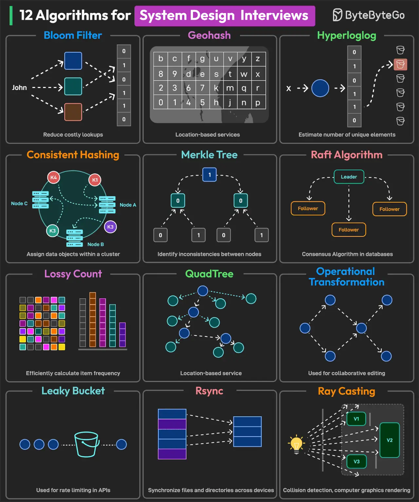

# 027 - 12 thuật toán cho phỏng vấn System Design

- Nguồn: ByteByteGo Big Archive System Design 2025
- Trang PDF: 59-60
- Ảnh minh họa: `../assets/027/figure-01.png`

## Hình minh họa

## Dịch sát

1. Bloom Filter: kiểm tra một item được request có nằm trong cache không trước khi thực hiện disk operation.

2. Geohash: dùng để xây dựng các location-based service.

3. HyperLogLog: đếm số query unique được user thực hiện trong search.

4. Consistent Hashing: dùng để phân phối dữ liệu hiệu quả giữa các node trong cluster.

5. Merkle Tree: dùng để phát hiện inconsistency giữa các data replica trên nhiều node.

6. Raft Algorithm: dùng để đạt consensus trên log replication.

7. Lossy Count: phân tích network traffic, web analytics và xác định heavy hitters.

8. QuadTree: dùng để xây dựng các location-based service.

9. Operational Transformation: dùng để hỗ trợ collaborative editing system.

10. Leaky Bucket: dùng cho rate limiting.

11. Rsync: đồng bộ file và directory giữa hai hệ thống khác nhau.

12. Ray Casting: dùng cho geospatial analysis, collision detection trong video game và computer graphics.

Câu hỏi dành cho bạn: Bạn sẽ thêm thuật toán nào khác vào danh sách?

## Dịch nội dung trong hình

- `Bloom Filter`: giảm costly lookup bằng cách kiểm tra khả năng tồn tại của item.
- `Geohash`: phục vụ location-based services.
- `HyperLogLog`: ước lượng số phần tử unique.
- `Consistent Hashing`: gán dữ liệu vào object/node trong cluster.
- `Merkle Tree`: phát hiện inconsistency giữa node.
- `Raft Algorithm`: consensus algorithm trong database/distributed systems.
- `Lossy Count`: tính tần suất item hiệu quả.
- `QuadTree`: service dựa trên location.
- `Operational Transformation`: dùng cho collaborative editing.
- `Leaky Bucket`: rate limiting trong API.
- `Rsync`: đồng bộ file và directory giữa nhiều device.
- `Ray Casting`: collision detection và computer graphics rendering.

## Tóm tắt & giải thích dễ hiểu

Các thuật toán này xuất hiện nhiều trong system design vì chúng giải quyết những bài toán hạ tầng rất thực tế: kiểm tra membership nhanh, tìm kiếm theo vị trí, đếm unique ở quy mô lớn, phân phối dữ liệu qua cluster, đồng bộ replica, consensus, rate limiting và collaborative editing.

Điểm cần học không phải là chứng minh toán học chi tiết của từng thuật toán, mà là biết thuật toán nào giải quyết loại vấn đề nào và trade-off ra sao. Ví dụ Bloom Filter rất nhanh và tiết kiệm memory nhưng có false positive. HyperLogLog đếm unique gần đúng, không chính xác tuyệt đối. Consistent Hashing giảm lượng data phải remap khi thêm/bớt node.

## Ví dụ thực tế - không nằm trong tài liệu gốc

Một CDN hoặc distributed cache có thể dùng consistent hashing để quyết định key nào nằm trên node nào. Khi thêm một cache node mới, chỉ một phần key cần chuyển chỗ thay vì remap toàn bộ.

Một search engine lớn có thể dùng HyperLogLog để ước lượng số user unique đã search một keyword trong ngày mà không cần lưu toàn bộ user id trong memory.

## Thuật ngữ chính

- `False positive`: thuật toán báo có thể tồn tại dù thực tế không tồn tại.
- `Consensus`: cơ chế nhiều node thống nhất cùng một trạng thái/log.
- `Replica`: bản sao dữ liệu.
- `Heavy hitter`: item xuất hiện với tần suất rất cao.
- `Rate limiting`: giới hạn tốc độ request.
- `Collaborative editing`: nhiều người cùng sửa tài liệu realtime.

## Câu hỏi ôn tập + trả lời + thinking học tập + liên hệ

> Đây là phần học tập thêm ở cuối file. Câu hỏi ưu tiên lấy từ tài liệu gốc và được trả lời trực tiếp; nếu bài không có câu hỏi riêng thì dùng tiêu đề/nội dung chính để tạo câu hỏi tự kiểm tra.

### Câu hỏi 1

**Nguồn câu hỏi:** Câu hỏi trong tài liệu gốc.

**Câu hỏi:** Bạn sẽ thêm thuật toán nào khác vào danh sách?

**Trả lời:** Phần còn thiếu đáng cân nhắc là `A* Search` cho tìm đường có heuristic trong bản đồ/game; `BFS/DFS` cho crawler, dependency graph và duyệt quan hệ; `Consistent Hashing` để phân phối key ổn định trong cache/database cluster; và `Bloom Filter` để kiểm tra membership nhanh với bộ nhớ thấp. Các mục này giúp bức tranh đầy đủ hơn vì chúng chạm vào phần triển khai/vận hành mà bài gốc chưa đi sâu. Ý chính đang có của bài là: Các thuật toán này xuất hiện nhiều trong system design vì chúng giải quyết những bài toán hạ tầng rất thực tế: kiểm tra membership nhanh, tìm kiếm theo vị trí, đếm unique ở quy mô lớn, phân phối dữ liệu qua cluster, đồng bộ replica, consensus, rate limiting và collaborative editing.

**Thinking học tập + liên hệ:** Danh sách trong `12 thuật toán cho phỏng vấn System Design` nên được kiểm theo coverage: nó đã nói phần nào, thiếu phần nào và phần thiếu có làm thay đổi quyết định thiết kế không. Lens chính là loại dữ liệu, kích thước input, latency mục tiêu, memory budget và sai số/lỗi có thể chấp nhận. Trong project thật, thuật toán thường ẩn sau search, cache, ranking, routing, queue hoặc storage; hiểu nó giúp dự đoán bottleneck trước khi hệ thống lớn lên. Khi ghi chú lại, hãy giải thích được các keyword: `False positive`, `Consensus`, `Replica`, `Heavy hitter`, `Rate limiting`.
