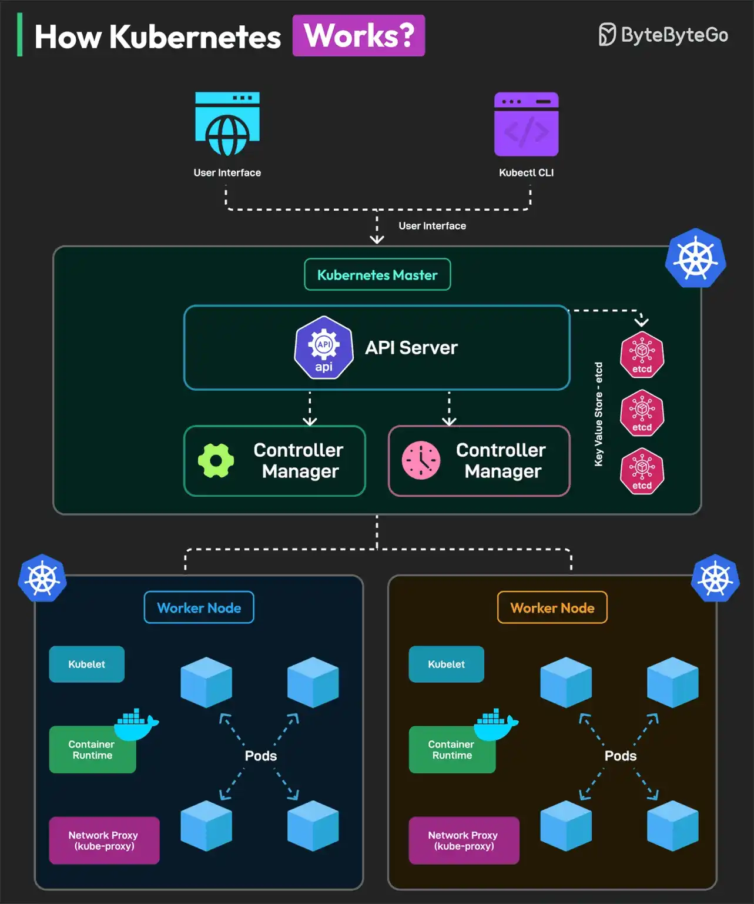

# 028 - Kubernetes hoạt động như thế nào?

- Nguồn: ByteByteGo Big Archive System Design 2025
- Trang PDF: 61-62
- Ảnh minh họa: `../assets/028/figure-01.png`

## Hình minh họa

## Dịch sát

Kubernetes, hay K8S, là một nền tảng container orchestration open-source, ban đầu được phát triển bởi Google và hiện được duy trì bởi Cloud Native Computing Foundation, viết tắt là CNCF.

Dưới đây là cách developer tương tác với Kubernetes:

1. Developer tạo các manifest file mô tả application.

2. Kubernetes lấy các manifest file này, validate chúng và deploy application trên cluster gồm các worker node.

3. Kubernetes quản lý toàn bộ lifecycle của application.

Kubernetes được tạo thành từ hai component chính:

1. Control Plane: nó giống như bộ não của Kubernetes và gồm các phần sau:

   - API Server: nhận mọi incoming request từ user hoặc CLI.

   - Scheduler: quyết định nơi chạy pod mới dựa trên resource availability và constraints.

   - Controller Manager: đảm bảo desired state của cluster khớp với actual state.

   - Etcd: key-value store nơi Kubernetes giữ toàn bộ dữ liệu của nó, bao gồm configuration, cluster state và desired state của application.

2. Worker Nodes: đây là các worker trong cluster. Mỗi node có các sub-component sau:

   - Kubelet: worker chính trên mỗi node. Nó giao tiếp với API server, nhận instruction và đảm bảo container đang chạy như kỳ vọng.

   - Kube-proxy: xử lý networking trên mỗi node.

   - Container runtime.

Câu hỏi dành cho bạn: Bạn đã dùng Kubernetes trong project của mình chưa?

## Dịch nội dung trong hình

- `User Interface`: người dùng hoặc tool thao tác với cluster.
- `kubectl CLI`: command-line tool để gửi request tới Kubernetes API.
- `Kubernetes Master`: control plane của cluster.
- `API Server`: điểm vào trung tâm cho mọi thao tác với cluster.
- `Scheduler`: xếp pod lên worker node phù hợp.
- `Controller Manager`: reconcile actual state về desired state.
- `etcd`: database key-value lưu trạng thái cluster.
- `Worker Node`: node chạy workload thật.
- `Kubelet`: agent trên worker node.
- `Container Runtime`: runtime chạy container.
- `Network Proxy / kube-proxy`: xử lý network routing/service proxy trên node.
- `Pods`: đơn vị deploy nhỏ nhất trong Kubernetes, chứa một hoặc nhiều container.

## Tóm tắt & giải thích dễ hiểu

Kubernetes hoạt động theo mô hình desired state. Developer khai báo “tôi muốn hệ thống trông như thế này” trong manifest, ví dụ deployment có 3 replica. Kubernetes control plane nhận cấu hình đó, lưu trạng thái vào etcd, scheduler chọn node để chạy pod, kubelet trên node tạo container, controller liên tục kiểm tra để đảm bảo actual state khớp desired state.

Nếu một pod chết, controller phát hiện actual state thiếu replica và yêu cầu tạo pod mới. Nếu muốn scale từ 3 lên 10 replica, developer cập nhật manifest hoặc chạy lệnh scale; Kubernetes tự điều phối thêm pod lên worker node phù hợp.

Kubernetes mạnh vì automation, self-healing, service discovery, rolling update và scaling. Nhưng nó cũng phức tạp: cần hiểu networking, storage, resource limit, deployment strategy, observability và security.

## Ví dụ thực tế - không nằm trong tài liệu gốc

Một API Node.js chạy production có thể được khai báo bằng `Deployment` với 4 replica, `Service` để expose nội bộ, `Ingress` để nhận traffic từ ngoài, `ConfigMap` cho config thường, `Secret` cho credential và `HorizontalPodAutoscaler` để tăng replica khi CPU cao.

Nếu một node bị lỗi, Kubernetes có thể reschedule pod sang node khác, miễn là cluster còn đủ resource.

## Thuật ngữ chính

- `Manifest`: file YAML/JSON khai báo resource Kubernetes.
- `Pod`: đơn vị chạy workload nhỏ nhất trong Kubernetes.
- `Control plane`: nhóm component quản lý cluster.
- `Worker node`: máy chạy pod/container.
- `etcd`: key-value store lưu trạng thái cluster.
- `Reconciliation`: quá trình đưa actual state về desired state.
- `Container runtime`: runtime thực thi container, ví dụ containerd.
