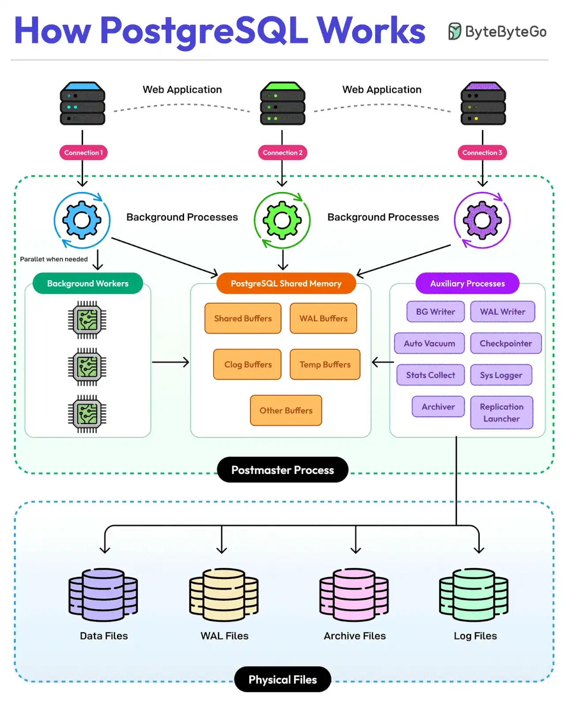

# 029 - PostgreSQL 101: database “làm được mọi thứ”

- Nguồn: ByteByteGo Big Archive System Design 2025
- Trang PDF: 63-64
- Ảnh minh họa: `../assets/029/figure-01.png`

## Hình minh họa

## Dịch sát

Được xây dựng bằng ngôn ngữ C, PostgreSQL là lựa chọn database phổ biến nhất từ các web app nhỏ đến enterprise system. Nó chạy như một multiprocess system và tuân theo các nguyên tắc ACID.

Các điểm chính về kiến trúc PostgreSQL như sau:

1. PostgreSQL hỗ trợ các concurrent client connection một cách độc lập. Mỗi client connection tới PostgreSQL tạo ra một dedicated server process.

2. Postmaster Process là supervisor chính quản lý tất cả PostgreSQL process khác. Nó kiểm soát toàn bộ database instance.

3. Background workers chạy các process song song khi cần để xử lý những task chuyên biệt.

4. PostgreSQL shared memory là vùng nhớ trung tâm chứa nhiều buffer như Shared, WAL, Clog và Temporary buffers. Tất cả component giao tiếp thông qua shared memory này.

5. PostgreSQL cũng có một số auxiliary process như:

   - BG Writer: quản lý background writing.
   - WAL Writer: xử lý write-ahead logging.
   - Auto Vacuum: duy trì sự “sạch sẽ” của database.
   - Checkpointer: đảm bảo data consistency.
   - Stats Collector: thu thập statistics.
   - System Logger: quản lý logging.
   - Archiver: xử lý archiving.
   - Replication launcher: quản lý replication.

6. PostgreSQL có nhiều loại physical file cho các nhu cầu khác nhau như:

   - Data Files: lưu dữ liệu database thực tế.
   - WAL Files: lưu write-ahead log.
   - Archive Files: dữ liệu backup và recovery.
   - Log Files: system log và error log.

Câu hỏi dành cho bạn: Bạn sẽ thêm gì khác để hiểu rõ hơn về kiến trúc PostgreSQL?

## Dịch nội dung trong hình

- `Web Application`: nhiều application/client kết nối tới PostgreSQL.
- `Connection#1/#2/#3`: mỗi connection có server process riêng.
- `Background Processes`: các process chạy nền.
- `Background Workers`: worker song song khi cần.
- `PostgreSQL Shared Memory`: vùng nhớ chung gồm shared buffers, WAL buffers, clog buffers, temp buffers và other buffers.
- `Auxiliary Processes`: BG Writer, WAL Writer, Auto Vacuum, Checkpointer, Stats Collector, Sys Logger, Archiver và Replication Launcher.
- `Postmaster Process`: process chính quản lý instance.
- `Physical Files`: data files, WAL files, archive files và log files.

## Tóm tắt & giải thích dễ hiểu

PostgreSQL dùng kiến trúc multiprocess. Khi client kết nối, PostgreSQL thường tạo một process riêng phục vụ connection đó. Các process này dùng shared memory để phối hợp với nhau và với các process nền.

WAL, Write-Ahead Log, là thành phần cực kỳ quan trọng. Trước khi thay đổi dữ liệu được ghi bền vững vào data file, PostgreSQL ghi log thay đổi vào WAL để hỗ trợ crash recovery và replication. Checkpointer, WAL writer, background writer và autovacuum phối hợp để giữ database ổn định, nhất quán và hiệu quả.

PostgreSQL được gọi vui là “everything database” vì ngoài relational database truyền thống, nó còn hỗ trợ JSON/JSONB, full-text search, extension, GIS qua PostGIS, queue pattern, vector search qua pgvector và nhiều workload khác.

## Ví dụ thực tế - không nằm trong tài liệu gốc

Nếu một hệ thống PostgreSQL chậm dần sau thời gian dài update/delete nhiều, nguyên nhân có thể liên quan đến MVCC và autovacuum. Row cũ không biến mất ngay; autovacuum cần dọn dead tuples. Nếu autovacuum cấu hình không phù hợp, table bloat tăng và query chậm.

Nếu cần HA, có thể dùng primary-replica replication. Primary nhận write, replica phục vụ read hoặc failover. Nhưng cần để ý replication lag nếu đọc ngay sau khi ghi.

## Thuật ngữ chính

- `ACID`: Atomicity, Consistency, Isolation, Durability.
- `Postmaster`: process chính quản lý PostgreSQL instance.
- `Shared buffers`: bộ nhớ cache page dữ liệu của PostgreSQL.
- `WAL`: Write-Ahead Log, log phục vụ durability, recovery và replication.
- `Autovacuum`: process dọn dead tuple và cập nhật statistics.
- `Checkpointer`: process flush dữ liệu bẩn ra disk theo checkpoint.
- `Replication`: sao chép dữ liệu sang node khác.

## Câu hỏi ôn tập + trả lời + thinking học tập + liên hệ

> Đây là phần học tập thêm ở cuối file. Câu hỏi ưu tiên lấy từ tài liệu gốc và được trả lời trực tiếp; nếu bài không có câu hỏi riêng thì dùng tiêu đề/nội dung chính để tạo câu hỏi tự kiểm tra.

### Câu hỏi 1

**Nguồn câu hỏi:** Câu hỏi trong tài liệu gốc.

**Câu hỏi:** Bạn sẽ thêm gì khác để hiểu rõ hơn về kiến trúc PostgreSQL?

**Trả lời:** Có thể thêm query plan/EXPLAIN để biết bottleneck thật; transaction isolation để tránh race condition và dirty read; connection pooling/backpressure để database không bị quá tải; và cache invalidation strategy rõ ràng. Các mục này giúp bức tranh đầy đủ hơn vì chúng chạm vào phần triển khai/vận hành mà bài gốc chưa đi sâu. Ý chính đang có của bài là: PostgreSQL dùng kiến trúc multiprocess. Khi client kết nối, PostgreSQL thường tạo một process riêng phục vụ connection đó. Các process này dùng shared memory để phối hợp với nhau và với các process nền. WAL, Write-Ahead Log, là thành phần cực kỳ quan trọng. Trước khi thay đổi dữ liệu được ghi bền vững vào data file, PostgreSQL ghi log thay đổi vào WAL để hỗ trợ crash recovery và replication. Checkpointer, WAL writer, background writer và autovacuum phối hợp để giữ database ổn định, nhất quán và hiệu quả.

**Thinking học tập + liên hệ:** Đừng thêm mục cho dài danh sách; với `PostgreSQL 101: database “làm được mọi thứ”`, chỉ thêm thứ mở ra một nhóm vấn đề mới hoặc giúp ra quyết định thiết kế tốt hơn. Lens chính là read/write ratio, consistency, cardinality, query pattern, growth rate và recovery requirement. Khi gặp bài toán dữ liệu, hãy nối bài học với truy vấn nóng nhất, index thật sự được dùng, cache nào có thể stale và thời gian restore sau sự cố. Khi ghi chú lại, hãy giải thích được các keyword: `ACID`, `Postmaster`, `Shared buffers`, `WAL`, `Autovacuum`.
