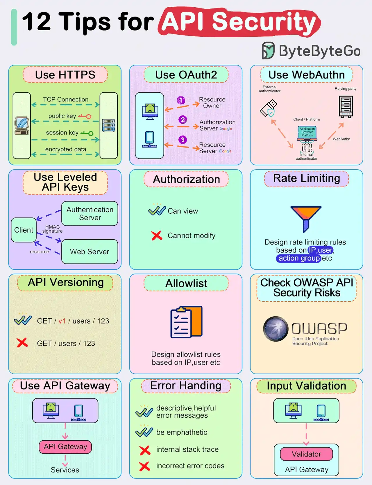

# 030 - 12 mẹo quan trọng để bảo mật API

- Nguồn: ByteByteGo Big Archive System Design 2025
- Trang PDF: 65-66
- Ảnh minh họa: `../assets/030/figure-01.png`

## Hình minh họa

## Dịch sát

- Dùng HTTPS.
- Dùng OAuth2.
- Dùng WebAuthn.
- Dùng API key theo nhiều cấp độ quyền.
- Authorization.
- Rate limiting.
- API versioning.
- Whitelisting.
- Kiểm tra OWASP API Security Risks.
- Dùng API Gateway.
- Error handling.
- Input validation.

## Dịch nội dung trong hình

- `Use HTTPS`: dùng HTTPS để mã hóa dữ liệu trên đường truyền.
- `Use OAuth2`: dùng OAuth2 để ủy quyền truy cập resource giữa client và resource server.
- `Use WebAuthn`: dùng WebAuthn cho xác thực mạnh, ví dụ passkey hoặc security key.
- `Use Leveled API Keys`: dùng API key theo cấp quyền khác nhau thay vì một key có toàn quyền.
- `Authorization`: phân quyền rõ hành động nào được xem, hành động nào không được sửa.
- `Rate Limiting`: thiết kế rule giới hạn request dựa trên IP, user action hoặc app.
- `API Versioning`: version API rõ ràng, ví dụ `GET /v1/users/123` thay vì endpoint không có version.
- `Allowlist`: thiết kế rule allowlist dựa trên IP, user hoặc tiêu chí khác.
- `Check OWASP API Security Risks`: kiểm tra các rủi ro bảo mật API theo OWASP.
- `Use API Gateway`: dùng API Gateway làm lớp kiểm soát chung trước services.
- `Error Handling`: trả error message mô tả đủ hữu ích và có thiện chí; tránh lộ internal stack trace và tránh trả sai error code.
- `Input Validation`: validate input trước khi request đi sâu vào backend.

## Tóm tắt & giải thích dễ hiểu

Bài này trùng chủ đề với bài 005 và nhắc lại các lớp bảo vệ quan trọng cho API production. API security nên được thiết kế theo nhiều lớp: bảo vệ transport bằng HTTPS, xác thực bằng OAuth2/WebAuthn/API key, phân quyền bằng authorization, chống abuse bằng rate limiting, giảm surface lỗi bằng input validation và tránh lộ nội bộ qua error handling.

API Gateway có thể tập trung nhiều policy ở boundary của hệ thống, nhưng service phía sau vẫn cần kiểm tra các rule quan trọng của chính nó. Đặc biệt với operation nhạy cảm như thanh toán, hoàn tiền, đổi quyền user hoặc truy cập dữ liệu cá nhân, không nên chỉ tin vào một lớp bảo vệ duy nhất.

## Ví dụ thực tế - không nằm trong tài liệu gốc

Một API admin `DELETE /v1/users/{id}` nên yêu cầu HTTPS, token hợp lệ, quyền admin cụ thể, audit log, rate limit thấp, validate `id`, kiểm tra user mục tiêu có được phép xóa không và trả error an toàn. Nếu request bị chặn, response không nên tiết lộ user có tồn tại hay không nếu điều đó tạo rủi ro enumeration.

## Thuật ngữ chính

- `HTTPS`: HTTP chạy qua TLS.
- `OAuth2`: framework ủy quyền truy cập.
- `WebAuthn`: chuẩn xác thực mạnh bằng passkey/security key.
- `API key`: khóa định danh client/app gọi API.
- `Rate limiting`: giới hạn tần suất request.
- `OWASP API Security`: danh sách rủi ro bảo mật API phổ biến.
- `Input validation`: kiểm tra input trước khi xử lý nghiệp vụ.

## Câu hỏi ôn tập + trả lời + thinking học tập + liên hệ

> Đây là phần học tập thêm ở cuối file. Câu hỏi ưu tiên lấy từ tài liệu gốc và được trả lời trực tiếp; nếu bài không có câu hỏi riêng thì dùng tiêu đề/nội dung chính để tạo câu hỏi tự kiểm tra.

### Câu hỏi 1

**Nguồn câu hỏi:** Suy ra từ tiêu đề/nội dung chính vì bài gốc không có câu hỏi riêng.

**Câu hỏi:** Sau khi đọc bài “Top 12 Tips for API Security”, ý chính cần trả lời và áp dụng vào system design là gì?

**Trả lời:** Nếu rút thành checklist thiết kế thì ý chính là: Bài này trùng chủ đề với bài 005 và nhắc lại các lớp bảo vệ quan trọng cho API production. API security nên được thiết kế theo nhiều lớp: bảo vệ transport bằng HTTPS, xác thực bằng OAuth2/WebAuthn/API key, phân quyền bằng authorization, chống abuse bằng rate limiting, giảm surface lỗi bằng input validation và tránh lộ nội bộ qua error handling. Khi áp dụng vào hệ thống thật, hãy kiểm thêm actor, trust boundary, dữ liệu nhạy cảm, lifetime của token/key, quyền truy cập và cơ chế revoke.

**Thinking học tập + liên hệ:** Khi học `12 mẹo quan trọng để bảo mật API`, hãy thử viết một checklist áp dụng vào project: input, output, owner, rủi ro và metric kiểm chứng. Lens chính là actor, trust boundary, dữ liệu nhạy cảm, lifetime của token/key, quyền truy cập và cơ chế revoke. Khi làm API thật, một endpoint chạy được chưa đủ; phải kiểm thêm abuse, audit log, error leakage, rate limit và quyền ở service chứa dữ liệu. Khi ghi chú lại, hãy giải thích được các keyword: `HTTPS`, `OAuth2`, `WebAuthn`, `API key`, `Rate limiting`.
