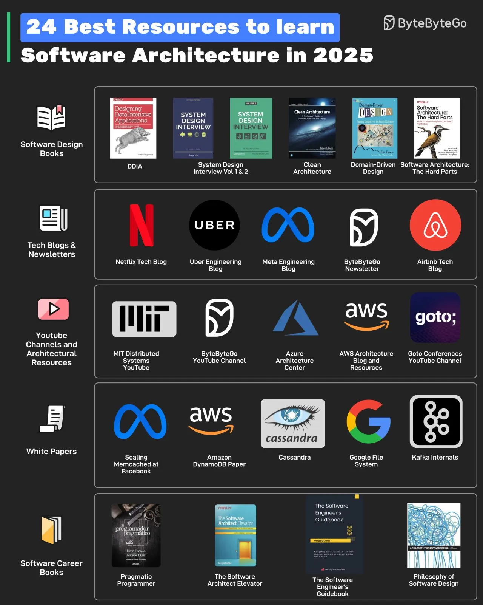

# 031 - 24 tài nguyên tốt để học Software Architecture trong năm 2025

- Nguồn: ByteByteGo Big Archive System Design 2025
- Trang PDF: 67-68
- Ảnh minh họa: `../assets/031/figure-01.png`

## Hình minh họa

## Dịch sát

Các tài nguyên có thể được chia thành nhiều loại khác nhau như:

1. Software Design Books

   Một số sách có thể giúp ích là DDIA, System Design Volume 1 & 2, Clean Architecture, Domain-Driven Design và Software Architecture: The Hard Parts.

2. Tech Blogs and Newsletters

   Đọc các technical blog của những công ty như Netflix, Uber, Meta và Airbnb. Ngoài ra, newsletter ByteByteGo cung cấp insight về software design mỗi tuần.

3. YouTube Channels and Architectural Resources

   Các kênh YouTube như MIT Distributed Systems, Goto Conferences và ByteByteGo có thể giúp học software architecture và system design. Azure Architecture Center và AWS Architecture Blog là những tài nguyên quan trọng khác.

4. WhitePapers

   Để có insight sâu hơn, hãy đọc whitepaper như Facebook Memcache Scaling, Cassandra, Amazon DynamoDB, Kafka và Google File System.

5. Software Career Books

   Một Software Architect cũng cần phát triển kỹ năng toàn diện. Các sách về khía cạnh career trong phần mềm như Pragmatic Programmer, The Software Architect Elevator, The Software Engineer's Guidebook và Philosophy of Software Design có thể giúp ích.

Câu hỏi dành cho bạn: Bạn sẽ thêm tài nguyên nào khác vào danh sách?

## Dịch nội dung trong hình

- `Software Design Books`: DDIA, System Design Interview Volume 1 & 2, Clean Architecture, Domain-Driven Design và Software Architecture: The Hard Parts.
- `Tech Blogs & Newsletters`: Netflix Tech Blog, Uber Engineering Blog, Meta Engineering Blog, ByteByteGo Newsletter và Airbnb Tech Blog.
- `YouTube Channels and Architectural Resources`: MIT Distributed Systems YouTube, ByteByteGo YouTube Channel, Azure Architecture Center, AWS Architecture Blog and Resources và Goto Conferences YouTube Channel.
- `White Papers`: Scaling Memcached at Facebook, Amazon DynamoDB Paper, Cassandra, Google File System và Kafka Internals.
- `Software Career Books`: Pragmatic Programmer, The Software Architect Elevator, The Software Engineer's Guidebook và Philosophy of Software Design.

## Tóm tắt & giải thích dễ hiểu

Học software architecture cần kết hợp nhiều nguồn. Sách giúp xây nền tảng dài hạn. Tech blog giúp thấy bài toán thật ở quy mô lớn. YouTube và architecture center giúp hình dung pattern và dịch vụ cloud. Whitepaper giúp hiểu sâu các hệ thống kinh điển. Sách career giúp architect không chỉ giỏi kỹ thuật mà còn biết giao tiếp, ra quyết định và dẫn dắt trade-off.

Với system design, cách học tốt là đi từ nguyên lý đến case study. Đọc DDIA để hiểu dữ liệu và distributed systems. Đọc blog Netflix/Uber/Meta/Airbnb để thấy trade-off production. Đọc whitepaper để hiểu cơ chế bên trong. Sau đó tự vẽ lại kiến trúc và giải thích vì sao họ chọn như vậy.

## Ví dụ thực tế - không nằm trong tài liệu gốc

Một lộ trình thực dụng có thể là: đọc `Designing Data-Intensive Applications` cho nền tảng dữ liệu, theo dõi ByteByteGo để học diagram ngắn, đọc AWS/Azure Architecture Center để hiểu reference architecture, rồi đọc whitepaper DynamoDB/Kafka/GFS khi cần đào sâu distributed storage hoặc streaming.

Khi đọc tech blog, đừng chỉ copy kiến trúc của công ty lớn. Hãy hỏi: scale của họ là gì, constraint của họ là gì, team size ra sao, và bài toán của mình có thật sự giống họ không?

## Thuật ngữ chính

- `Software architecture`: cấu trúc cấp cao, boundary và trade-off của hệ thống.
- `Whitepaper`: tài liệu kỹ thuật chuyên sâu mô tả thiết kế hoặc nghiên cứu hệ thống.
- `Case study`: phân tích một hệ thống/tình huống thực tế.
- `Trade-off`: đánh đổi giữa nhiều mục tiêu như latency, cost, consistency, complexity.
- `Architect`: người định hướng cấu trúc kỹ thuật và quyết định thiết kế quan trọng.
