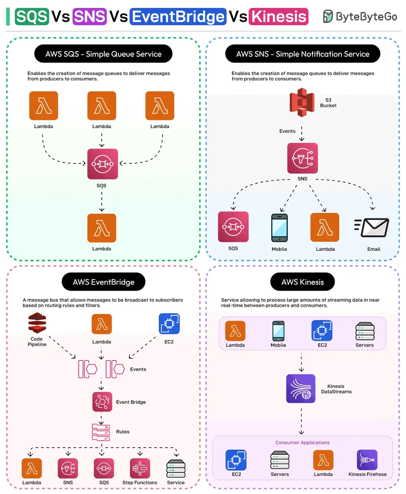

# 032 - SQS vs SNS vs EventBridge vs Kinesis

- Nguồn: ByteByteGo Big Archive System Design 2025
- Trang PDF: 69-70
- Ảnh minh họa: `../assets/032/figure-01.png`

## Hình minh họa

## Dịch sát

1. AWS SQS: đây là một fully managed message queuing service giúp decouple giao tiếp giữa các distributed component.

2. AWS SNS: một fully managed publish/subscribe messaging service dùng topic để gửi message tới nhiều subscriber hoặc endpoint, chẳng hạn email, Lambda, SQS, v.v.

3. AWS EventBridge: đây là một serverless event bus hỗ trợ route event giữa các AWS service và application dựa trên routing rule và filter cụ thể.

4. AWS Kinesis Data Streams: một real-time data streaming service thu thập, xử lý và phân tích dữ liệu gần real-time.

Làm sao chọn service nào để dùng?

Dưới đây là một số tip và ví dụ cơ bản:

- Với lượng event rất lớn như clickstream từ application, dùng Kinesis Data Stream.
- Với event được xử lý bởi một consumer duy nhất như job xử lý ảnh, SQS là lựa chọn tốt hơn.
- Để gửi message và notification, SNS là lựa chọn rất tốt.
- Với system event như user registration mới mà nhiều service phải nhận và phản ứng, dùng EventBridge.

Câu hỏi dành cho bạn: Bạn đã dùng SQS, SNS, EventBridge hoặc Kinesis chưa?

## Dịch nội dung trong hình

- `AWS SQS - Simple Queue Service`: tạo managed queue để chuyển message từ producer tới consumer; nhiều Lambda có thể gửi message vào SQS và một Lambda consumer xử lý.
- `AWS SNS - Simple Notification Service`: dùng topic để fan-out message tới nhiều subscriber như SQS, mobile, Lambda và email.
- `AWS EventBridge`: event bus route event dựa trên rule; event có thể đến từ code pipeline, Lambda, EC2 và đi tới Lambda, SNS, SQS, Step Functions hoặc service khác.
- `AWS Kinesis`: xử lý lượng lớn streaming data gần real-time giữa producer như Lambda/mobile/EC2/server và consumer application như EC2/server/Lambda/Kinesis Firehose.

## Tóm tắt & giải thích dễ hiểu

Bốn service này đều liên quan đến message/event nhưng phục vụ bài toán khác nhau. SQS là queue: producer gửi message, consumer lấy ra xử lý, phù hợp decouple và xử lý async. SNS là pub/sub topic: một message được broadcast tới nhiều subscriber. EventBridge là event bus có routing rule/filter mạnh hơn, phù hợp event-driven integration giữa nhiều service. Kinesis là data stream cho throughput lớn, thứ tự theo shard và xử lý gần real-time.

Chọn sai service dễ làm kiến trúc phức tạp. Nếu chỉ cần worker xử lý từng job, SQS đủ đơn giản. Nếu cần fan-out notification, SNS hợp hơn. Nếu cần nhiều hệ thống phản ứng theo rule domain event, EventBridge hợp hơn. Nếu cần ingest clickstream/log/event cực lớn liên tục, Kinesis hợp hơn.

## Ví dụ thực tế - không nằm trong tài liệu gốc

Upload ảnh đại diện: API nhận file, ghi metadata, đẩy job vào SQS, worker resize ảnh. Đăng ký user mới: publish event `UserRegistered` vào EventBridge để email service, analytics service và CRM integration cùng xử lý. Gửi thông báo outage tới email/SMS/mobile: dùng SNS. Thu thập clickstream từ app để phân tích realtime: dùng Kinesis.

## Thuật ngữ chính

- `Queue`: hàng đợi message, thường một message được một consumer xử lý.
- `Pub/Sub`: publish/subscribe, một message có thể tới nhiều subscriber.
- `Event bus`: bus trung tâm nhận và route event theo rule.
- `Fan-out`: gửi một message tới nhiều đích.
- `Streaming`: xử lý dòng dữ liệu liên tục.
- `Decoupling`: giảm phụ thuộc trực tiếp giữa component.
