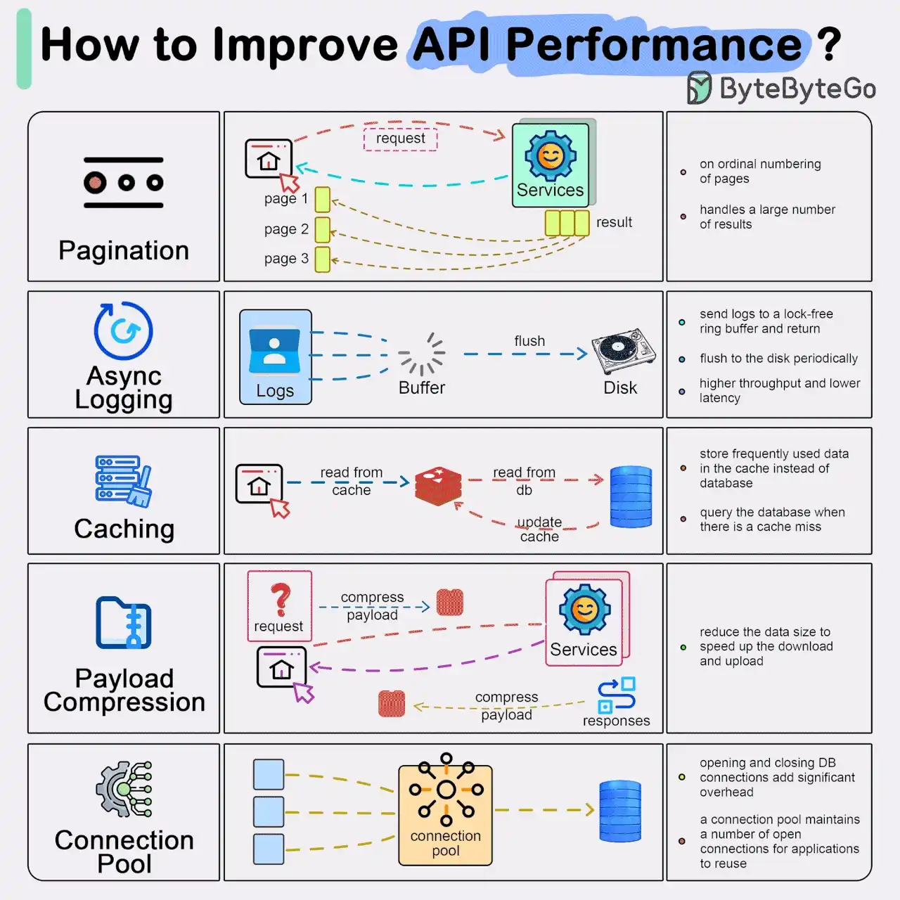

# 033 - 5 cách phổ biến để cải thiện hiệu năng API

- Nguồn: ByteByteGo Big Archive System Design 2025
- Trang PDF: 71-72
- Ảnh minh họa: `../assets/033/figure-01.png`

## Hình minh họa

## Dịch sát

Result Pagination:

Phương pháp này được dùng để tối ưu các result set lớn bằng cách stream chúng trả về client, cải thiện responsiveness của service và user experience.

Asynchronous Logging:

Cách tiếp cận này gửi log vào một lock-free buffer và return ngay lập tức, thay vì xử lý disk trong mỗi call. Log được flush định kỳ xuống disk, giảm đáng kể I/O overhead.

Data Caching:

Dữ liệu được truy cập thường xuyên có thể được lưu trong cache để tăng tốc retrieval. Client kiểm tra cache trước khi query database, với các giải pháp lưu trữ dữ liệu như Redis cung cấp truy cập nhanh hơn nhờ in-memory storage.

Payload Compression:

Để giảm thời gian truyền dữ liệu, request và response có thể được compress, ví dụ dùng gzip, giúp quá trình upload và download nhanh hơn.

Connection Pooling:

Kỹ thuật này dùng một pool các connection đang mở để quản lý tương tác với database, giúp giảm overhead liên quan đến việc mở và đóng connection mỗi lần cần load dữ liệu. Pool quản lý lifecycle của connection để sử dụng tài nguyên hiệu quả.

Câu hỏi dành cho bạn: Bạn dùng cách nào khác để cải thiện API performance?

## Dịch nội dung trong hình

- `Pagination`: đánh số/trả từng page kết quả; xử lý số lượng lớn result.
- `Async Logging`: gửi log vào buffer lock-free, flush xuống disk định kỳ, tăng throughput và giảm latency.
- `Caching`: đọc từ cache trước, đọc database khi cache miss và update cache.
- `Payload Compression`: nén payload request/response để giảm kích thước dữ liệu download/upload.
- `Connection Pool`: duy trì nhiều DB connection mở để tái sử dụng, tránh overhead mở/đóng connection liên tục.

## Tóm tắt & giải thích dễ hiểu

API performance thường bị ảnh hưởng bởi dữ liệu trả về quá lớn, I/O log đồng bộ, database bị đọc lặp lại, payload quá nặng và connection database tạo mới liên tục. Năm kỹ thuật trong bài xử lý đúng các điểm nghẽn đó.

Pagination giảm lượng dữ liệu mỗi response. Async logging tránh request path bị chặn bởi disk I/O. Cache giảm tải database và latency. Compression giảm băng thông cho payload lớn. Connection pooling giảm chi phí thiết lập kết nối database.

Tối ưu performance cần đo trước khi sửa. Không phải API nào cũng cần compression; với payload nhỏ, gzip có thể thêm CPU overhead không đáng. Cache cần TTL/invalidation đúng. Connection pool quá lớn có thể làm database quá tải.

## Ví dụ thực tế - không nằm trong tài liệu gốc

API `GET /orders` không nên trả 100.000 đơn trong một response. Nó nên dùng pagination hoặc cursor pagination. API đọc profile user nhiều lần có thể cache trong Redis với TTL ngắn. API trả JSON lớn cho mobile có thể bật gzip/br compression. Backend Node.js/Java/PHP nên dùng connection pool thay vì mở connection database mới cho từng request.

## Thuật ngữ chính

- `Pagination`: chia kết quả thành nhiều trang nhỏ.
- `Cursor pagination`: phân trang bằng cursor để ổn định hơn offset trong dataset lớn.
- `Lock-free buffer`: buffer giảm blocking khi nhiều thread/process ghi log.
- `Cache miss`: cache không có dữ liệu cần đọc.
- `Compression`: nén dữ liệu để giảm kích thước truyền tải.
- `Connection pool`: nhóm connection mở sẵn để tái sử dụng.
