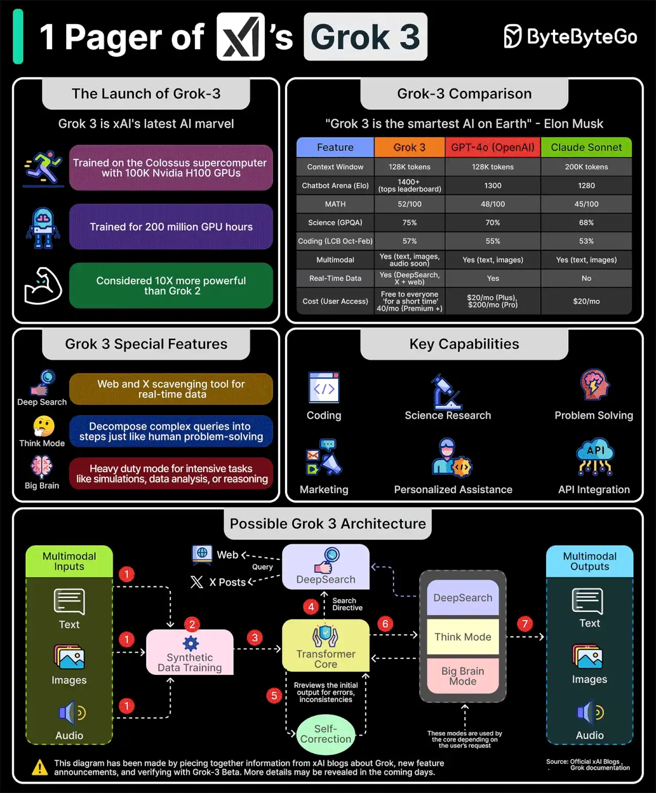

# 034 - Grok-3 của xAI trong một trang

- Nguồn: ByteByteGo Big Archive System Design 2025
- Trang PDF: 73-74
- Ảnh minh họa: `../assets/034/figure-01.png`

## Hình minh họa

## Dịch sát

Grok 3 được công bố vào ngày 17 tháng 2. Theo Elon Musk, nó là “AI thông minh nhất trên Trái Đất”.

Nhưng điều gì khiến nó mạnh như vậy?

Grok 3 được train trên siêu máy tính Colossus với 100K GPU Nvidia H100. Theo một thống kê, nó đã được train trong 200 triệu GPU hours. Các capability chính của Grok 3 là coding, science research, problem-solving, tạo marketing campaign, personalized assistance và API integration.

Một số feature đặc biệt của Grok 3 gồm:

1. DeepSearch: cho phép Grok search web và các X post để lấy dữ liệu và thông tin real-time.

2. Think Mode: phân rã query phức tạp thành các bước giống cách con người giải quyết vấn đề.

3. Big Brain Mode: chế độ heavy-duty cho các task nặng như simulation, data analysis hoặc reasoning.

Dưới đây là cách Grok 3 có thể hoạt động:

1. Grok 3 hỗ trợ multi-modal input. User có thể hỏi bằng text, upload image hoặc nói chuyện với Grok. Input được tokenize để bắt đầu xử lý.

2. Synthetic data training tăng cường khả năng diễn giải query.

3. Dữ liệu này được đưa vào core transformer model để phân tích input.

4. Core transformer phát hành một search directive tới DeepSearch để retrieve thông tin cần thiết từ web hoặc dữ liệu X real-time.

5. Tiếp theo, một self-correct process đảm bảo accuracy thông qua internal feedback loop.

6. Tùy theo input của user, Think Mode hoặc Big Brain Mode refine response theo yêu cầu. Nó có thể lại dùng DeepSearch để tìm thêm thông tin.

7. Câu trả lời được gửi tới user theo cách multimodal.

Lưu ý rằng các chi tiết này dựa trên việc ghép nối thông tin từ blog của xAI về Grok và các announcement feature mới. Có thể sẽ có thêm chi tiết được tiết lộ trong những ngày tới.

Câu hỏi dành cho bạn: Bạn đã dùng Grok 3 của xAI chưa?

## Dịch nội dung trong hình

- `The Launch of Grok-3`: Grok 3 là AI model mới nhất của xAI, train trên Colossus supercomputer với 100K Nvidia H100 GPU, 200 triệu GPU hours, được xem là mạnh hơn Grok 2.
- `Grok-3 Comparison`: bảng so sánh Grok 3 với GPT-4o và Claude Sonnet theo context window, chatbot arena, MATH, science, coding, multimodal, real-time data và cost.
- `Grok 3 Special Features`: DeepSearch, Think Mode và Big Brain Mode.
- `Key Capabilities`: coding, science research, problem solving, marketing, personalized assistance và API integration.
- `Possible Grok 3 Architecture`: multimodal input gồm text/image/audio, synthetic data training, transformer core, DeepSearch, self-correction, Think Mode/Big Brain Mode và multimodal output.

## Tóm tắt & giải thích dễ hiểu

Bài này mô tả Grok 3 như một model AI mạnh tập trung vào reasoning, multimodal input và khả năng truy xuất dữ liệu real-time qua DeepSearch. Điểm kiến trúc đáng chú ý là không chỉ có transformer core, mà còn có các module hỗ trợ như search, self-correction và mode reasoning chuyên sâu.

Theo tư duy system design AI, một AI product mạnh thường là một pipeline, không chỉ là model. Input phải được tokenize và chuẩn hóa; model có thể gọi search/retrieval; output có thể đi qua self-correction; sau đó response được format thành text, image hoặc audio. Các chế độ như Think Mode/Big Brain Mode có thể hiểu là trade-off giữa latency/cost và độ sâu reasoning.

## Ghi chú kỹ thuật - không nằm trong tài liệu gốc

Tài liệu gốc viết theo thời điểm Grok 3 mới được công bố, nên các mô tả “latest”, benchmark hoặc cost nên được hiểu là thông tin trong tài liệu tại thời điểm đó, không phải khẳng định cập nhật hiện tại.

## Ví dụ thực tế - không nằm trong tài liệu gốc

Một assistant phân tích thị trường có thể nhận câu hỏi bằng text, tìm dữ liệu mới qua web search, đọc biểu đồ người dùng upload, chạy reasoning nhiều bước, rồi trả lời bằng bảng và tóm tắt. Nếu câu hỏi đơn giản, dùng mode nhanh để giảm latency. Nếu câu hỏi cần phân tích sâu, dùng mode reasoning nặng hơn dù chi phí cao hơn.

## Thuật ngữ chính

- `GPU hour`: một giờ sử dụng một GPU, đơn vị đo chi phí training/compute.
- `Multimodal`: xử lý nhiều loại input/output như text, image, audio.
- `Synthetic data`: dữ liệu nhân tạo dùng để train hoặc fine-tune model.
- `Transformer`: kiến trúc neural network nền tảng của nhiều LLM.
- `Self-correction`: vòng tự kiểm tra/sửa để tăng độ chính xác.
- `Real-time retrieval`: truy xuất thông tin mới tại thời điểm trả lời.
