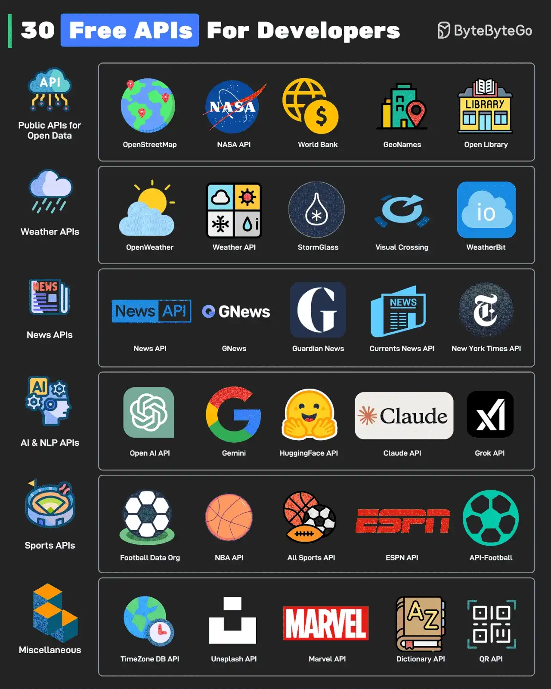

# 035 - 30 API miễn phí cho developer

- Nguồn: ByteByteGo Big Archive System Design 2025
- Trang PDF: 75-76
- Ảnh minh họa: `../assets/035/figure-01.png`

## Hình minh họa

## Dịch sát

API là xương sống của modern software development. Dù là hobby project hay real-world application, developer đều cần API. Những API này, một số hoàn toàn miễn phí và một số có free tier, có thể giúp khởi động quá trình development.

1. Public APIs for Open Data

   OpenStreetMap, NASA, World Bank, GeoNames và Open Library APIs cung cấp rất nhiều dữ liệu hữu ích.

2. Weather APIs

   OpenWeather, Weather API, StormGlass, Visual Crossing và WeatherBit là một số API để lấy thông tin liên quan đến thời tiết.

3. News APIs

   The News API, GNews, Guardian News, Current News API và New York Times API có thể giúp developer lấy tin tức mới nhất.

4. AI & NLP APIs

   OpenAI API, Gemini, HuggingFace API, Claude API và Grok API có thể giúp developer thử nghiệm với AI model và tool.

5. Sports API

   Football Data Org, NBA API, All Sports API, ESPN API và API-Football có thể giúp lấy thông tin liên quan đến thể thao.

6. Miscellaneous

   Một số API miscellaneous thú vị là TimeZone API, Unsplash API, Marvel API, Dictionary API và QR Generation API.

Câu hỏi dành cho bạn: Bạn sẽ thêm API nào khác vào danh sách?

## Dịch nội dung trong hình

- `Public APIs for Open Data`: OpenStreetMap, NASA API, World Bank, GeoNames và Open Library.
- `Weather APIs`: OpenWeather, Weather API, StormGlass, Visual Crossing và WeatherBit.
- `News APIs`: News API, GNews, Guardian News, Currents News API và New York Times API.
- `AI & NLP APIs`: OpenAI API, Gemini, HuggingFace API, Claude API và Grok API.
- `Sports APIs`: Football Data Org, NBA API, All Sports API, ESPN API và API-Football.
- `Miscellaneous`: TimeZone DB API, Unsplash API, Marvel API, Dictionary API và QR API.

## Tóm tắt & giải thích dễ hiểu

Danh sách này hữu ích cho developer muốn xây prototype nhanh. Thay vì tự tạo dữ liệu mẫu, bạn có thể dùng public API về bản đồ, thời tiết, tin tức, AI, thể thao, ảnh, từ điển hoặc QR code để thử ý tưởng sản phẩm.

Khi dùng API bên ngoài trong production, cần kiểm tra rate limit, SLA, quota, pricing, license dữ liệu, authentication, caching policy và fallback nếu API lỗi. Free tier rất tốt cho học tập và MVP, nhưng không nên phụ thuộc mù quáng vào free API cho luồng critical.

## Ví dụ thực tế - không nằm trong tài liệu gốc

Một app du lịch nhỏ có thể dùng OpenStreetMap cho bản đồ, OpenWeather cho thời tiết, Unsplash cho ảnh địa điểm, TimeZone API cho múi giờ và Gemini/OpenAI API để sinh gợi ý lịch trình. Để production ổn định, nên cache response thời tiết theo location trong vài phút và có fallback khi API provider downtime.

## Thuật ngữ chính

- `Public API`: API công khai cho developer bên ngoài sử dụng.
- `Free tier`: gói miễn phí có giới hạn quota/tính năng.
- `Rate limit`: giới hạn số request trong một khoảng thời gian.
- `Quota`: tổng mức sử dụng được cấp.
- `SLA`: Service Level Agreement, cam kết chất lượng dịch vụ.
- `Fallback`: phương án dự phòng khi dependency bên ngoài lỗi.
