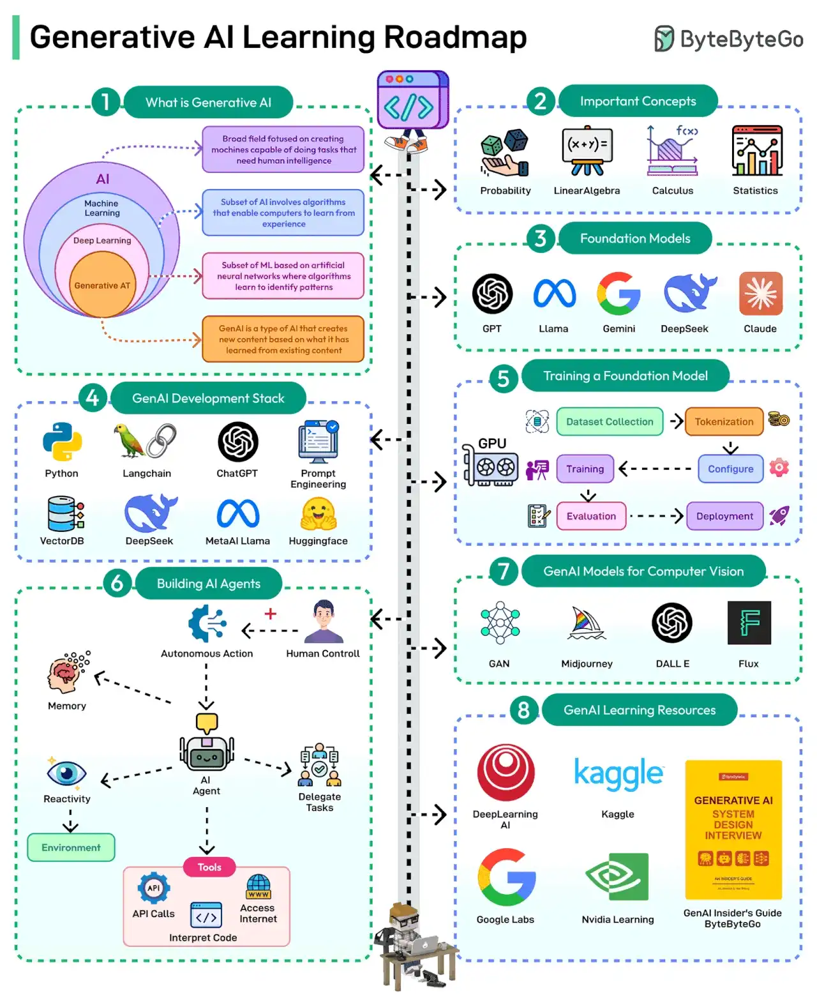

# 036 - Lộ trình học Generative AI

- Nguồn: ByteByteGo Big Archive System Design 2025
- Trang PDF: 77-78
- Ảnh minh họa: `../assets/036/figure-01.png`

## Hình minh họa

## Dịch sát

Generative AI là một loại AI có thể tạo nội dung mới dựa trên những gì nó đã học từ tri thức hiện có. Nó có tiềm năng cách mạng hóa việc học của con người.

Dưới đây là roadmap GenAI kèm learning resources:

1. Học các concept quan trọng như Probability, Statistics, Calculus và Linear Algebra.

2. Hiểu cách hoạt động của foundational model như GPT, Llama của MetaAI, Gemini, DeepSeek và Claude.

3. Học GenAI development stack gồm Python, LangChain, ChatGPT APIs, Prompt Engineering, VectorDB, DeepSeek, Llama và HuggingFace.

4. Học cách train và fine-tune một foundation model.

5. Hiểu vai trò của AI Agent và cách xây dựng một agent bằng GenAI tools.

6. Học về GenAI model cho computer vision như GAN, tức Generative Adversarial Networks, MidJourney, DALL E, Flux, v.v.

7. Tận dụng GenAI Learning Resources như nền tảng DeepLearning AI, Kaggle, Generative AI Insider's Guide của ByteByteGo, Google Labs và Nvidia Learning platforms.

Câu hỏi dành cho bạn: Bạn sẽ thêm gì khác vào GenAI learning roadmap?

## Dịch nội dung trong hình

- `What is Generative AI`: GenAI là nhánh AI có thể tạo nội dung mới dựa trên pattern học từ dữ liệu.
- `Important Concepts`: Probability, Linear Algebra, Calculus và Statistics.
- `Foundation Models`: GPT, Llama, Gemini, DeepSeek và Claude.
- `GenAI Development Stack`: Python, LangChain, ChatGPT, Prompt Engineering, VectorDB, DeepSeek, MetaAI Llama và HuggingFace.
- `Training a Foundation Model`: GPU, dataset collection, tokenization, training, configure, evaluation và deployment.
- `Building AI Agents`: memory, autonomous action, human control, reactivity, environment, delegate tasks và tools như API calls, interpret code, access Internet.
- `GenAI Models for Computer Vision`: GAN, Midjourney, DALL-E và Flux.
- `GenAI Learning Resources`: DeepLearning AI, Kaggle, GenAI Insider's Guide by ByteByteGo, Google Labs và Nvidia Learning.

## Tóm tắt & giải thích dễ hiểu

Roadmap này bắt đầu từ nền tảng toán và ML, rồi đi lên foundation model, development stack, fine-tuning, AI agents, computer vision và tài nguyên học tập. Với developer ứng dụng, không nhất thiết phải train foundation model từ đầu, nhưng cần hiểu các khái niệm để dùng API, RAG, embedding, vector database và agent đúng cách.

Học GenAI nên chia thành hai luồng: hiểu model và xây sản phẩm. Hiểu model gồm token, transformer, embedding, training, fine-tuning và evaluation. Xây sản phẩm gồm prompt engineering, retrieval/RAG, tool calling, guardrails, observability, cost control và deployment.

## Ví dụ thực tế - không nằm trong tài liệu gốc

Nếu mục tiêu là xây chatbot hỏi đáp tài liệu công ty, bạn nên học Python/TypeScript backend, embedding, vector database, RAG, prompt design, evaluation và security trước. Bạn chưa cần tự train LLM từ đầu. Nếu mục tiêu là nghiên cứu model, lúc đó mới cần đào sâu linear algebra, calculus, training loop, GPU và distributed training.

Một roadmap thực dụng cho developer là: học API LLM trước, xây RAG nhỏ, thêm evaluation, thêm tool calling/agent, rồi mới học fine-tuning khi RAG hoặc prompting không đủ.

## Thuật ngữ chính

- `Generative AI`: AI tạo nội dung mới như text, image, audio hoặc code.
- `Foundation model`: model lớn làm nền cho nhiều task khác nhau.
- `Prompt engineering`: thiết kế input để model trả output tốt hơn.
- `VectorDB`: database lưu và tìm kiếm embedding vector.
- `Fine-tuning`: huấn luyện thêm model trên dữ liệu/task cụ thể.
- `Evaluation`: đánh giá chất lượng output của model.
- `Guardrails`: rào chắn kiểm soát hành vi/rủi ro của AI system.

## Câu hỏi ôn tập + trả lời + thinking học tập + liên hệ

> Đây là phần học tập thêm ở cuối file. Câu hỏi ưu tiên lấy từ tài liệu gốc và được trả lời trực tiếp; nếu bài không có câu hỏi riêng thì dùng tiêu đề/nội dung chính để tạo câu hỏi tự kiểm tra.

### Câu hỏi 1

**Nguồn câu hỏi:** Câu hỏi trong tài liệu gốc.

**Câu hỏi:** Bạn sẽ thêm gì khác vào GenAI learning roadmap?

**Trả lời:** Phần còn thiếu đáng cân nhắc là evaluation harness để đo chất lượng thay vì cảm tính; guardrails/policy để giảm prompt injection và output nguy hiểm; observability cho prompt, context, latency, cost và hallucination; và model routing theo độ khó/cost của request. Các mục này giúp bức tranh đầy đủ hơn vì chúng chạm vào phần triển khai/vận hành mà bài gốc chưa đi sâu. Ý chính đang có của bài là: Roadmap này bắt đầu từ nền tảng toán và ML, rồi đi lên foundation model, development stack, fine-tuning, AI agents, computer vision và tài nguyên học tập. Với developer ứng dụng, không nhất thiết phải train foundation model từ đầu, nhưng cần hiểu các khái niệm để dùng API, RAG, embedding, vector database và agent đúng cách.

**Thinking học tập + liên hệ:** Danh sách trong `Lộ trình học Generative AI` nên được kiểm theo coverage: nó đã nói phần nào, thiếu phần nào và phần thiếu có làm thay đổi quyết định thiết kế không. Lens chính là quality, latency, cost/token, privacy, cập nhật tri thức và rủi ro hallucination. Khi build AI app, hãy nối model với pipeline thật: data vào đâu, context lấy từ đâu, output được kiểm thế nào và chi phí tăng theo traffic ra sao. Khi ghi chú lại, hãy giải thích được các keyword: `Generative AI`, `Foundation model`, `Prompt engineering`, `VectorDB`, `Fine-tuning`.
