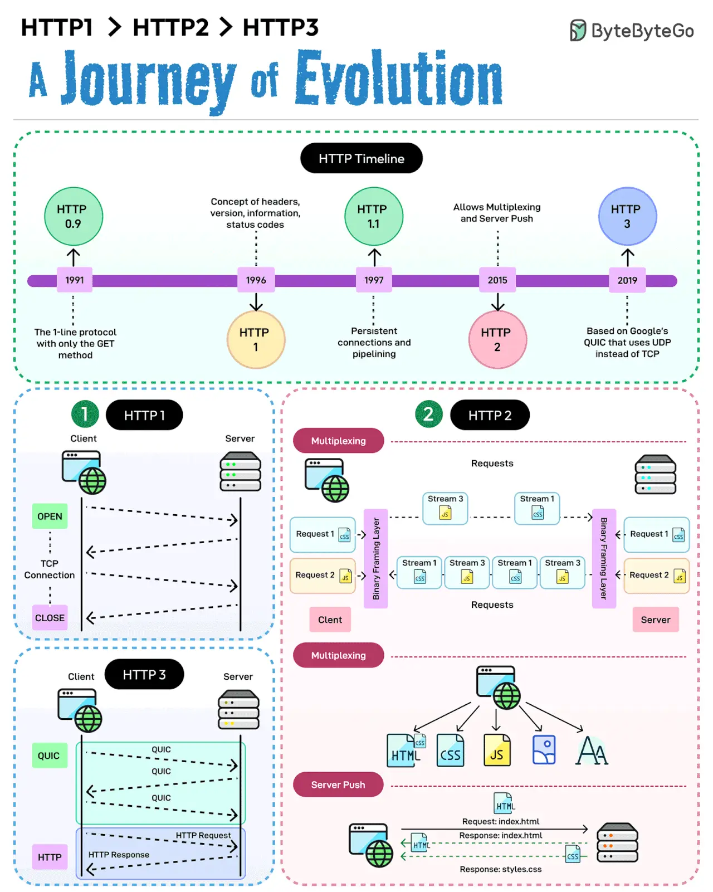

# 037 - HTTP/1 -> HTTP/2 -> HTTP/3

- Nguồn: ByteByteGo Big Archive System Design 2025
- Trang PDF: 79-80
- Ảnh minh họa: `../assets/037/figure-01.png`

## Hình minh họa

## Dịch sát

HTTP 1 bắt đầu vào năm 1996, sau đó HTTP 1.1 xuất hiện ngay năm tiếp theo. Năm 2015, HTTP 2 ra đời và năm 2019 chúng ta có HTTP 3.

Qua mỗi lần lặp, protocol này đã tiến hóa theo những cách mới và thú vị.

1. HTTP 1 và các sub-version của nó giới thiệu các feature như persistent connections, pipelining và khái niệm headers. Protocol này được xây dựng trên TCP và cung cấp một cách giao tiếp đáng tin cậy trên World Wide Web. Nó vẫn được sử dụng dù đã hơn 25 năm tuổi.

2. HTTP 2 mang đến các feature mới như multiplexing, stream prioritization, server push và HPACK compression. Tuy nhiên, nó vẫn dùng TCP làm protocol nền bên dưới.

3. HTTP 3 dùng QUIC của Google, được xây dựng trên UDP. Nói cách khác, HTTP 3 đã rời khỏi TCP.

Câu hỏi dành cho bạn: Bạn sẽ thêm gì để hiểu rõ hơn sự tiến hóa của HTTP qua các năm?

## Dịch nội dung trong hình

- `HTTP Timeline`: HTTP/0.9 năm 1991, HTTP/1 năm 1996, HTTP/1.1 năm 1997, HTTP/2 năm 2015 và HTTP/3 năm 2019.
- `HTTP 0.9`: mini-protocol chỉ với phương thức GET.
- `HTTP 1`: thêm header, version, information status code.
- `HTTP 1.1`: thêm persistent connection và pipelining.
- `HTTP 2`: cho phép multiplexing và server push.
- `HTTP 3`: dựa trên QUIC, dùng UDP thay vì TCP.
- `HTTP/1`: client mở TCP connection, gửi request/nhận response theo connection.
- `HTTP/2`: nhiều stream request/response cùng chia sẻ một connection nhờ multiplexing.
- `HTTP/3`: dùng QUIC trên UDP, giảm ảnh hưởng head-of-line blocking ở tầng TCP.

## Tóm tắt & giải thích dễ hiểu

HTTP tiến hóa để giải quyết các bottleneck khi web ngày càng phức tạp. HTTP/1.1 cải thiện HTTP/1 bằng persistent connection, giúp không phải mở connection mới cho từng request. HTTP/2 thêm multiplexing để nhiều request đi song song trên một TCP connection và dùng HPACK để nén header. HTTP/3 chuyển sang QUIC trên UDP để cải thiện latency, connection migration và giảm một số vấn đề của TCP.

Điểm quan trọng là HTTP/3 không có nghĩa “UDP không đáng tin cậy nên HTTP/3 không đáng tin cậy”. QUIC tự xây reliability, congestion control và TLS integration ở tầng trên UDP. Mục tiêu là giữ lợi ích reliability nhưng linh hoạt hơn TCP truyền thống.

## Ví dụ thực tế - không nằm trong tài liệu gốc

Một website tải nhiều file JS/CSS/image nhỏ trên HTTP/1.1 dễ gặp giới hạn số connection và head-of-line blocking. HTTP/2 giúp multiplex nhiều request qua một connection, giảm overhead. Với mobile network hay đổi mạng giữa WiFi và 4G, HTTP/3/QUIC có thể reconnect/migrate tốt hơn trong một số trường hợp.

Khi tối ưu production, bạn không chỉ bật HTTP/2/3 là xong. Vẫn cần CDN, caching, compression, giảm bundle size và ưu tiên tài nguyên quan trọng.

## Thuật ngữ chính

- `Persistent connection`: tái sử dụng connection cho nhiều request.
- `Pipelining`: gửi nhiều request trước khi response trước đó hoàn tất.
- `Multiplexing`: nhiều stream chạy song song trên một connection.
- `HPACK`: cơ chế nén header của HTTP/2.
- `QUIC`: transport protocol chạy trên UDP, nền tảng của HTTP/3.
- `Head-of-line blocking`: một request/packet bị chậm làm các request phía sau bị chặn.
