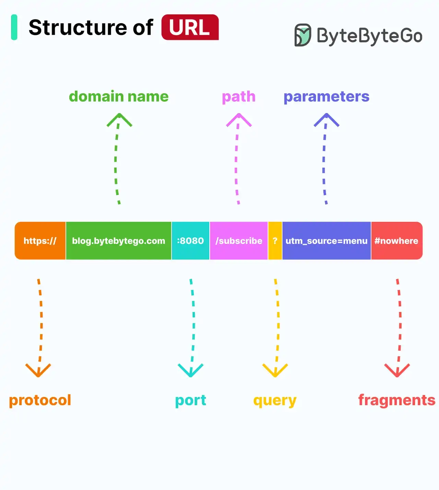

# 038 - Cấu trúc của URL

- Nguồn: ByteByteGo Big Archive System Design 2025
- Trang PDF: 81-82
- Ảnh minh họa: `../assets/038/figure-01.png`

## Hình minh họa

## Dịch sát

Bạn có biết tất cả component của một URL không?

Uniform Resource Locator, viết tắt là URL, là thuật ngữ quen thuộc với hầu hết mọi người vì nó được dùng để định vị resource trên Internet. Khi bạn nhập một URL vào thanh địa chỉ của web browser, bạn đang truy cập một “resource”, không chỉ là một webpage.

URL gồm nhiều component:

- Protocol hoặc scheme, chẳng hạn `http`, `https` và `ftp`.
- Domain name và port, được phân tách bằng dấu chấm `.` theo text extract từ tài liệu gốc.
- Path tới resource, được phân tách bằng dấu slash `/`.
- Parameters, bắt đầu bằng dấu hỏi `?` và gồm các cặp key-value, ví dụ `a=b&c=d`.
- Fragment hoặc anchor, được chỉ định bằng dấu thăng `#`, dùng để bookmark một section cụ thể của resource.

## Dịch nội dung trong hình

Ví dụ URL trong hình:

`https://blog.bytebytego.com:8080/subscribe?utm_source=menu#nowhere`

- `protocol`: `https://`.
- `domain name`: `blog.bytebytego.com`.
- `port`: `:8080`.
- `path`: `/subscribe`.
- `query`: `?utm_source=menu`.
- `parameters`: cặp key-value trong query string.
- `fragments`: `#nowhere`.

## Tóm tắt & giải thích dễ hiểu

URL là địa chỉ định vị resource. Trong backend/frontend, hiểu URL rất quan trọng vì routing, API design, caching, SEO, authentication callback và tracking đều phụ thuộc vào từng phần của URL.

Scheme cho biết protocol dùng để truy cập. Domain xác định host. Port xác định service trên host. Path định danh resource hoặc route. Query parameter truyền filter, paging, tracking hoặc option. Fragment thường xử lý ở client/browser để nhảy tới một phần trong trang và thường không được gửi lên server trong HTTP request.

## Ghi chú kỹ thuật - không nằm trong tài liệu gốc

Domain và port thường được phân tách bằng dấu hai chấm `:`, ví dụ `example.com:8080`, không phải dấu chấm. Dấu chấm dùng trong domain name để phân tách label như `blog.bytebytego.com`.

## Ví dụ thực tế - không nằm trong tài liệu gốc

API danh sách user có thể là `https://api.example.com:443/v1/users?page=2&limit=20#top`. Trong đó `/v1/users` là path resource, `page` và `limit` là query parameter. Với API server, fragment `#top` thường không quan trọng vì browser không gửi phần này lên server.

## Thuật ngữ chính

- `URL`: Uniform Resource Locator, địa chỉ định vị resource.
- `Scheme`: phần protocol như `https`.
- `Domain`: tên miền của host.
- `Port`: số service trên host.
- `Path`: đường dẫn tới resource.
- `Query string`: phần sau `?`, chứa key-value parameter.
- `Fragment`: phần sau `#`, thường dùng ở phía client.

## Câu hỏi ôn tập + trả lời + thinking học tập + liên hệ

> Đây là phần học tập thêm ở cuối file. Câu hỏi ưu tiên lấy từ tài liệu gốc và được trả lời trực tiếp; nếu bài không có câu hỏi riêng thì dùng tiêu đề/nội dung chính để tạo câu hỏi tự kiểm tra.

### Câu hỏi 1

**Nguồn câu hỏi:** Suy ra từ tiêu đề/nội dung chính vì bài gốc không có câu hỏi riêng.

**Câu hỏi:** Sau khi đọc bài “Structure of URL”, ý chính cần trả lời và áp dụng vào system design là gì?

**Trả lời:** Sau bài này, phần đáng nhớ nhất là: URL là địa chỉ định vị resource. Trong backend/frontend, hiểu URL rất quan trọng vì routing, API design, caching, SEO, authentication callback và tracking đều phụ thuộc vào từng phần của URL. Scheme cho biết protocol dùng để truy cập. Domain xác định host. Port xác định service trên host. Path định danh resource hoặc route. Query parameter truyền filter, paging, tracking hoặc option. Fragment thường xử lý ở client/browser để nhảy tới một phần trong trang và thường không được gửi lên server trong HTTP request. Khi áp dụng vào hệ thống thật, hãy kiểm thêm UX, bundle size, build time, maintainability, accessibility và tốc độ release.

**Thinking học tập + liên hệ:** Ôn tập `Cấu trúc của URL` bằng cách biến khái niệm thành quyết định thiết kế cụ thể: chọn gì, bỏ gì, đo gì và ai chịu trách nhiệm. Lens chính là UX, bundle size, build time, maintainability, accessibility và tốc độ release. Khi làm frontend production, hãy nối code với người dùng thật: load có nhanh không, lỗi có thấy được không, component có tái dùng được không và build có scale với team không. Khi ghi chú lại, hãy giải thích được các keyword: `URL`, `Scheme`, `Domain`, `Port`, `Path`.
