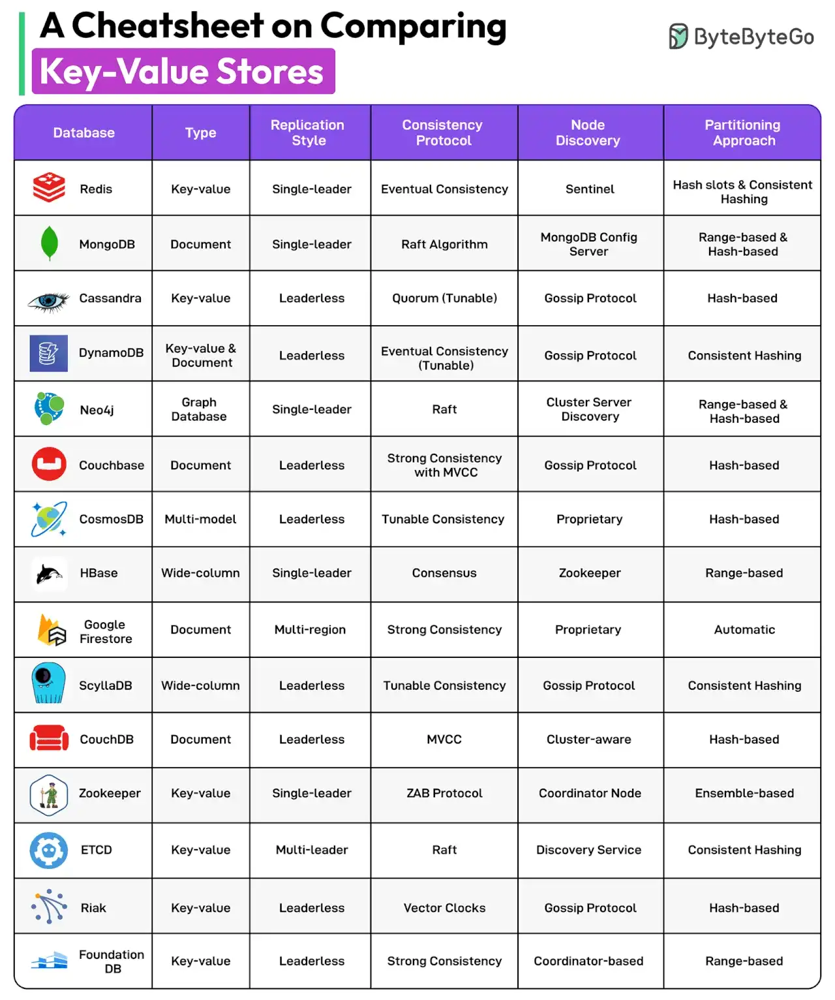

# 039 - Cheatsheet so sánh các Key-Value Store

- Nguồn: ByteByteGo Big Archive System Design 2025
- Trang PDF: 83-84
- Ảnh minh họa: `../assets/039/figure-01.png`

## Hình minh họa

## Dịch sát

Key-value store là một database lưu dữ liệu dưới dạng tập hợp các cặp key-value. Chúng ta so sánh 15 key-value store theo nhiều parameter khác nhau như replication style, consistency protocol, node discovery approach và partitioning approach.

Các database được đề cập gồm:

1. Redis
2. MongoDB
3. Cassandra
4. DynamoDB
5. Neo4j
6. Couchbase
7. CosmosDB
8. HBase
9. Firestore
10. ScyllaDB
11. CouchDB
12. Zookeeper
13. ETCD
14. Riak
15. FoundationDB

Câu hỏi dành cho bạn: Bạn sẽ thêm database nào khác vào danh sách?

## Dịch nội dung trong hình

Hình so sánh theo các cột: `Database`, `Type`, `Replication Style`, `Consistency Protocol`, `Node Discovery` và `Partitioning Approach`.

- `Redis`: key-value, single-leader, eventual consistency, Sentinel, hash slots và consistent hashing.
- `MongoDB`: document, single-leader, Raft algorithm, MongoDB config server, range-based và hash-based.
- `Cassandra`: key-value, leaderless, quorum tunable, gossip protocol, hash-based.
- `DynamoDB`: key-value và document, leaderless, eventual consistency có thể tùy chỉnh, gossip protocol, consistent hashing.
- `Neo4j`: graph database, single-leader, Raft, cluster server discovery, range-based và hash-based.
- `Couchbase`: document, leaderless, strong consistency with MVCC, gossip protocol, hash-based.
- `CosmosDB`: multi-model, leaderless, tunable consistency, proprietary discovery, hash-based.
- `HBase`: wide-column, single-leader, consensus, Zookeeper, range-based.
- `Google Firestore`: document, multi-region, strong consistency, proprietary discovery, automatic partitioning.
- `ScyllaDB`: wide-column, leaderless, tunable consistency, gossip protocol, consistent hashing.
- `CouchDB`: document, leaderless, MVCC, cluster-aware, hash-based.
- `Zookeeper`: key-value, single-leader, ZAB protocol, coordinator node, ensemble-based.
- `ETCD`: key-value, Raft, discovery service, consistent hashing theo hình.
- `Riak`: key-value, leaderless, vector clocks, gossip protocol, hash-based.
- `FoundationDB`: key-value, strong consistency, coordinator-based, range-based.

## Tóm tắt & giải thích dễ hiểu

Key-value store là mô hình database đơn giản về mặt API: đưa vào key, lấy ra value. Nhưng bên dưới, mỗi hệ thống có thiết kế phân tán rất khác nhau. Một số dùng leader, một số leaderless. Một số ưu tiên strong consistency, một số ưu tiên eventual consistency. Một số partition theo hash, một số theo range.

Khi chọn database, không nên chỉ nhìn “có key-value không”. Cần hỏi: workload đọc/ghi thế nào, có cần transaction không, consistency cần mạnh đến đâu, data model là document/graph/wide-column hay key-value thuần, scale multi-region không, và team vận hành quen hệ nào.

## Ghi chú kỹ thuật - không nằm trong tài liệu gốc

Một số hệ trong bảng không phải key-value store thuần theo nghĩa hẹp. MongoDB là document database, Neo4j là graph database, HBase/ScyllaDB là wide-column, CosmosDB là multi-model. Bảng đang so sánh rộng các database có thể phục vụ pattern truy cập dạng key-based hoặc distributed data store.

## Ví dụ thực tế - không nằm trong tài liệu gốc

Nếu cần cache session và counter realtime, Redis rất phù hợp. Nếu cần write-heavy, multi-node, availability cao và chấp nhận consistency tunable, Cassandra/ScyllaDB có thể hợp. Nếu cần document query linh hoạt, MongoDB/Firestore hợp hơn. Nếu cần graph traversal như friend-of-friend, Neo4j đúng bài toán hơn key-value thuần.

## Thuật ngữ chính

- `Key-value store`: database lưu dữ liệu theo cặp key và value.
- `Leaderless`: nhiều node có thể nhận write, không phụ thuộc một leader duy nhất.
- `Quorum`: số node tối thiểu phải đồng ý/ack để operation hợp lệ.
- `MVCC`: Multi-Version Concurrency Control.
- `Consistent hashing`: phân phối key qua node sao cho ít remap khi thêm/bớt node.
- `Range partitioning`: chia dữ liệu theo khoảng giá trị key.

## Câu hỏi ôn tập + trả lời + thinking học tập + liên hệ

> Đây là phần học tập thêm ở cuối file. Câu hỏi ưu tiên lấy từ tài liệu gốc và được trả lời trực tiếp; nếu bài không có câu hỏi riêng thì dùng tiêu đề/nội dung chính để tạo câu hỏi tự kiểm tra.

### Câu hỏi 1

**Nguồn câu hỏi:** Câu hỏi trong tài liệu gốc.

**Câu hỏi:** Bạn sẽ thêm database nào khác vào danh sách?

**Trả lời:** Nên bổ sung `A* Search` cho tìm đường có heuristic trong bản đồ/game; `BFS/DFS` cho crawler, dependency graph và duyệt quan hệ; `Consistent Hashing` để phân phối key ổn định trong cache/database cluster; và `Bloom Filter` để kiểm tra membership nhanh với bộ nhớ thấp. Các mục này giúp bức tranh đầy đủ hơn vì chúng chạm vào phần triển khai/vận hành mà bài gốc chưa đi sâu. Ý chính đang có của bài là: Key-value store là mô hình database đơn giản về mặt API: đưa vào key, lấy ra value. Nhưng bên dưới, mỗi hệ thống có thiết kế phân tán rất khác nhau. Một số dùng leader, một số leaderless. Một số ưu tiên strong consistency, một số ưu tiên eventual consistency. Một số partition theo hash, một số theo range.

**Thinking học tập + liên hệ:** Đừng thêm mục cho dài danh sách; với `Cheatsheet so sánh các Key-Value Store`, chỉ thêm thứ mở ra một nhóm vấn đề mới hoặc giúp ra quyết định thiết kế tốt hơn. Lens chính là loại dữ liệu, kích thước input, latency mục tiêu, memory budget và sai số/lỗi có thể chấp nhận. Trong project thật, thuật toán thường ẩn sau search, cache, ranking, routing, queue hoặc storage; hiểu nó giúp dự đoán bottleneck trước khi hệ thống lớn lên. Khi ghi chú lại, hãy giải thích được các keyword: `Key-value store`, `Leaderless`, `Quorum`, `MVCC`, `Consistent hashing`.
