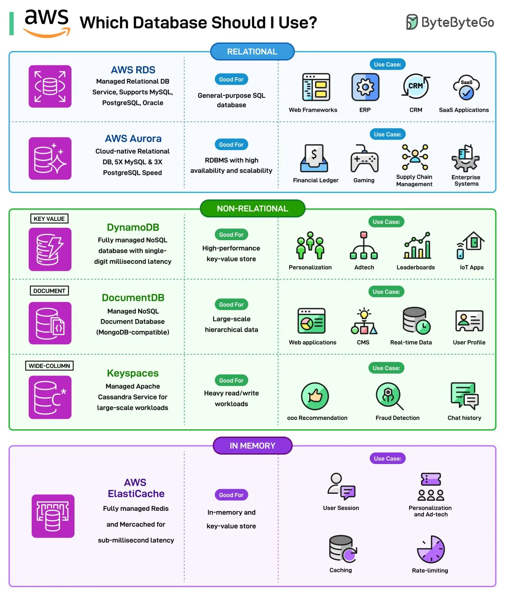

# 040 - Nên dùng database nào trên AWS?

- Nguồn: ByteByteGo Big Archive System Design 2025
- Trang PDF: 85-86
- Ảnh minh họa: `../assets/040/figure-01.png`

## Hình minh họa

## Dịch sát

Câu hỏi này thường xuất hiện khi chúng ta bắt đầu deploy một application trên AWS. Có rất nhiều option để lựa chọn.

Ở mức rộng, có ba category database:

1. Relational

   Hai lựa chọn chính trong nhóm này là AWS RDS và AWS Aurora.

   AWS RDS là managed relational DB service hỗ trợ MySQL, PostgreSQL, Oracle, v.v. AWS Aurora là cloud-native relational database hỗ trợ high availability và scalability.

2. Non-Relational

   Ba lựa chọn chính trong category này là DynamoDB, DocumentDB và AWS Keyspaces.

   DynamoDB là fully managed NoSQL key-value datastore. DocumentDB là managed document database tương thích với MongoDB. AWS Keyspaces là managed wide-column Apache Cassandra service cho workload quy mô lớn.

3. In-memory

   AWS ElastiCache là option phổ biến nhất trong category này. Đây là fully managed Redis hoặc Memcached service cho sub-millisecond latency.

Câu hỏi dành cho bạn: Bạn đã dùng AWS Database nào?

## Dịch nội dung trong hình

- `Relational`: AWS RDS và AWS Aurora.
- `AWS RDS`: managed relational DB service, hỗ trợ MySQL, PostgreSQL, Oracle; phù hợp general-purpose SQL database, web framework, ERP, CRM và SaaS application.
- `AWS Aurora`: cloud-native relational DB, hỗ trợ MySQL và PostgreSQL, scan DB; phù hợp RDBMS cần high availability và scalability, enterprise ledger, gaming, supply chain management và enterprise system.
- `Non-Relational`: DynamoDB, DocumentDB và Keyspaces.
- `DynamoDB`: fully managed NoSQL key-value datastore; phù hợp high-performance key-value store, personalization, adtech, leaderboards và IoT apps.
- `DocumentDB`: managed NoSQL document database tương thích MongoDB; phù hợp dữ liệu hierarchical quy mô lớn, web application, CMS, real-time data và user profile.
- `Keyspaces`: managed Apache Cassandra service cho large-scale workload; phù hợp heavy read/write workload, recommendation, fraud detection và chat history.
- `In Memory`: AWS ElastiCache.
- `AWS ElastiCache`: fully managed Redis và Memcached cho sub-millisecond latency; phù hợp in-memory key-value store, user session, recommendation/personalization, caching và rate limiting.

## Tóm tắt & giải thích dễ hiểu

Chọn database trên AWS nên bắt đầu từ data model và access pattern. Nếu dữ liệu có quan hệ rõ, cần SQL, transaction và join, hãy nghĩ tới RDS hoặc Aurora. Nếu cần key-value cực nhanh và scale lớn, DynamoDB là lựa chọn mạnh. Nếu dữ liệu dạng document và team quen MongoDB, DocumentDB có thể phù hợp. Nếu workload wide-column kiểu Cassandra, cân nhắc Keyspaces. Nếu cần cache/session/rate-limit latency cực thấp, dùng ElastiCache.

Không có “database tốt nhất cho mọi thứ”. Aurora mạnh cho relational workload nhưng không thay thế cache. DynamoDB scale tốt nhưng yêu cầu thiết kế partition key/sort key cẩn thận. ElastiCache rất nhanh nhưng dữ liệu chủ yếu nằm trong memory và không nên là source of truth cho dữ liệu quan trọng nếu không thiết kế persistence/backup phù hợp.

## Ví dụ thực tế - không nằm trong tài liệu gốc

Một app e-commerce có thể dùng Aurora PostgreSQL cho order/payment transaction, DynamoDB cho session/cart hoặc high-scale key-value access, ElastiCache Redis cho cache product hot và rate limiting, OpenSearch cho search sản phẩm. Việc phối hợp nhiều database là bình thường nếu mỗi database giải quyết đúng workload.

## Thuật ngữ chính

- `RDS`: Relational Database Service của AWS.
- `Aurora`: relational database cloud-native của AWS, tương thích MySQL/PostgreSQL.
- `DynamoDB`: managed NoSQL key-value/document database.
- `DocumentDB`: managed document database tương thích MongoDB.
- `Keyspaces`: managed Cassandra-compatible service.
- `ElastiCache`: managed Redis/Memcached cho cache in-memory.
- `Access pattern`: cách ứng dụng đọc/ghi/query dữ liệu.

## Câu hỏi ôn tập + trả lời + thinking học tập + liên hệ

> Đây là phần học tập thêm ở cuối file. Câu hỏi ưu tiên lấy từ tài liệu gốc và được trả lời trực tiếp; nếu bài không có câu hỏi riêng thì dùng tiêu đề/nội dung chính để tạo câu hỏi tự kiểm tra.

### Câu hỏi 1

**Nguồn câu hỏi:** Câu hỏi trong tài liệu gốc.

**Câu hỏi:** Bạn đã dùng AWS Database nào?

**Trả lời:** Với `Nên dùng database nào trên AWS?`, cách liên hệ tốt nhất là chọn một workload nhỏ rồi kiểm chứng bằng số liệu thay vì chọn theo cảm tính. Nên kiểm bằng workload nhỏ trước: latency, độ ổn định, khả năng debug, cost và rủi ro vận hành. Phần cốt lõi cần đem theo từ bài là: Chọn database trên AWS nên bắt đầu từ data model và access pattern. Nếu dữ liệu có quan hệ rõ, cần SQL, transaction và join, hãy nghĩ tới RDS hoặc Aurora. Nếu cần key-value cực nhanh và scale lớn, DynamoDB là lựa chọn mạnh. Nếu dữ liệu dạng document và team quen MongoDB, DocumentDB có thể phù hợp. Nếu workload wide-column kiểu Cassandra, cân nhắc Keyspaces. Nếu cần cache/session/rate-limit latency cực thấp, dùng ElastiCache.

**Thinking học tập + liên hệ:** Khi tự liên hệ `Nên dùng database nào trên AWS?`, hãy viết ra một project cụ thể, lý do chọn công nghệ và lỗi vận hành có thể xảy ra. Lens chính là read/write ratio, consistency, cardinality, query pattern, growth rate và recovery requirement. Khi gặp bài toán dữ liệu, hãy nối bài học với truy vấn nóng nhất, index thật sự được dùng, cache nào có thể stale và thời gian restore sau sự cố. Khi ghi chú lại, hãy giải thích được các keyword: `RDS`, `Aurora`, `DynamoDB`, `DocumentDB`, `Keyspaces`.
