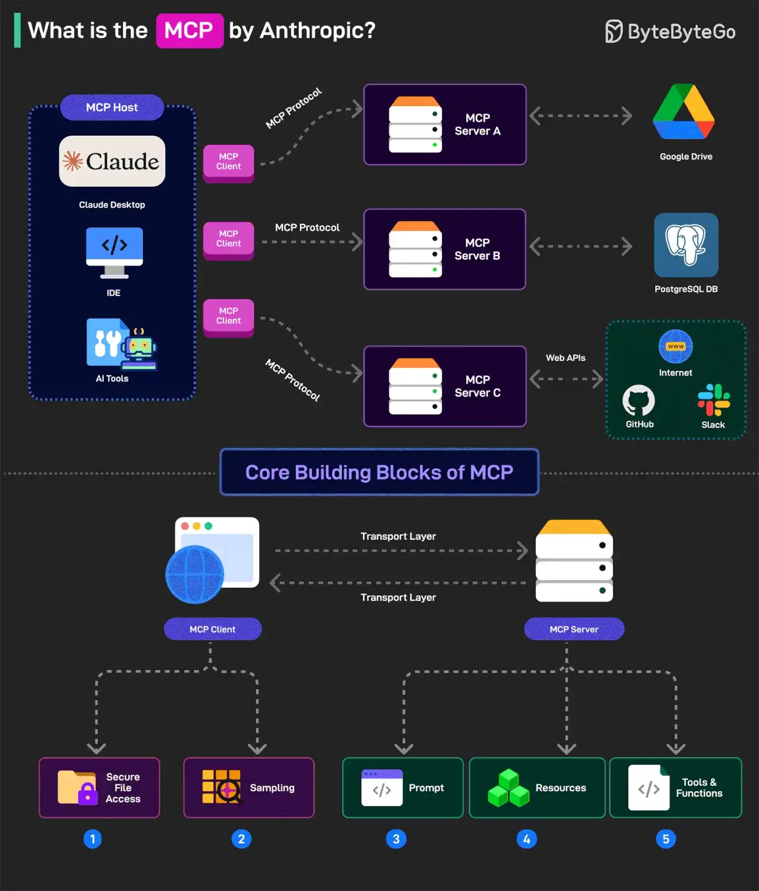

# 041 - MCP là gì?

- Nguồn: ByteByteGo Big Archive System Design 2025
- Trang PDF: 87-88
- Ảnh minh họa: `../assets/041/figure-01.png`

## Hình minh họa

## Dịch sát

Tại sao mọi người đều nói về nó? Hãy cùng xem kỹ hơn.

Model Context Protocol, viết tắt là MCP, là một hệ thống mới được Anthropic giới thiệu để làm cho AI model mạnh hơn.

Đây là một open standard, cũng đang được vận hành như một open-source project, cho phép AI model như Claude kết nối tới database, API, file system và các tool khác mà không cần custom code cho mỗi integration mới.

MCP tuân theo mô hình client-server với 3 component chính:

1. Host: các AI application như Claude cung cấp môi trường cho AI interaction để có thể truy cập nhiều tool và data source khác nhau. Host chạy MCP Client.

2. MCP Client: MCP client là component bên trong một AI model như Claude, cho phép nó giao tiếp với MCP server. Ví dụ, nếu AI model muốn dữ liệu từ PostgreSQL, MCP client format request thành một structured message để gửi tới MCP Server.

3. MCP Server: đây là middleman kết nối AI model với external system như PostgreSQL, Google Drive hoặc API. Ví dụ, nếu Claude phân tích sales data từ PostgreSQL, MCP Server cho PostgreSQL đóng vai trò connector giữa Claude và database.

MCP có năm core building block, còn gọi là primitive. Chúng được chia giữa client và server.

1. Với client, các building block là Roots, tức secure file access, và Sampling, tức yêu cầu AI hỗ trợ một task như generate DB query.

2. Với server, có Prompts, tức instruction để hướng dẫn AI; Resources, tức data object mà AI có thể tham chiếu; và Tools, tức function mà AI có thể gọi như chạy DB query.

Câu hỏi dành cho bạn: Bạn đã khám phá Model Context Protocol của Anthropic chưa?

## Dịch nội dung trong hình

- `MCP Host`: ứng dụng AI như Claude Desktop, IDE hoặc AI tool, nơi user tương tác.
- `MCP Client`: client bên trong host, dùng MCP protocol để nói chuyện với server.
- `MCP Server`: connector chuẩn hóa tới external system.
- Ví dụ MCP server kết nối tới `Google Drive`, `PostgreSQL DB`, `Internet`, `GitHub` và `Slack`.
- `Core Building Blocks of MCP`: MCP client và MCP server giao tiếp qua transport layer.
- `Roots`: secure file access.
- `Sampling`: cơ chế server nhờ model/host hỗ trợ sinh hoặc xử lý nội dung.
- `Prompts`: prompt/instruction được server cung cấp.
- `Resources`: data object mà model có thể đọc/tham chiếu.
- `Tools & Functions`: function/tool mà model có thể gọi.

## Tóm tắt & giải thích dễ hiểu

MCP có thể hiểu như “USB-C cho AI tool integration”. Thay vì mỗi AI app phải viết integration riêng cho PostgreSQL, Google Drive, GitHub, Slack hay file system, MCP chuẩn hóa cách host, client và server giao tiếp. Một MCP server expose resource/tool theo chuẩn; AI host có MCP client có thể dùng chúng.

Trong kiến trúc AI agent, MCP giúp tách model khỏi tool implementation. Model không cần biết chi tiết driver PostgreSQL hay API Slack; nó gọi tool qua interface chuẩn. Điều này giúp tái sử dụng integration, quản lý permission rõ hơn và mở rộng hệ sinh thái tool dễ hơn.

## Ví dụ thực tế - không nằm trong tài liệu gốc

Một AI assistant trong IDE có thể dùng MCP server file system để đọc repo, MCP server GitHub để xem issue/PR, MCP server PostgreSQL để query database staging và MCP server Slack để tìm context cuộc trao đổi. Mỗi server chịu trách nhiệm permission và format dữ liệu, còn host điều phối tương tác với model.

Khi dùng MCP trong production, cần giới hạn quyền tool. Một server chỉ đọc database an toàn hơn server có quyền `DROP TABLE` hoặc sửa dữ liệu production.

## Thuật ngữ chính

- `MCP`: Model Context Protocol, chuẩn kết nối AI model/host với tool và data source.
- `Host`: ứng dụng chứa trải nghiệm AI và chạy MCP client.
- `MCP Client`: component giao tiếp với MCP server.
- `MCP Server`: connector expose tool/resource/prompt theo chuẩn MCP.
- `Resource`: dữ liệu mà AI có thể tham chiếu.
- `Tool`: function mà AI có thể gọi để thực hiện hành động.
- `Primitive`: building block cơ bản trong MCP.
