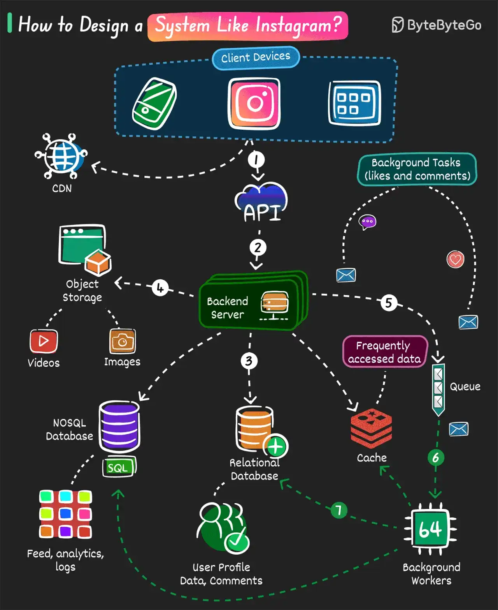

# 042 - Cách thiết kế một hệ thống giống Instagram

- Nguồn: ByteByteGo Big Archive System Design 2025
- Trang PDF: 89-90
- Ảnh minh họa: `../assets/042/figure-01.png`

## Hình minh họa

## Dịch sát

Dưới đây là cách tiếp cận từng bước đơn giản để xây dựng core functionality:

1. User thực hiện một action trên device của họ như bấm nút like, upload picture hoặc follow user khác.

2. Request đi qua gateway tới backend server được xây bằng framework như Django, Express hoặc bất kỳ framework nào khác.

3. Dữ liệu được lưu trong database.

   - Structured data như user profile, comment và relationship được lưu trong relational database như Postgres.
   - Data item yêu cầu write throughput cao như user feed và activity log có thể được lưu trong eventually consistent database như Cassandra.
   - Dữ liệu được truy cập thường xuyên được lưu trong cache, ví dụ Redis hoặc Memcached.

4. Image và video được lưu trong object storage và metadata tương ứng được lưu trong database.

5. Các asynchronous task như gửi notification được gửi tới queue.

6. Background worker như Celery lấy task từ queue và thực hiện xử lý cần thiết.

7. Celery worker cũng thực hiện các update cần thiết trong database.

Câu hỏi dành cho bạn: Bạn sẽ thêm gì khác để xây dựng một hệ thống giống Instagram?

## Dịch nội dung trong hình

- `Client Devices`: mobile/web client nơi user like, comment, upload ảnh/video.
- `CDN`: phục vụ media/static content gần user hơn.
- `API`: lớp gateway/API nhận request.
- `Backend Server`: xử lý request chính.
- `Object Storage`: lưu video và image.
- `Relational Database`: lưu user profile, data và comment có cấu trúc.
- `NoSQL Database`: lưu feed, analytics và log hoặc dữ liệu write-heavy.
- `Cache`: lưu frequently accessed data.
- `Queue`: hàng đợi cho background task như like/comment notification.
- `Background Workers`: worker xử lý task async và cập nhật dữ liệu.

## Tóm tắt & giải thích dễ hiểu

Một hệ thống giống Instagram cần tách rõ media storage, metadata, social graph, feed, cache và background processing. Ảnh/video không nên lưu trực tiếp trong relational database; nên lưu ở object storage, còn DB lưu URL, owner, caption, timestamp và permission metadata.

Các action như like, comment, follow cần xử lý nhanh cho user. Những việc không cần hoàn tất ngay như gửi notification, fan-out feed hoặc analytics nên đưa vào queue để worker xử lý bất đồng bộ. Cache giúp giảm tải cho các dữ liệu đọc nhiều như profile, post hot hoặc feed fragment.

Với scale lớn, feed là bài toán khó. Có thể dùng fan-out-on-write, fan-out-on-read hoặc hybrid. User nổi tiếng có hàng triệu follower thường cần chiến lược riêng để tránh ghi quá nhiều feed item.

## Ví dụ thực tế - không nằm trong tài liệu gốc

Khi user A upload ảnh, backend lưu file vào S3/object storage, ghi metadata vào Postgres, publish event `PostCreated` vào queue. Worker tạo thumbnail, quét moderation, cập nhật search index và gửi notification/fan-out feed cho follower phù hợp. CDN cache ảnh để user ở nhiều vùng tải nhanh hơn.

## Thuật ngữ chính

- `Object storage`: lưu object/file lớn như ảnh và video.
- `Metadata`: dữ liệu mô tả media, ví dụ owner, caption, size, URL.
- `Social graph`: quan hệ follow/friend giữa user.
- `Feed`: dòng nội dung hiển thị cho user.
- `Fan-out`: phân phối post/event tới nhiều follower/service.
- `Eventually consistent`: dữ liệu cuối cùng sẽ nhất quán, nhưng có thể trễ tạm thời.
- `Background worker`: process xử lý task nền ngoài request path.

## Câu hỏi ôn tập + trả lời + thinking học tập + liên hệ

> Đây là phần học tập thêm ở cuối file. Câu hỏi ưu tiên lấy từ tài liệu gốc và được trả lời trực tiếp; nếu bài không có câu hỏi riêng thì dùng tiêu đề/nội dung chính để tạo câu hỏi tự kiểm tra.

### Câu hỏi 1

**Nguồn câu hỏi:** Câu hỏi trong tài liệu gốc.

**Câu hỏi:** Bạn sẽ thêm gì khác để xây dựng một hệ thống giống Instagram?

**Trả lời:** Có thể thêm query plan/EXPLAIN để biết bottleneck thật; transaction isolation để tránh race condition và dirty read; connection pooling/backpressure để database không bị quá tải; và cache invalidation strategy rõ ràng. Các mục này giúp bức tranh đầy đủ hơn vì chúng chạm vào phần triển khai/vận hành mà bài gốc chưa đi sâu. Ý chính đang có của bài là: Một hệ thống giống Instagram cần tách rõ media storage, metadata, social graph, feed, cache và background processing. Ảnh/video không nên lưu trực tiếp trong relational database; nên lưu ở object storage, còn DB lưu URL, owner, caption, timestamp và permission metadata.

**Thinking học tập + liên hệ:** Danh sách trong `Cách thiết kế một hệ thống giống Instagram` nên được kiểm theo coverage: nó đã nói phần nào, thiếu phần nào và phần thiếu có làm thay đổi quyết định thiết kế không. Lens chính là read/write ratio, consistency, cardinality, query pattern, growth rate và recovery requirement. Khi gặp bài toán dữ liệu, hãy nối bài học với truy vấn nóng nhất, index thật sự được dùng, cache nào có thể stale và thời gian restore sau sự cố. Khi ghi chú lại, hãy giải thích được các keyword: `Object storage`, `Metadata`, `Social graph`, `Feed`, `Fan-out`.
