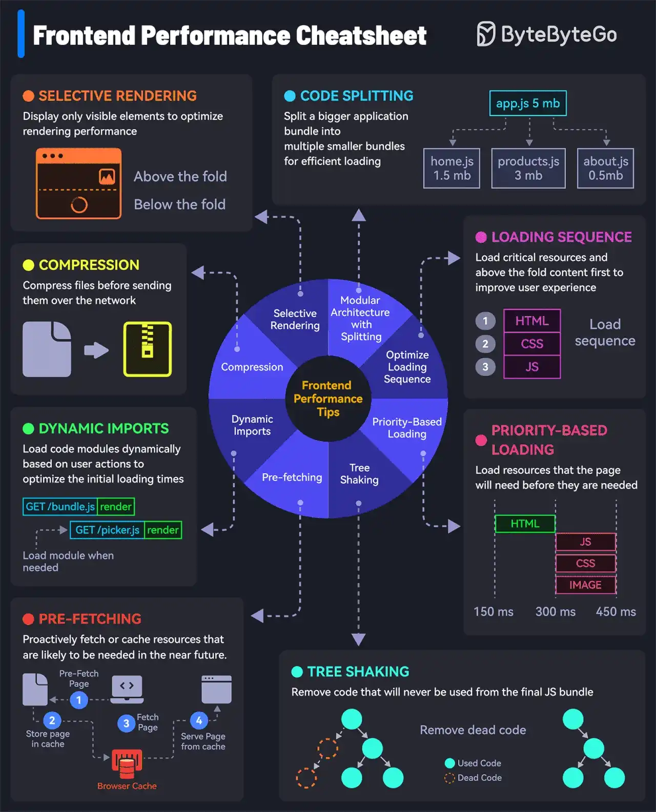

# 043 - Cách tải website nhanh như chớp

- Nguồn: ByteByteGo Big Archive System Design 2025
- Trang PDF: 91-92
- Ảnh minh họa: `../assets/043/figure-01.png`

## Hình minh họa

## Dịch sát

Hãy xem 8 tip sau để tăng frontend performance:

1. Compression

   Compress file và minimize data size trước khi truyền để giảm network load.

2. Selective Rendering/Windowing

   Chỉ hiển thị các element đang nhìn thấy để tối ưu rendering performance. Ví dụ, trong một dynamic list, chỉ render các item đang visible.

3. Modular Architecture with Code Splitting

   Chia một application bundle lớn thành nhiều bundle nhỏ hơn để load hiệu quả.

4. Priority-Based Loading

   Ưu tiên các resource thiết yếu và nội dung visible hoặc above-the-fold để cải thiện user experience.

5. Pre-loading

   Fetch resource trước khi chúng được request để cải thiện loading speed.

6. Tree Shaking or Dead Code Removal

   Tối ưu JS bundle cuối cùng bằng cách loại bỏ dead code sẽ không bao giờ được dùng.

7. Pre-fetching

   Chủ động fetch hoặc cache các resource có khả năng sẽ sớm cần đến.

8. Dynamic Imports

   Load code module một cách dynamic dựa trên action của user để tối ưu initial loading time.

Câu hỏi dành cho bạn: Bạn sẽ thêm tip frontend performance nào khác vào cheat sheet này?

## Dịch nội dung trong hình

- `Selective Rendering`: chỉ display visible element để tối ưu rendering performance; phân biệt above the fold và below the fold.
- `Code Splitting`: tách application bundle lớn thành nhiều bundle nhỏ hơn như `home.js`, `products.js`, `about.js`.
- `Compression`: compress file trước khi gửi qua network.
- `Loading Sequence`: load critical resource và above-the-fold content trước để tăng user experience; ví dụ HTML, CSS, JS theo thứ tự ưu tiên.
- `Dynamic Imports`: load module khi user action phát sinh; ví dụ click mới load bundle liên quan.
- `Priority-Based Loading`: load resource mà page cần trước các resource khác.
- `Pre-fetching`: fetch/cache trước resource có thể cần trong tương lai gần.
- `Tree Shaking`: loại bỏ dead code khỏi JS bundle cuối cùng.

## Tóm tắt & giải thích dễ hiểu

Frontend performance chủ yếu xoay quanh việc gửi ít dữ liệu hơn, tải đúng thứ đúng thời điểm và render ít hơn. Compression giảm kích thước file. Code splitting và dynamic import giảm initial bundle. Selective rendering/windowing tránh render danh sách khổng lồ. Priority loading, preload và prefetch giúp tài nguyên quan trọng đến sớm hơn.

Cần phân biệt `preload` và `prefetch`. Preload dành cho resource quan trọng cần ngay trong page hiện tại. Prefetch dành cho resource có thể cần trong tương lai, ví dụ route tiếp theo. Dùng sai có thể cạnh tranh bandwidth với tài nguyên quan trọng.

## Ví dụ thực tế - không nằm trong tài liệu gốc

Một dashboard có bảng 50.000 dòng không nên render toàn bộ DOM. Dùng virtualization/windowing chỉ render 50-100 dòng đang visible. Một app React lớn nên split route: user vào `/login` thì không cần tải code của `/admin/reports`. Ảnh below-the-fold nên lazy-load, còn font/hero image quan trọng có thể preload.

## Thuật ngữ chính

- `Above the fold`: vùng nội dung user thấy ngay khi mở trang.
- `Bundle`: file JS/CSS được đóng gói để browser tải.
- `Code splitting`: chia bundle theo route/component/feature.
- `Tree shaking`: loại bỏ code không dùng.
- `Lazy loading`: tải tài nguyên khi cần.
- `Windowing`: chỉ render phần visible của danh sách lớn.
- `Core Web Vitals`: nhóm chỉ số trải nghiệm web như LCP, INP, CLS.
