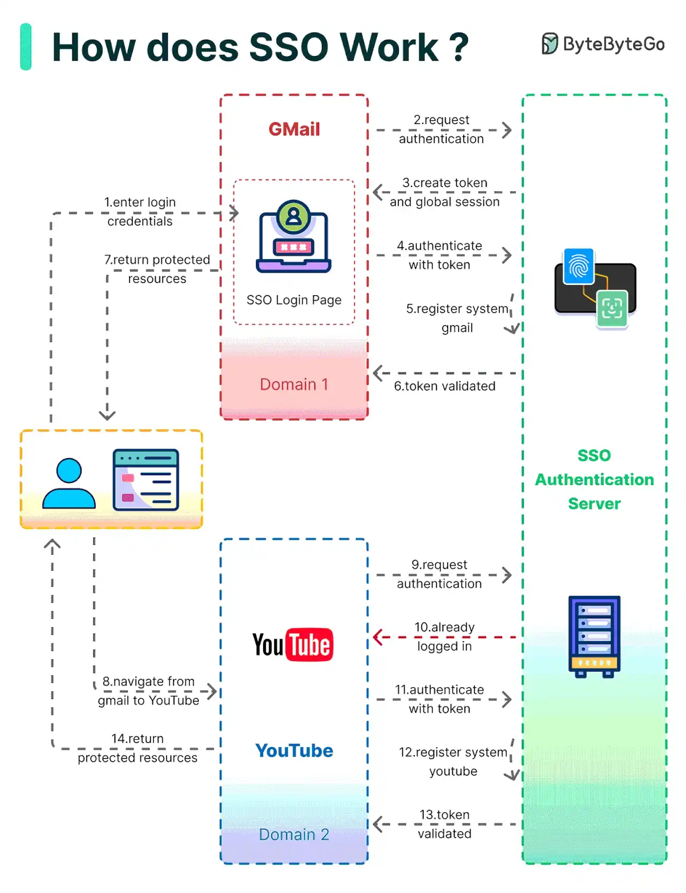

# 044 - SSO (Single Sign-On) là gì?

- Nguồn: ByteByteGo Big Archive System Design 2025
- Trang PDF: 93-94
- Ảnh minh họa: `../assets/044/figure-01.png`

## Hình minh họa

## Dịch sát

Về cơ bản, Single Sign-On, viết tắt là SSO, là một authentication scheme. Nó cho phép user đăng nhập vào nhiều hệ thống khác nhau bằng một ID duy nhất.

Sơ đồ bên dưới minh họa cách SSO hoạt động.

- Step 1: User truy cập Gmail hoặc bất kỳ email service nào. Gmail thấy user chưa đăng nhập nên redirect user tới SSO authentication server, server này cũng thấy user chưa đăng nhập. Kết quả là user được redirect tới SSO login page, nơi họ nhập login credential.

- Steps 2-3: SSO authentication server validate credential, tạo global session cho user và tạo token.

- Steps 4-7: Gmail validate token với SSO authentication server. Authentication server register hệ thống Gmail và trả về `valid`. Gmail trả protected resource cho user.

- Step 8: Từ Gmail, user điều hướng tới một website khác do Google sở hữu, ví dụ YouTube.

- Steps 9-10: YouTube thấy user chưa đăng nhập, sau đó request authentication. SSO authentication server thấy user đã đăng nhập và trả token.

- Steps 11-14: YouTube validate token với SSO authentication server. Authentication server register hệ thống YouTube và trả về `valid`. YouTube trả protected resource cho user.

Quá trình hoàn tất và user lấy lại quyền truy cập vào account của họ.

Câu hỏi dành cho bạn:

- Bạn đã implement SSO trong project chưa? Phần khó nhất là gì?
- Phương thức sign-in yêu thích của bạn là gì và tại sao?

## Dịch nội dung trong hình

- `GMail - Domain 1`: hệ thống đầu tiên user truy cập.
- `SSO Login Page`: trang login tập trung.
- `SSO Authentication Server`: server xác thực trung tâm.
- `YouTube - Domain 2`: hệ thống thứ hai user truy cập.
- Luồng 1-7: user đăng nhập qua SSO, Gmail validate token và nhận protected resource.
- Luồng 8-14: user chuyển sang YouTube; vì đã có global SSO session, YouTube lấy/validate token và trả protected resource mà user không cần nhập lại password.

## Tóm tắt & giải thích dễ hiểu

SSO cho phép user đăng nhập một lần rồi truy cập nhiều hệ thống liên quan. Thay vì mỗi app tự quản lý username/password riêng, các app tin tưởng một identity provider hoặc authentication server trung tâm. Điều này giúp UX tốt hơn, quản lý user tập trung hơn và dễ áp dụng policy như MFA, password policy, revoke access.

Điểm quan trọng trong SSO là trust relationship giữa service provider và identity provider. Ứng dụng như Gmail/YouTube không tự tin user chỉ vì user nói đã login; chúng validate token/assertion với SSO server hoặc verify chữ ký token.

## Ví dụ thực tế - không nằm trong tài liệu gốc

Một doanh nghiệp có HR, CRM, E-Office và BI dashboard. Nếu không có SSO, nhân viên phải tạo password riêng ở từng hệ thống. Với SSO, tất cả app redirect về Identity Provider như Google Workspace, Azure AD/Entra ID, Okta hoặc Keycloak. Khi nhân viên nghỉ việc, admin disable một account trung tâm là quyền vào các app bị chặn.

## Thuật ngữ chính

- `SSO`: Single Sign-On, đăng nhập một lần cho nhiều hệ thống.
- `Identity Provider`: hệ thống xác thực danh tính trung tâm.
- `Service Provider`: ứng dụng tin tưởng identity provider.
- `Global session`: phiên đăng nhập trung tâm ở SSO server.
- `Token`: bằng chứng đăng nhập/quyền truy cập.
- `MFA`: Multi-Factor Authentication, xác thực đa yếu tố.
