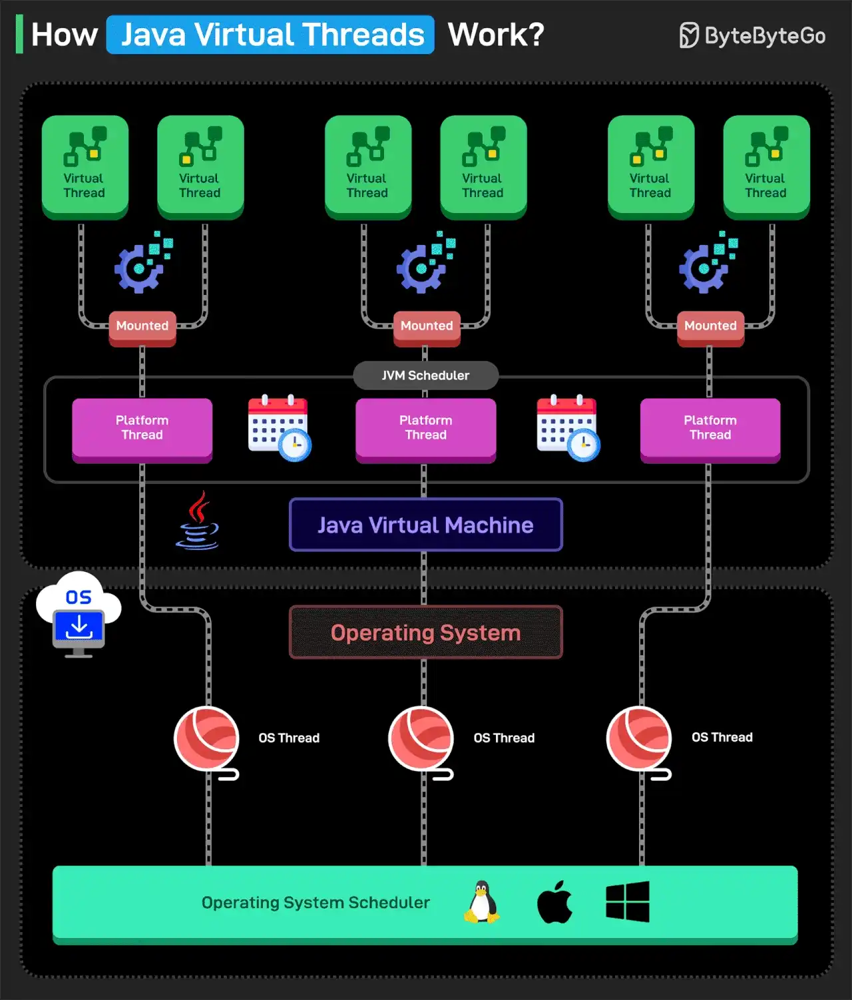

# 045 - Java Virtual Threads hoạt động như thế nào?

- Nguồn: ByteByteGo Big Archive System Design 2025
- Trang PDF: 95-96
- Ảnh minh họa: `../assets/045/figure-01.png`

## Hình minh họa

## Dịch sát

Virtual Threads là lightweight thread được giới thiệu trong Java 19 ở dạng Preview và Java 21 ở dạng Stable. Chúng cho phép Java tạo hàng triệu thread một cách hiệu quả, giúp xử lý concurrent task mà không lãng phí memory hoặc CPU.

Virtual Threads không map 1:1 với OS Threads và không thay thế Platform Threads ban đầu. Platform Threads được backing bởi OS Threads và trong ngữ cảnh này đôi khi cũng được gọi là Carrier Threads.

Hãy nghĩ Platform Threads như một nhóm worker nhỏ, còn Virtual Threads như các task. Với Virtual Threads, task chỉ được đưa cho worker khi cần, cho phép một worker xử lý hàng nghìn task hiệu quả.

Dưới đây là cách Virtual Threads hoạt động:

1. Virtual Threads chạy trên Platform Threads. JVM schedule chúng lên một số lượng nhỏ Platform Threads.

2. Khi một Virtual Thread bắt đầu, JVM gán nó cho một Platform Thread thông thường được backing bởi OS.

3. Virtual Threads cũng có thể xử lý CPU-intensive work, nhưng lợi thế thật sự của chúng nằm ở các scenario có số lượng lớn I/O-bound hoặc concurrent task.

4. Nếu Virtual Thread thực hiện blocking operation như I/O, database call, sleep, v.v., JVM unmount nó khỏi Platform Thread. Tuy nhiên, điều này không block OS Thread bên dưới.

5. Platform Thread được giải phóng để xử lý Virtual Thread khác.

6. Khi blocking operation kết thúc, Virtual Thread được reschedule lên bất kỳ Platform Thread nào còn available.

Câu hỏi dành cho bạn: Bạn đã dùng Virtual Threads chưa?

## Dịch nội dung trong hình

- `Virtual Thread`: lightweight thread đại diện cho task logic.
- `Mounted`: virtual thread đang được gắn lên platform thread để chạy.
- `JVM Scheduler`: scheduler của JVM điều phối virtual thread lên platform thread.
- `Platform Thread`: thread truyền thống trong Java, được backing bởi OS thread.
- `Java Virtual Machine`: JVM quản lý scheduling và runtime.
- `Operating System`: hệ điều hành bên dưới.
- `OS Thread`: thread thật ở OS.
- `Operating System Scheduler`: scheduler của hệ điều hành quản lý OS thread trên CPU.

## Tóm tắt & giải thích dễ hiểu

Virtual Threads giúp Java xử lý concurrency kiểu “một request một thread” với chi phí thấp hơn nhiều so với platform thread truyền thống. Chúng đặc biệt hữu ích cho workload I/O-bound như gọi database, HTTP API, file I/O hoặc sleep, vì khi bị block, virtual thread có thể unmount khỏi platform thread để platform thread xử lý task khác.

Virtual Threads không làm CPU chạy nhanh hơn. Nếu workload CPU-bound nặng, bạn vẫn bị giới hạn bởi số core CPU. Lợi ích lớn nhất là đơn giản hóa code concurrent I/O mà không cần chuyển hoàn toàn sang reactive programming phức tạp.

## Ví dụ thực tế - không nằm trong tài liệu gốc

Một Java web server xử lý 50.000 request đồng thời, mỗi request chủ yếu chờ database hoặc service bên ngoài. Với platform thread truyền thống, tạo quá nhiều thread sẽ tốn memory và context switching. Với virtual thread, mỗi request có thể dùng một virtual thread nhẹ, khi chờ I/O thì platform thread được nhả ra để phục vụ request khác.

Tuy nhiên, vẫn cần cấu hình connection pool/database pool hợp lý. Virtual thread giúp tạo nhiều concurrent task hơn, nhưng database không tự nhiên chịu được vô hạn connection.

## Thuật ngữ chính

- `Virtual Thread`: thread nhẹ do JVM quản lý.
- `Platform Thread`: thread Java truyền thống được backing bởi OS thread.
- `Carrier Thread`: platform thread dùng để chạy virtual thread.
- `Mount/Unmount`: gắn/gỡ virtual thread khỏi carrier thread.
- `I/O-bound`: workload chủ yếu chờ I/O.
- `CPU-bound`: workload chủ yếu dùng CPU.
- `Scheduler`: thành phần quyết định thread/task nào được chạy.
