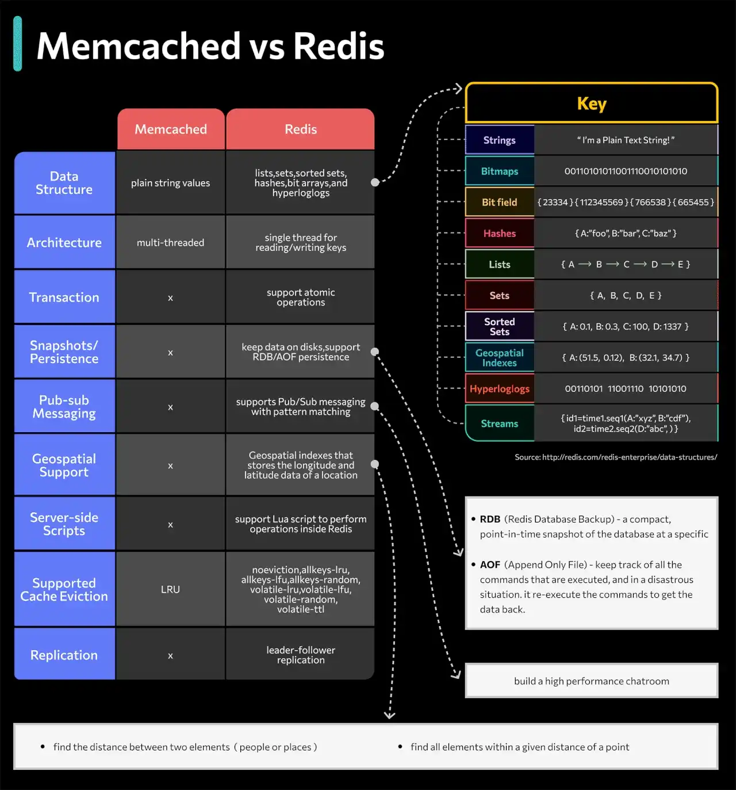

# 046 - Redis vs Memcached

- Nguồn: ByteByteGo Big Archive System Design 2025
- Trang PDF: 97
- Ảnh minh họa: `../assets/046/figure-01.png`

## Hình minh họa

## Dịch sát

Sơ đồ bên dưới minh họa các khác biệt chính.

Lợi thế về data structure khiến Redis là lựa chọn tốt cho:

- Ghi nhận số lượng click và comment cho mỗi post, dùng hash.
- Sắp xếp danh sách user đã comment và dedupe user, dùng zset.
- Cache lịch sử hành vi user và lọc hành vi độc hại, dùng zset, hash.
- Lưu thông tin boolean của dữ liệu cực lớn trong không gian nhỏ. Ví dụ: trạng thái login, trạng thái membership, dùng bitmap.

## Dịch nội dung trong hình

- `Data Structure`: Memcached chủ yếu dùng plain string value; Redis hỗ trợ data structure phong phú như hash, list, array/set, hyperloglog, bitmap, sorted set và stream.
- `Architecture`: Memcached multi-threaded; Redis truyền thống single-thread cho read/write chính.
- `Transaction`: Memcached không tập trung vào transaction; Redis hỗ trợ atomic operation.
- `Snapshots/Persistence`: Memcached thường không persistence; Redis có thể giữ dữ liệu trên disk qua RDB/AOF.
- `Pub-sub Messaging`: Redis hỗ trợ pub/sub messaging với pattern publish/subscribe.
- `Geospatial Support`: Redis hỗ trợ geospatial index để query vị trí.
- `Server-side Scripts`: Redis hỗ trợ Lua script để chạy logic gần dữ liệu.
- `Supported Cache Eviction`: Memcached dùng LRU; Redis hỗ trợ nhiều eviction policy như LRU/LFU/random/TTL tùy cấu hình.
- `Replication`: Redis hỗ trợ leader-follower replication.
- `Key`: Redis có nhiều kiểu dữ liệu như strings, bitmaps, bit field, hashes, lists, sets, sorted sets, geospatial indexes, HyperLogLog và streams.

## Tóm tắt & giải thích dễ hiểu

Memcached là cache đơn giản, nhanh, phù hợp lưu key-string value ngắn hạn. Redis cũng có thể làm cache nhưng mạnh hơn vì hỗ trợ nhiều data structure và tính năng như persistence, replication, pub/sub, Lua scripting, geospatial, sorted set và stream.

Nếu chỉ cần cache đơn giản để giảm tải database, Memcached có thể đủ và dễ vận hành. Nếu cần counter, ranking, rate limit, queue nhẹ, session store, distributed lock hoặc pub/sub, Redis thường linh hoạt hơn.

Điểm cần nhớ: Redis mạnh hơn không có nghĩa lúc nào cũng nên dùng Redis cho mọi thứ. Khi dùng Redis làm cache, cần TTL, eviction policy và memory sizing rõ ràng. Khi dùng Redis gần như database, cần hiểu persistence, backup, replication và failover.

## Ví dụ thực tế - không nằm trong tài liệu gốc

Một mạng xã hội có thể dùng Redis hash để lưu counter like/comment theo post, sorted set để tạo leaderboard, bitmap để đánh dấu user đã login trong ngày, và rate limiter bằng key có TTL. Memcached có thể dùng để cache HTML fragment hoặc kết quả query đơn giản với TTL ngắn.

## Thuật ngữ chính

- `Cache`: lớp lưu dữ liệu truy cập nhanh để giảm tải backend/database.
- `Hash`: cấu trúc map field-value trong Redis.
- `Sorted set / zset`: set có score để xếp hạng.
- `Bitmap`: biểu diễn boolean/bit tiết kiệm memory.
- `Eviction policy`: chính sách loại bỏ key khi đầy memory.
- `RDB/AOF`: cơ chế persistence phổ biến của Redis.
- `Pub/Sub`: publish-subscribe messaging.
